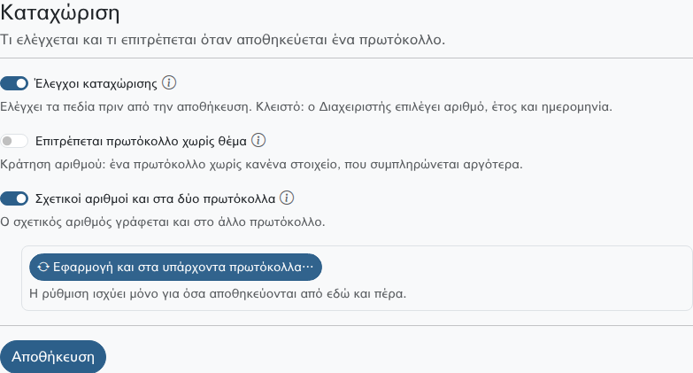
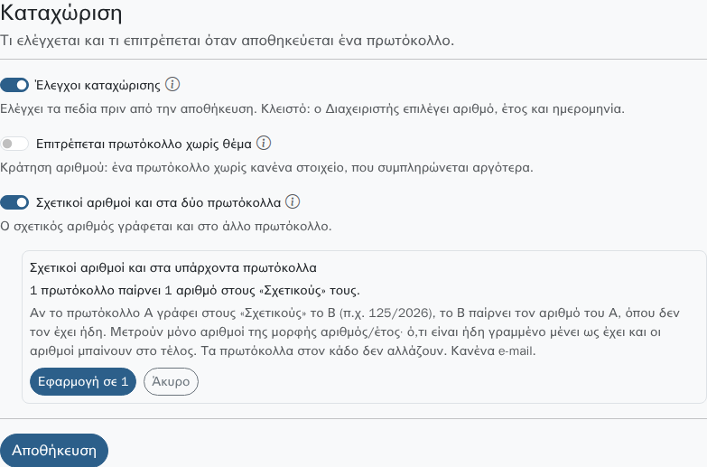

# Σχετικοί αριθμοί in both protocols

Last update: 2026-11-26 09:26 (R6l; the form's display helper named in R1o)

A protocol's **Σχετικοί αριθμοί** (column `protocols.sxetiko`, at most 255 characters) list the other protocols it
relates to, e.g. `125/2026, 40/2025`. The setting **Σχετικοί αριθμοί και στα δύο πρωτόκολλα** (key
`saveCycleSxetiko`, Ρυθμίσεις → Καταχώριση) also writes the reference in the other protocol, so both protocols point to
each other.

- [For administrators](#for-administrators): what the setting does and what *Εφαρμογή και στα υπάρχοντα πρωτόκολλα…*
  changes.
- [For developers and AI assistants](#for-developers-and-ai-assistants): where the code is, the rules it keeps, its
  tests, and what to check before changing it.

## For administrators

### When the setting is on

It works **when a protocol is saved**: a new protocol, or an existing one edited and saved.

Example: you save protocol **130/2026** with *Σχετικοί* `125/2026, 98/2026`. Then:

| Protocol | Its Σχετικοί before | After the save |
|---|---|---|
| 125/2026 | *(empty)* | `98/2026, 130/2026` |
| 98/2026 | `Φ.3` | `Φ.3, 125/2026, 130/2026` |

Each related protocol gets the number being saved **and** the other numbers written with it. This is the old
application's rule, kept as it was.

- Only numbers written as **number/year** (`125/2026`) are followed. The form turns a bare `125` into `125/<year>`
  when you type it.
- A number with no protocol (for example one that was never created, or one in the trash) is skipped.
- Nothing is removed from the other protocol. If its field would go over 255 characters, that protocol is left
  unchanged.
- **The setting does not change protocols saved before it was turned on.** For those, see below.

### Applying it to existing protocols

While the setting is saved **on**, a box under it shows **Εφαρμογή και στα υπάρχοντα πρωτόκολλα…**:

1. Press it. Nothing changes yet: it counts how many protocols would get how many numbers, and how many would not
   have room for all of them.
2. **Εφαρμογή σε N** applies it; **Άκυρο** closes the box.

What it does: **if protocol A names protocol B in its Σχετικοί, B gets A's number** (when B does not already have it).

- It only adds the protocol that names B (A's number). Unlike a save, it does not also copy A's other related
  numbers to B. That keeps it predictable, and running it a second time changes nothing.
- Only *number/year* numbers count, written with any separator (`,` `;` or a space); a leading zero is ignored
  (`0125/2026` is `125/2026`).
- The text already in B stays exactly as it is. The numbers are added at its end, separated by `, `.
- If B has no room for all of them (255 characters), as many as fit are added and the rest left out. The question
  and the result message say in how many protocols this happened.
- Only the *Σχετικοί* field changes. The protocol's *last change* date stays as it was (this is a data fix, not an
  edit). No e-mail is sent.
- Protocols in the trash are not touched.
- Only administrators can see and use it, as with all of *Ρυθμίσεις*.
- There is no undo. A backup first (Διαχείριση → Backup, page `/backups`) is the way back.

## For developers and AI assistants

### Where the code is

| What | Where |
|---|---|
| Both rules (on save; existing protocols) | [`app/Services/Protocols/RelatedNumbers.php`](../app/Services/Protocols/RelatedNumbers.php) |
| Called after every save | `ProtocolWriter::afterSave()` in [`ProtocolWriter.php`](../app/Services/Protocols/ProtocolWriter.php) (`saveCycleSxetiko` on) |
| The setting's label and explanation | `saveCycleSxetiko` in [`SettingsCatalog.php`](../app/Support/SettingsCatalog.php) (section `registration`) |
| The button, the question, the apply | `openRelated()` / `closeRelated()` / `applyRelated()` in [`SettingsPage.php`](../app/Livewire/SettingsPage.php); the view [`related-existing.blade.php`](../resources/views/livewire/partials/related-existing.blade.php), included from `settings-page.blade.php` under that setting |
| How the form tokenizes what is typed | `TagList::related()` in [`app/Support/TagList.php`](../app/Support/TagList.php) |
| The form's green / orange pills and links (display only, a bare number = the protocol's own year) | `App\Support\RelatedNumbers::resolve()` in [`app/Support/RelatedNumbers.php`](../app/Support/RelatedNumbers.php): not the service above, despite the name |
| Tests | [`tests/Feature/RelatedNumbersTest.php`](../tests/Feature/RelatedNumbersTest.php); browser: `R6l` in [`e2e/tests/settings.spec.js`](../e2e/tests/settings.spec.js) |
| History | [`docs/reports/R6l.md`](reports/R6l.md) |

### The rules the code keeps (tests check them)

`RelatedNumbers::linkOnSave(Protocol $p)` (on save, the old application's rule):

- Splits `$p->sxetiko` on commas. For each `N/YYYY` that is an existing protocol other than `$p`, it writes into
  that protocol's field its old values plus the other values of `$p`'s list plus `$p`'s own number, without
  duplicates, joined with `, `.
- It writes only if the result is ≤ 255 characters and differs from what is stored. It uses `save()`, so
  `updated_at` changes.

`RelatedNumbers::plan()` / `applyToExisting()` (R6l, existing protocols):

- `numbers(string)` is the one parser. It splits on `[\s,;]+`, keeps `^\d{1,9}/\d{4}$`, normalizes to
  `(int)N/YYYY` and drops duplicates.
- It collects, in protocol id order, every `(named protocol ← naming protocol)` pair, ignoring self-references. The
  named protocols are looked up by `(protocolnum, etos)`, the table's unique key.
- Per named protocol, it appends the missing numbers to the existing text as it is (never re-joined or reordered),
  each only if the text stays ≤ 255 characters (`MAX`).
- **Idempotent:** a second run adds nothing. It only adds back-links, never siblings, so it does not spread through
  chains of references. `plan()` returns the counts `applyToExisting()` would return.
- Each protocol is changed in its own transaction with `lockForUpdate()` and is read again inside it. A save made
  meanwhile is kept, not overwritten.
- `timestamps = false`: `updated_at` is not touched. No e-mail, no other column, no assignment.
- `SettingsPage::applyRelated()` refuses to run unless the user is an administrator and the setting is **stored**
  as `1`. The box is drawn only then too.

### Before changing it

- Keep the save rule and the R6l rule documented here and in `SettingsCatalog` (the ⓘ text that administrators
  read). Update this file and its `Last update:` line in the same PR.
- If the save rule is changed to copy only numbers (not words such as `Φ.3`) or to use `numbers()`, say so in the
  setting's ⓘ text. Adjust `test_on_save_the_other_protocol_gets_this_one_and_the_others`, which records today's
  behaviour.
- Making R6l also copy siblings would make it non-idempotent: every run could add more numbers through chains. If
  that is ever wanted, compute the closure once and test that a second run changes nothing.
- Large databases: `plan()` reads `id, protocolnum, etos, sxetiko` of every protocol with a non-empty field, in
  chunks of 1000, then one query per 1000 numbers per year. It is meant for a click by an administrator, not for
  every page load.
- Real data never goes into tests or fixtures (see `CLAUDE.md`). Use invented protocols as `RelatedNumbersTest`
  does.
