# Development progress (PERT / CPM)

> Generated by `python3 docs/plan/tools/pert.py` from [`tasks.toml`](tasks.toml) — do not edit by hand.
> Task descriptions: [BACKLOG.md](BACKLOG.md) · Hand-off notes: [HANDOFF.md](HANDOFF.md).

## Summary

| | |
|---|---|
| Tasks done | **99 / 110** `███████████████████████████░░░` 90% |
| Effort done (PERT) | **44.2 / 49.3 h** `███████████████████████████░░░` 90% |
| Remaining effort, one agent in sequence | **5.1 h ± 0.3** of agent working time (calendar time depends on plan usage limits and your reviews) |
| Remaining critical path (if work could run in parallel) | 1.4 h ± 0.2 |
| In progress | — |
| Next task | **R6e** — Log viewer for administrators (Console-like: levels, search, pages by day) |
| On hold | B03d (Date reset on save (pinned, awaiting steps)) |

**Critical path (remaining):** Z01 → Z02 → Z03

## Batches

| Batch | Tasks | Done | Progress |
|---|---|---|---|
| 1 | ✅F01 ✅F03 ✅F02 ✅S00 ✅B03 ✅B08 ✅S02 ✅A02 | 8/8 | `██████████` |
| 2 | ✅B09 ✅F04 ✅L01 ✅L02 ✅F05 ✅F06 ✅F07 ✅S04 ✅B04 ✅B07 | 10/10 | `██████████` |
| 3 | ✅B10 ✅N01 ✅N02 ✅N03 ✅N04 | 5/5 | `██████████` |
| 4 | ✅D05 ✅D01 ✅R5a ✅F08 | 4/4 | `██████████` |
| 5 | ✅D02 ✅D03 ✅D04 | 3/3 | `██████████` |
| 6 | ✅R1a ✅R1b ✅R1c ✅R2 ✅R4a ✅R4b | 6/6 | `██████████` |
| 6.5 | ✅R1e ✅R2b ✅R2c | 3/3 | `██████████` |
| 6.6 | ✅D06 ✅R1f ✅R1g ✅R2d | 4/4 | `██████████` |
| 7 | ✅R3a ✅R3b ✅R3c | 3/3 | `██████████` |
| 7.5 | ✅R1h ✅R3d ✅R1i | 3/3 | `██████████` |
| 8 | ✅R5c ✅R5d ✅R5b | 3/3 | `██████████` |
| 9 | ✅R6a ✅R6b ✅R1d ✅R6c ✅R7 | 5/5 | `██████████` |
| 9.5 | ✅F09 ✅R2e ✅R6d ✅R2f ✅R2g ✅R2h ✅R5e ✅D07 ✅D08 ✅R1j ✅R3e ✅R2i ✅R3f ✅R1k ✅R2j ✅R5f ✅R5g ✅R3g ✅R2k ✅R5h ✅R5i ✅R5j ✅R5k ✅L03 ✅R5m ✅R5n ✅R5o ✅R2l ✅D09 ✅D10 ✅D11 ✅R5l | 32/32 | `██████████` |
| 9.6 | ✅R3h ✅R3i ✅R4d ✅R4c ✅R4e ✅R4f ✅R4g ✅R4h ✅R5p ✅N05 ⬜R6e | 10/11 | `█████████░` |
| 10 | ⬜A01 ⬜A03 ⬜A04 ⬜A05 ⬜A06 ⬜X01 ⬜X02 ⬜Z01 ⬜Z02 ⬜Z03 | 0/10 | `░░░░░░░░░░` |

## Dependency network

Green = done · blue = in progress · white = to do · grey = on hold · **red border = remaining critical path**.

```mermaid
flowchart LR
  subgraph F["0 Foundation"]
    F01["F01<br/>CI on GitHub Actions"]
    F03["F03<br/>Docker dev stack + mock mail"]
    F02["F02<br/>Test foundation, characterization tests"]
    F04["F04<br/>Real-data loader (owner runs it)"]
    L01["L01<br/>Owner's VS Code + local stack with real data"]
    L02["L02<br/>Two computers: macOS guide, RPM VS Code, switching"]
    F05["F05<br/>Playwright evidence tooling"]
    F06["F06<br/>nginx finds a recreated app container (no 502)"]
    F07["F07<br/>real load: adopt a backup without migrations table"]
    F08["F08<br/>Attachment names fit 255 bytes (Linux/Docker)"]
    F09["F09<br/>Docker build: apt retries + 30 s time-outs; CI jobs with time limits"]
    L03["L03<br/>Real copy: optional test mailbox (local-data/test-mailbox.env → «Δοκιμαστικός λογαριασμός» in Ρυθμίσεις; optional SMTP, mail only to TEST_MAIL_ONLY_TO)"]
  end
  subgraph U["1 Urgent patches"]
    S00["S00<br/>Close open admin registration"]
    B03["B03<br/>Keep manually typed number"]
    B08["B08<br/>Atomic numbering (concurrency)"]
    S02["S02<br/>Central access-control policy"]
    A02["A02<br/>Missing-number reminder"]
    B03d["B03d<br/>Date reset on save (pinned, awaiting steps)"]
    B09["B09<br/>Fix all outgoing email (500s)"]
    S04["S04<br/>Remove committed .env / APP_KEY"]
    B04["B04<br/>Descriptive error pages"]
    B07["B07<br/>Diagnose timeouts / 500s"]
    B10["B10<br/>Backup creates complete dumps (mysqldump errors shown)"]
  end
  subgraph N["2 Platform"]
    N01["N01<br/>PHP + Composer upgrade, drop ext-imap"]
    N02["N02<br/>Laravel structure modernization"]
    N03["N03<br/>Vite + Bootstrap 5 + Livewire, top nav layout"]
    N04["N04<br/>Shared UI components (pills, date input…)"]
    N05["N05<br/>Notepad per user on every page: sections, to-dos, markdown, autosave"]
  end
  subgraph D["3 Data model"]
    D05["D05<br/>Tables → utf8mb4"]
    D01["D01<br/>Subject/summary → TEXT"]
    D02["D02<br/>Assignments table (replace d14,e10 text)"]
    D03["D03<br/>Attachment size/hash/deleted_by"]
    D04["D04<br/>Integer dates → DATE columns"]
    D06["D06<br/>Folder description → TEXT"]
    D07["D07<br/>Folder glossary: the owner's list (full descriptions) applied by command; merge Φ.43 → Φ.46 (protocols, files, rules)"]
    D08["D08<br/>Folder codes without the dot (Φ12 = Φ.12): search and merge find every spelling the protocols use"]
    D09["D09<br/>Folder glossary: aliases — the same folder under another code on the copy is updated and keeps its code (Φ32.β, Φ29Α, Φ33.β)"]
    D10["D10<br/>Real data: load copies the server's files by the database (local-data/server-files → storage/app, attachments:import) and applies the folder glossary"]
    D11["D11<br/>attachments:import: server files that are not attachments counted apart; --list says why each other file has no row"]
  end
  subgraph R["4 Module rebuilds"]
    R5a["R5a<br/>Email service, EML cache, charsets"]
    R1a["R1a<br/>Protocol service (sanitation, copy date…)"]
    R1b["R1b<br/>Protocol form screen"]
    R1c["R1c<br/>Attachments panel, drag & drop"]
    R2["R2<br/>Protocol list rebuild"]
    R4a["R4a<br/>Secure file handling"]
    R4b["R4b<br/>Attachment trash with retention"]
    R1e["R1e<br/>Form feedback: drop (Firefox), related tags, notices"]
    R2b["R2b<br/>List feedback: user filter, detailed view, file names"]
    R2c["R2c<br/>Missing numbers as rows in the list"]
    R1f["R1f<br/>Form: checked tags (related, keywords), folder filter"]
    R1g["R1g<br/>Form layout: number in the centre, rarely used sections lower"]
    R2d["R2d<br/>Missing-number rows: new look"]
    R3a["R3a<br/>Advanced search screen"]
    R3b["R3b<br/>Gmail-style query parser"]
    R3c["R3c<br/>Global search box + results page"]
    R1h["R1h<br/>Folder codes: φ11 = Φ.11 only, 12 → Φ12 first, list scrolled to the match"]
    R3d["R3d<br/>Top bar: fewer items (Εκτύπωση, Διατήρηση under Διαχείριση), search in the box, icons, institution under the name; page width per user"]
    R1i["R1i<br/>Protocol page sections: collapsible, movable, one/two columns, saved per user"]
    R5c["R5c<br/>Inbox screen (sidebar, collapsible)"]
    R5d["R5d<br/>Register-from-email flow, keywords"]
    R5b["R5b<br/>winmail.dat (TNEF)"]
    R6a["R6a<br/>Users & roles screens"]
    R6b["R6b<br/>Folders + auto-assignment rules"]
    R1d["R1d<br/>Apply auto-assignment on save"]
    R6c["R6c<br/>Settings, backups, archive screens"]
    R7["R7<br/>Printing & exports"]
    R2e["R2e<br/>List pager above the list too; previous / next; any page from a list"]
    R6d["R6d<br/>Settings: every setting explained (ⓘ), numbering settings framed together, settings without effect hidden; retention per setting in the form too; number always given on save"]
    R2f["R2f<br/>Dates out of order with the numbers, or in the future: flagged in the list (⚠ + explanation) and warned in the form"]
    R2g["R2g<br/>List pager on every paged screen (search, trash, users, clean-up); past the last page → the last page"]
    R2h["R2h<br/>List: the row actions (copy, receipt) under a ⋮ menu"]
    R5e["R5e<br/>Inbox: the app's date field for the incoming date; keyword suggestions from the file names too, accents from earlier subjects"]
    R1j["R1j<br/>Protocol form: one Αποθήκευση floating at the bottom right; no Νέο / Λίστα in the form; copy and receipt at the far right with icons; Λίστα in the top bar is a link"]
    R3e["R3e<br/>Each user chooses their home page (all / προς Διεκπεραίωση / προς Ενημέρωση); the top bar's menu stays open from 768px"]
    R2i["R2i<br/>List: rows in alternating colours, fixed column widths, each row short (two lines, two files) with ▾ to show all"]
    R3f["R3f<br/>Search: whole words or numbers («=» before a value, εισ:=120, «Ολόκληρες λέξεις» switch), in the help too"]
    R1k["R1k<br/>Protocol page: a red dot on Αποθήκευση while changes are unsaved; leaving asks to save, listing what changed"]
    R2j["R2j<br/>List: assignments as pills, ✎ Διεκπεραίωση / 👁 Ενημέρωση (also the Λίστα menu and the search results)"]
    R5f["R5f<br/>Top bar: a red badge next to Εισερχόμενα with the number of e-mails waiting; one count for all users, checked every minute"]
    R5g["R5g<br/>Inbox: the list pager above and below the e-mails, and the page in the list on the left"]
    R3g["R3g<br/>Top bar: Διαχείριση moved into the user menu, grouped (Εκτύπωση, Φάκελοι, Διαχειριστής | Προτιμήσεις)"]
    R2k["R2k<br/>List: every row two lines (sender only, number and dates in a tooltip; one pill and one file with +N)"]
    R5h["R5h<br/>Inbox: going to an e-mail from the list stays on it (folder list scrolled the page; late HTML frames moved it)"]
    R5i["R5i<br/>Inbox: a long Προς / Κοιν. list folded (three + «και άλλοι N»); browser tests load only invented / approved e-mails"]
    R5j["R5j<br/>Inbox: files above the buttons; the e-mail (Από, Προς, Θέμα, text, HTML) tinted apart"]
    R5k["R5k<br/>Inbox: registering says so until done (notice, spinners, the yellow button too); one registration at a time"]
    R5m["R5m<br/>Inbox: page at once + «Σύνδεση με τον διακομιστή…» with seconds; failure says slow / login / other + retry; one registration per e-mail across users"]
    R5n["R5n<br/>Inbox: while the mail server is slow, show the e-mails of the last check from the cache (registering still needs the server)"]
    R5o["R5o<br/>Inbox: no jump when Κείμενο / HTML opens; Εξερχόμενο fields (collapsed); section colours as in the protocol form; HTML tab icon; list positions + ✓ number; lavender headers"]
    R2l["R2l<br/>List: remove the «Αναζήτηση» button (the search field has its own)"]
    R5l["R5l<br/>Inbox: a registered / read e-mail folds; «Εμφάνιση email» opens it, «Επόμενο email» goes on"]
    R3h["R3h<br/>Direct links /protocol/N and /protocol/N/YYYY; one «Δεν υπάρχει» page; «Σύνδεσμος» pill"]
    R3i["R3i<br/>Search: πότε: σήμερα / χθες / εβδομάδα / N μέρες / μήνας; χρήστης: (who registered); quick buttons"]
    R4d["R4d<br/>Rename an attachment (shown name only; extension fixed)"]
    R4c["R4c<br/>Preview in the app: PDF, images, text; docx / xlsx converted in the browser"]
    R4e["R4e<br/>Stamp designer: editable template (emblem, lines, fields), live preview; owner's official stamp loaded locally"]
    R4f["R4f<br/>Stamp when viewing / printing (originals kept); «Με σφραγίδα» toggle; old stamped files never stamped twice"]
    R4g["R4g<br/>Old stamped PDFs: can the stamp be removed? (investigation, owner-run command only if safe)"]
    R4h["R4h<br/>Deleted protocols to the trash; restore with the original number if free, else a new one (original number in the notes); admins restore all, writers their own"]
    R5p["R5p<br/>Inbox: each e-mail in an envelope (2–3 versions, owner chooses)"]
    R6e["R6e<br/>Log viewer for administrators (Console-like: levels, search, pages by day)"]
  end
  subgraph Z["5 Finish"]
    A01["A01<br/>Integrity-check engine + page"]
    A03["A03<br/>Rule: dates going backwards"]
    A04["A04<br/>Rule: εκκρεμότητα"]
    A05["A05<br/>Rule: (partial) duplicates"]
    A06["A06<br/>Rule: missing attachment"]
    X01["X01<br/>Audit log — recording"]
    X02["X02<br/>Audit log — viewing"]
    Z01["Z01<br/>Remove legacy code"]
    Z02["Z02<br/>Auth hardening, security headers"]
    Z03["Z03<br/>Final security review"]
  end
  F01 --> F02
  F02 --> S00
  F02 --> B03
  F02 --> B08
  F02 --> S02
  B08 --> A02
  F02 --> B09
  F03 --> F04
  F04 --> L01
  L01 --> L02
  F02 --> F05
  F03 --> F05
  F03 --> F06
  L01 --> F07
  F03 --> B07
  B04 --> B07
  F01 --> N01
  F02 --> N01
  F03 --> N01
  N01 --> N02
  N02 --> N03
  F05 --> N03
  N03 --> N04
  F04 --> D05
  F02 --> D01
  N01 --> R5a
  F04 --> F08
  F03 --> F09
  F04 --> D02
  F04 --> D03
  F04 --> D04
  D01 --> R1a
  D02 --> R1a
  R1a --> R1b
  N04 --> R1b
  R1b --> R1c
  D03 --> R1c
  N04 --> R2
  D02 --> R2
  S02 --> R4a
  R4a --> R4b
  D03 --> R4b
  R1c --> R1e
  R4b --> R1e
  R2 --> R2b
  R2b --> R2c
  A02 --> R2c
  D05 --> D06
  R1e --> R1f
  D06 --> R1f
  R1f --> R1g
  R2c --> R2d
  N04 --> R3a
  D02 --> R3a
  R3a --> R3b
  R3b --> R3c
  R3c --> R1h
  R3c --> R3d
  R1g --> R1i
  R3d --> R1i
  R5a --> R5c
  N04 --> R5c
  R5c --> R5d
  R1a --> R5d
  R5a --> R5b
  N04 --> R6a
  N04 --> R6b
  D02 --> R6b
  R1a --> R1d
  R6b --> R1d
  N04 --> R6c
  R4b --> R6c
  R2 --> R7
  R2 --> R2e
  R6c --> R6d
  R2e --> R2f
  R1b --> R2f
  R2e --> R2g
  R2 --> R2h
  R5d --> R5e
  N04 --> R5e
  R6b --> D07
  D06 --> D07
  D07 --> D08
  R3c --> D08
  R1b --> R1j
  R3d --> R1j
  R1j --> R3e
  R3d --> R3e
  R2h --> R2i
  R3e --> R2i
  R3a --> R3f
  R3b --> R3f
  R1j --> R1k
  R2i --> R2j
  R5c --> R5f
  R3e --> R5f
  R5f --> R5g
  R2g --> R5g
  R3e --> R3g
  R2i --> R2k
  R2j --> R2k
  R5g --> R5h
  R5h --> R5i
  R5i --> R5j
  R5j --> R5k
  L01 --> L03
  R5l --> R5m
  R5m --> R5n
  R5n --> R5o
  R2k --> R2l
  D07 --> D09
  D08 --> D09
  D09 --> D10
  L01 --> D10
  D03 --> D10
  D10 --> D11
  R5k --> R5l
  R1b --> R3h
  R3f --> R3i
  R1c --> R4d
  R4a --> R4c
  R6c --> R4e
  R4c --> R4f
  R4e --> R4f
  R4f --> R4g
  R4b --> R4h
  R5o --> R5p
  N04 --> N05
  R6c --> R6e
  R2 --> A01
  A01 --> A03
  A01 --> A04
  A01 --> A05
  D03 --> A05
  A01 --> A06
  N02 --> X01
  X01 --> X02
  R1c --> Z01
  R1d --> Z01
  R2 --> Z01
  R3c --> Z01
  R4b --> Z01
  R5b --> Z01
  R5d --> Z01
  R6a --> Z01
  R6c --> Z01
  R7 --> Z01
  Z01 --> Z02
  Z02 --> Z03
  classDef done fill:#d4edda,stroke:#28a745,color:#155724
  classDef inprogress fill:#cce5ff,stroke:#004085,color:#004085
  classDef todo fill:#ffffff,stroke:#6c757d,color:#212529
  classDef onhold fill:#e2e3e5,stroke:#6c757d,color:#6c757d,stroke-dasharray: 4 3
  classDef critical stroke:#dc3545,stroke-width:3px
  class F01,F03,F02,S00,B03,B08,S02,A02,B09,F04,L01,L02,F05,F06,F07,S04,B04,B07,B10,N01,N02,N03,N04,D05,D01,R5a,F08,F09,D02,D03,D04,R1a,R1b,R1c,R2,R4a,R4b,R1e,R2b,R2c,D06,R1f,R1g,R2d,R3a,R3b,R3c,R1h,R3d,R1i,R5c,R5d,R5b,R6a,R6b,R1d,R6c,R7,R2e,R6d,R2f,R2g,R2h,R5e,D07,D08,R1j,R3e,R2i,R3f,R1k,R2j,R5f,R5g,R3g,R2k,R5h,R5i,R5j,R5k,L03,R5m,R5n,R5o,R2l,D09,D10,D11,R5l,R3h,R3i,R4d,R4c,R4e,R4f,R4g,R4h,R5p,N05 done
  class R6e,A01,A03,A04,A05,A06,X01,X02,Z01,Z02,Z03 todo
  class B03d onhold
  class Z01,Z02,Z03 critical
```

## Timeline (one agent, execution order)

Bars are PERT expected **agent working hours** laid end to end in batch order — not calendar dates.

```mermaid
gantt
  dateFormat YYYY-MM-DD HH:mm
  axisFormat %d/%m %H:%M
  todayMarker off
  section Batch 1
  F01 CI on GitHub Actions :done, f01, 2026-11-12 09:00, 19m
  F03 Docker dev stack + mock mail :done, f03, 2026-11-12 09:19, 33m
  F02 Test foundation, characterization tests :done, f02, 2026-11-12 09:52, 66m
  S00 Close open admin registration :done, s00, 2026-11-12 10:58, 19m
  B03 Keep manually typed number :done, b03, 2026-11-12 11:17, 33m
  B08 Atomic numbering (concurrency) :done, b08, 2026-11-12 11:50, 33m
  S02 Central access-control policy :done, s02, 2026-11-12 12:23, 33m
  A02 Missing-number reminder :done, a02, 2026-11-12 12:56, 33m
  section Batch 2
  B09 Fix all outgoing email (500s) :done, b09, 2026-11-12 13:29, 19m
  F04 Real-data loader (owner runs it) :done, f04, 2026-11-12 13:48, 19m
  L01 Owner's VS Code + local stack with real data :done, l01, 2026-11-12 14:07, 19m
  L02 Two computers  macOS guide, RPM VS Code, switching :done, l02, 2026-11-12 14:26, 19m
  F05 Playwright evidence tooling :done, f05, 2026-11-12 14:45, 33m
  F06 nginx finds a recreated app container (no 502) :done, f06, 2026-11-12 15:18, 19m
  F07 real load  adopt a backup without migrations table :done, f07, 2026-11-12 15:37, 19m
  S04 Remove committed .env / APP_KEY :done, s04, 2026-11-12 15:56, 19m
  B04 Descriptive error pages :done, b04, 2026-11-12 16:15, 19m
  B07 Diagnose timeouts / 500s :done, b07, 2026-11-12 16:34, 33m
  section Batch 3
  B10 Backup creates complete dumps (mysqldump errors shown) :done, b10, 2026-11-12 17:07, 19m
  N01 PHP + Composer upgrade, drop ext-imap :done, n01, 2026-11-12 17:26, 33m
  N02 Laravel structure modernization :done, n02, 2026-11-12 17:59, 33m
  N03 Vite + Bootstrap 5 + Livewire, top nav layout :done, n03, 2026-11-12 18:32, 33m
  N04 Shared UI components (pills, date input…) :done, n04, 2026-11-12 19:05, 33m
  section Batch 4
  D05 Tables → utf8mb4 :done, d05, 2026-11-12 19:38, 19m
  D01 Subject/summary → TEXT :done, d01, 2026-11-12 19:57, 19m
  R5a Email service, EML cache, charsets :done, r5a, 2026-11-12 20:16, 66m
  F08 Attachment names fit 255 bytes (Linux/Docker) :done, f08, 2026-11-12 21:22, 19m
  section Batch 5
  D02 Assignments table (replace d14,e10 text) :done, d02, 2026-11-12 21:41, 33m
  D03 Attachment size/hash/deleted_by :done, d03, 2026-11-12 22:14, 19m
  D04 Integer dates → DATE columns :done, d04, 2026-11-12 22:33, 33m
  section Batch 6
  R1a Protocol service (sanitation, copy date…) :done, r1a, 2026-11-12 23:06, 33m
  R1b Protocol form screen :done, r1b, 2026-11-12 23:39, 33m
  R1c Attachments panel, drag & drop :done, r1c, 2026-11-13 00:12, 33m
  R2 Protocol list rebuild :done, r2, 2026-11-13 00:45, 33m
  R4a Secure file handling :done, r4a, 2026-11-13 01:18, 19m
  R4b Attachment trash with retention :done, r4b, 2026-11-13 01:37, 33m
  section Batch 6.5
  R1e Form feedback  drop (Firefox), related tags, notices :done, r1e, 2026-11-13 02:10, 19m
  R2b List feedback  user filter, detailed view, file names :done, r2b, 2026-11-13 02:29, 33m
  R2c Missing numbers as rows in the list :done, r2c, 2026-11-13 03:02, 33m
  section Batch 6.6
  D06 Folder description → TEXT :done, d06, 2026-11-13 03:35, 19m
  R1f Form  checked tags (related, keywords), folder filter :done, r1f, 2026-11-13 03:54, 33m
  R1g Form layout  number in the centre, rarely used sections lower :done, r1g, 2026-11-13 04:27, 19m
  R2d Missing-number rows  new look :done, r2d, 2026-11-13 04:46, 19m
  section Batch 7
  R3a Advanced search screen :done, r3a, 2026-11-13 05:05, 33m
  R3b Gmail-style query parser :done, r3b, 2026-11-13 05:38, 33m
  R3c Global search box + results page :done, r3c, 2026-11-13 06:11, 33m
  section Batch 7.5
  R1h Folder codes  φ11 = Φ.11 only, 12 → Φ12 first, list scrolled to the match :done, r1h, 2026-11-13 06:44, 19m
  R3d Top bar  fewer items (Εκτύπωση, Διατήρηση under Διαχείριση), search in the box, icons, institution under the name; page width per user :done, r3d, 2026-11-13 07:03, 19m
  R1i Protocol page sections  collapsible, movable, one/two columns, saved per user :done, r1i, 2026-11-13 07:22, 33m
  section Batch 8
  R5c Inbox screen (sidebar, collapsible) :done, r5c, 2026-11-13 07:55, 33m
  R5d Register-from-email flow, keywords :done, r5d, 2026-11-13 08:28, 33m
  R5b winmail.dat (TNEF) :done, r5b, 2026-11-13 09:01, 66m
  section Batch 9
  R6a Users & roles screens :done, r6a, 2026-11-13 10:07, 33m
  R6b Folders + auto-assignment rules :done, r6b, 2026-11-13 10:40, 33m
  R1d Apply auto-assignment on save :done, r1d, 2026-11-13 11:13, 19m
  R6c Settings, backups, archive screens :done, r6c, 2026-11-13 11:32, 33m
  R7 Printing & exports :done, r7, 2026-11-13 12:05, 33m
  section Batch 9.5
  F09 Docker build  apt retries + 30 s time-outs; CI jobs with time limits :done, f09, 2026-11-13 12:38, 19m
  R2e List pager above the list too; previous / next; any page from a list :done, r2e, 2026-11-13 12:57, 19m
  R6d Settings  every setting explained (ⓘ), numbering settings framed together, settings without effect hidden; retention per setting in the form too; number always given on save :done, r6d, 2026-11-13 13:16, 33m
  R2f Dates out of order with the numbers, or in the future  flagged in the list (⚠ + explanation) and warned in the form :done, r2f, 2026-11-13 13:49, 33m
  R2g List pager on every paged screen (search, trash, users, clean-up); past the last page → the last page :done, r2g, 2026-11-13 14:22, 19m
  R2h List  the row actions (copy, receipt) under a ⋮ menu :done, r2h, 2026-11-13 14:41, 19m
  R5e Inbox  the app's date field for the incoming date; keyword suggestions from the file names too, accents from earlier subjects :done, r5e, 2026-11-13 15:00, 19m
  D07 Folder glossary  the owner's list (full descriptions) applied by command; merge Φ.43 → Φ.46 (protocols, files, rules) :done, d07, 2026-11-13 15:19, 19m
  D08 Folder codes without the dot (Φ12 = Φ.12)  search and merge find every spelling the protocols use :done, d08, 2026-11-13 15:38, 19m
  R1j Protocol form  one Αποθήκευση floating at the bottom right; no Νέο / Λίστα in the form; copy and receipt at the far right with icons; Λίστα in the top bar is a link :done, r1j, 2026-11-13 15:57, 19m
  R3e Each user chooses their home page (all / προς Διεκπεραίωση / προς Ενημέρωση); the top bar's menu stays open from 768px :done, r3e, 2026-11-13 16:16, 19m
  R2i List  rows in alternating colours, fixed column widths, each row short (two lines, two files) with ▾ to show all :done, r2i, 2026-11-13 16:35, 19m
  R3f Search  whole words or numbers («=» before a value, εισ =120, «Ολόκληρες λέξεις» switch), in the help too :done, r3f, 2026-11-13 16:54, 19m
  R1k Protocol page  a red dot on Αποθήκευση while changes are unsaved; leaving asks to save, listing what changed :done, r1k, 2026-11-13 17:13, 19m
  R2j List  assignments as pills, ✎ Διεκπεραίωση / 👁 Ενημέρωση (also the Λίστα menu and the search results) :done, r2j, 2026-11-13 17:32, 19m
  R5f Top bar  a red badge next to Εισερχόμενα with the number of e-mails waiting; one count for all users, checked every minute :done, r5f, 2026-11-13 17:51, 19m
  R5g Inbox  the list pager above and below the e-mails, and the page in the list on the left :done, r5g, 2026-11-13 18:10, 19m
  R3g Top bar  Διαχείριση moved into the user menu, grouped (Εκτύπωση, Φάκελοι, Διαχειριστής | Προτιμήσεις) :done, r3g, 2026-11-13 18:29, 19m
  R2k List  every row two lines (sender only, number and dates in a tooltip; one pill and one file with +N) :done, r2k, 2026-11-13 18:48, 19m
  R5h Inbox  going to an e-mail from the list stays on it (folder list scrolled the page; late HTML frames moved it) :done, r5h, 2026-11-13 19:07, 19m
  R5i Inbox  a long Προς / Κοιν. list folded (three + «και άλλοι N»); browser tests load only invented / approved e-mails :done, r5i, 2026-11-13 19:26, 19m
  R5j Inbox  files above the buttons; the e-mail (Από, Προς, Θέμα, text, HTML) tinted apart :done, r5j, 2026-11-13 19:45, 19m
  R5k Inbox  registering says so until done (notice, spinners, the yellow button too); one registration at a time :done, r5k, 2026-11-13 20:04, 19m
  L03 Real copy  optional test mailbox (local-data/test-mailbox.env → «Δοκιμαστικός λογαριασμός» in Ρυθμίσεις; optional SMTP, mail only to TEST_MAIL_ONLY_TO) :done, l03, 2026-11-13 20:23, 19m
  R5m Inbox  page at once + «Σύνδεση με τον διακομιστή…» with seconds; failure says slow / login / other + retry; one registration per e-mail across users :done, r5m, 2026-11-13 20:42, 33m
  R5n Inbox  while the mail server is slow, show the e-mails of the last check from the cache (registering still needs the server) :done, r5n, 2026-11-13 21:15, 33m
  R5o Inbox  no jump when Κείμενο / HTML opens; Εξερχόμενο fields (collapsed); section colours as in the protocol form; HTML tab icon; list positions + ✓ number; lavender headers :done, r5o, 2026-11-13 21:48, 33m
  R2l List  remove the «Αναζήτηση» button (the search field has its own) :done, r2l, 2026-11-13 22:21, 19m
  D09 Folder glossary  aliases — the same folder under another code on the copy is updated and keeps its code (Φ32.β, Φ29Α, Φ33.β) :done, d09, 2026-11-13 22:40, 19m
  D10 Real data  load copies the server's files by the database (local-data/server-files → storage/app, attachments import) and applies the folder glossary :done, d10, 2026-11-13 22:59, 33m
  D11 attachments import  server files that are not attachments counted apart; --list says why each other file has no row :done, d11, 2026-11-13 23:32, 19m
  R5l Inbox  a registered / read e-mail folds; «Εμφάνιση email» opens it, «Επόμενο email» goes on :done, r5l, 2026-11-13 23:51, 19m
  section Batch 9.6
  R3h Direct links /protocol/N and /protocol/N/YYYY; one «Δεν υπάρχει» page; «Σύνδεσμος» pill :done, r3h, 2026-11-14 00:10, 19m
  R3i Search  πότε  σήμερα / χθες / εβδομάδα / N μέρες / μήνας; χρήστης  (who registered); quick buttons :done, r3i, 2026-11-14 00:29, 33m
  R4d Rename an attachment (shown name only; extension fixed) :done, r4d, 2026-11-14 01:02, 19m
  R4c Preview in the app  PDF, images, text; docx / xlsx converted in the browser :done, r4c, 2026-11-14 01:21, 33m
  R4e Stamp designer  editable template (emblem, lines, fields), live preview; owner's official stamp loaded locally :done, r4e, 2026-11-14 01:54, 33m
  R4f Stamp when viewing / printing (originals kept); «Με σφραγίδα» toggle; old stamped files never stamped twice :done, r4f, 2026-11-14 02:27, 33m
  R4g Old stamped PDFs  can the stamp be removed? (investigation, owner-run command only if safe) :done, r4g, 2026-11-14 03:00, 19m
  R4h Deleted protocols to the trash; restore with the original number if free, else a new one (original number in the notes); admins restore all, writers their own :done, r4h, 2026-11-14 03:19, 33m
  R5p Inbox  each e-mail in an envelope (2–3 versions, owner chooses) :done, r5p, 2026-11-14 03:52, 19m
  N05 Notepad per user on every page  sections, to-dos, markdown, autosave :done, n05, 2026-11-14 04:11, 33m
  R6e Log viewer for administrators (Console-like  levels, search, pages by day) :r6e, 2026-11-14 04:44, 33m
  section Batch 10
  A01 Integrity-check engine + page :a01, 2026-11-14 05:17, 33m
  A03 Rule  dates going backwards :a03, 2026-11-14 05:50, 19m
  A04 Rule  εκκρεμότητα :a04, 2026-11-14 06:09, 19m
  A05 Rule  (partial) duplicates :a05, 2026-11-14 06:28, 33m
  A06 Rule  missing attachment :a06, 2026-11-14 07:01, 19m
  X01 Audit log — recording :x01, 2026-11-14 07:20, 33m
  X02 Audit log — viewing :x02, 2026-11-14 07:53, 33m
  Z01 Remove legacy code :crit, z01, 2026-11-14 08:26, 33m
  Z02 Auth hardening, security headers :crit, z02, 2026-11-14 08:59, 19m
  Z03 Final security review :crit, z03, 2026-11-14 09:18, 33m
```

## CPM table (all tasks, unlimited parallelism)

te = expected hours; ES/EF = earliest start/finish; LS/LF = latest start/finish; slack = LS − ES (hours).

| | ID | Task | Deps | te | σ | ES | EF | LS | LF | Slack | PR |
|---|---|---|---|---|---|---|---|---|---|---|---|
| ✅ | **F01** 🔴 | CI on GitHub Actions | — | 0.3 | 0.1 | 0.0 | 0.3 | -0.0 | 0.3 | -0.0 | #3 |
| ✅ | **F03** | Docker dev stack + mock mail | — | 0.5 | 0.1 | 0.0 | 0.5 | 0.9 | 1.4 | 0.9 | #2 |
| ✅ | **F02** 🔴 | Test foundation, characterization tests | F01 | 1.1 | 0.2 | 0.3 | 1.4 | 0.3 | 1.4 | -0.0 | #4 |
| ✅ | **S00** | Close open admin registration | F02 | 0.3 | 0.1 | 1.4 | 1.7 | 10.2 | 10.5 | 8.8 | #5 |
| ✅ | **B03** | Keep manually typed number | F02 | 0.5 | 0.1 | 1.4 | 2.0 | 9.9 | 10.5 | 8.5 | #6 |
| ✅ | **B08** | Atomic numbering (concurrency) | F02 | 0.5 | 0.1 | 1.4 | 2.0 | 8.5 | 9.1 | 7.1 | #7 |
| ✅ | **S02** | Central access-control policy | F02 | 0.5 | 0.1 | 1.4 | 2.0 | 7.1 | 7.6 | 5.7 | #8 |
| ✅ | **A02** | Missing-number reminder | B08 | 0.5 | 0.1 | 2.0 | 2.5 | 9.1 | 9.6 | 7.1 | #9 |
| ✅ | **B09** | Fix all outgoing email (500s) | F02 | 0.3 | 0.1 | 1.4 | 1.7 | 10.2 | 10.5 | 8.8 | #14 |
| ✅ | **F04** | Real-data loader (owner runs it) | F03 | 0.3 | 0.1 | 0.5 | 0.9 | 2.7 | 3.1 | 2.2 | #15 |
| ✅ | **L01** | Owner's VS Code + local stack with real data | F04 | 0.3 | 0.1 | 0.9 | 1.2 | 9.3 | 9.6 | 8.4 | #16 |
| ✅ | **L02** | Two computers: macOS guide, RPM VS Code, switching | L01 | 0.3 | 0.1 | 1.2 | 1.5 | 10.2 | 10.5 | 9.0 | #21 |
| ✅ | **F05** | Playwright evidence tooling | F02, F03 | 0.5 | 0.1 | 1.4 | 2.0 | 2.0 | 2.5 | 0.5 | #17 |
| ✅ | **F06** | nginx finds a recreated app container (no 502) | F03 | 0.3 | 0.1 | 0.5 | 0.9 | 10.2 | 10.5 | 9.6 | #23 |
| ✅ | **F07** | real load: adopt a backup without migrations table | L01 | 0.3 | 0.1 | 1.2 | 1.5 | 10.2 | 10.5 | 9.0 | #24 |
| ✅ | **S04** | Remove committed .env / APP_KEY | — | 0.3 | 0.1 | 0.0 | 0.3 | 10.2 | 10.5 | 10.2 | #18 |
| ✅ | **B04** | Descriptive error pages | — | 0.3 | 0.1 | 0.0 | 0.3 | 9.6 | 9.9 | 9.6 | #19 |
| ✅ | **B07** | Diagnose timeouts / 500s | F03, B04 | 0.5 | 0.1 | 0.5 | 1.1 | 9.9 | 10.5 | 9.4 | #20 |
| ✅ | **B10** | Backup creates complete dumps (mysqldump errors shown) | — | 0.3 | 0.1 | 0.0 | 0.3 | 10.2 | 10.5 | 10.2 | #25 |
| ✅ | **N01** 🔴 | PHP + Composer upgrade, drop ext-imap | F01, F02, F03 | 0.5 | 0.1 | 1.4 | 2.0 | 1.4 | 2.0 | -0.0 | #27 |
| ✅ | **N02** 🔴 | Laravel structure modernization | N01 | 0.5 | 0.1 | 2.0 | 2.5 | 2.0 | 2.5 | -0.0 | #28 |
| ✅ | **N03** 🔴 | Vite + Bootstrap 5 + Livewire, top nav layout | N02, F05 | 0.5 | 0.1 | 2.5 | 3.1 | 2.5 | 3.1 | -0.0 | #31 |
| ✅ | **N04** 🔴 | Shared UI components (pills, date input…) | N03 | 0.5 | 0.1 | 3.1 | 3.6 | 3.1 | 3.6 | -0.0 | #33 |
| ✅ | **D05** | Tables → utf8mb4 | F04 | 0.3 | 0.1 | 0.9 | 1.2 | 8.0 | 8.3 | 7.1 | #34 |
| ✅ | **D01** | Subject/summary → TEXT | F02 | 0.3 | 0.1 | 1.4 | 1.7 | 4.2 | 4.5 | 2.7 | #35 |
| ✅ | **R5a** | Email service, EML cache, charsets | N01 | 1.1 | 0.2 | 2.0 | 3.1 | 4.6 | 5.7 | 2.6 | #36 |
| ✅ | **F08** | Attachment names fit 255 bytes (Linux/Docker) | F04 | 0.3 | 0.1 | 0.9 | 1.2 | 10.2 | 10.5 | 9.3 | #37 |
| ✅ | **D02** | Assignments table (replace d14,e10 text) | F04 | 0.5 | 0.1 | 0.9 | 1.4 | 3.1 | 3.6 | 2.2 | #38 |
| ✅ | **D03** | Attachment size/hash/deleted_by | F04 | 0.3 | 0.1 | 0.9 | 1.2 | 7.6 | 8.0 | 6.8 | #39 |
| ✅ | **D04** | Integer dates → DATE columns | F04 | 0.5 | 0.1 | 0.9 | 1.4 | 9.9 | 10.5 | 9.1 | #40 |
| ✅ | **R1a** | Protocol service (sanitation, copy date…) | D01, D02 | 0.5 | 0.1 | 1.7 | 2.3 | 4.5 | 5.0 | 2.7 | #42 |
| ✅ | **R1b** | Protocol form screen | R1a, N04 | 0.5 | 0.1 | 3.6 | 4.2 | 5.0 | 5.6 | 1.4 | #43 |
| ✅ | **R1c** | Attachments panel, drag & drop | R1b, D03 | 0.5 | 0.1 | 4.2 | 4.7 | 8.2 | 8.8 | 4.0 | #44 |
| ✅ | **R2** | Protocol list rebuild | N04, D02 | 0.5 | 0.1 | 3.6 | 4.2 | 5.4 | 5.9 | 1.7 | #45 |
| ✅ | **R4a** | Secure file handling | S02 | 0.3 | 0.1 | 2.0 | 2.3 | 7.6 | 8.0 | 5.7 | #46 |
| ✅ | **R4b** | Attachment trash with retention | R4a, D03 | 0.5 | 0.1 | 2.3 | 2.8 | 8.0 | 8.5 | 5.7 | #47 |
| ✅ | **R1e** | Form feedback: drop (Firefox), related tags, notices | R1c, R4b | 0.3 | 0.1 | 4.7 | 5.0 | 8.8 | 9.1 | 4.0 | #48 |
| ✅ | **R2b** | List feedback: user filter, detailed view, file names | R2 | 0.5 | 0.1 | 4.2 | 4.7 | 9.1 | 9.6 | 4.9 | #49 |
| ✅ | **R2c** | Missing numbers as rows in the list | R2b, A02 | 0.5 | 0.1 | 4.7 | 5.3 | 9.6 | 10.2 | 4.9 | #50 |
| ✅ | **D06** | Folder description → TEXT | D05 | 0.3 | 0.1 | 1.2 | 1.5 | 8.3 | 8.7 | 7.1 | #51 |
| ✅ | **R1f** | Form: checked tags (related, keywords), folder filter | R1e, D06 | 0.5 | 0.1 | 5.0 | 5.6 | 9.1 | 9.6 | 4.0 | #53 |
| ✅ | **R1g** | Form layout: number in the centre, rarely used sections lower | R1f | 0.3 | 0.1 | 5.6 | 5.9 | 9.6 | 9.9 | 4.0 | #54 |
| ✅ | **R2d** | Missing-number rows: new look | R2c | 0.3 | 0.1 | 5.3 | 5.6 | 10.2 | 10.5 | 4.9 | #52 |
| ✅ | **R3a** 🔴 | Advanced search screen | N04, D02 | 0.5 | 0.1 | 3.6 | 4.2 | 3.6 | 4.2 | -0.0 | #55 |
| ✅ | **R3b** 🔴 | Gmail-style query parser | R3a | 0.5 | 0.1 | 4.2 | 4.7 | 4.2 | 4.7 | -0.0 | #56 |
| ✅ | **R3c** 🔴 | Global search box + results page | R3b | 0.5 | 0.1 | 4.7 | 5.3 | 4.7 | 5.3 | -0.0 | #57 |
| ✅ | **R1h** | Folder codes: φ11 = Φ.11 only, 12 → Φ12 first, list scrolled to the match | R3c | 0.3 | 0.1 | 5.3 | 5.6 | 10.2 | 10.5 | 4.9 | #59 |
| ✅ | **R3d** 🔴 | Top bar: fewer items (Εκτύπωση, Διατήρηση under Διαχείριση), search in the box, icons, institution under the name; page width per user | R3c | 0.3 | 0.1 | 5.3 | 5.6 | 5.3 | 5.6 | -0.0 | #60 |
| ✅ | **R1i** | Protocol page sections: collapsible, movable, one/two columns, saved per user | R1g, R3d | 0.5 | 0.1 | 5.9 | 6.5 | 9.9 | 10.5 | 4.0 | #61 |
| ✅ | **R5c** | Inbox screen (sidebar, collapsible) | R5a, N04 | 0.5 | 0.1 | 3.6 | 4.2 | 5.7 | 6.2 | 2.1 | #62 |
| ✅ | **R5d** | Register-from-email flow, keywords | R5c, R1a | 0.5 | 0.1 | 4.2 | 4.7 | 8.5 | 9.1 | 4.3 | #63 |
| ✅ | **R5b** | winmail.dat (TNEF) | R5a | 1.1 | 0.2 | 3.1 | 4.2 | 8.0 | 9.1 | 4.9 | #64 |
| ✅ | **R6a** | Users & roles screens | N04 | 0.5 | 0.1 | 3.6 | 4.2 | 8.5 | 9.1 | 4.9 | #65 |
| ✅ | **R6b** | Folders + auto-assignment rules | N04, D02 | 0.5 | 0.1 | 3.6 | 4.2 | 8.1 | 8.7 | 4.5 | #66 |
| ✅ | **R1d** | Apply auto-assignment on save | R1a, R6b | 0.3 | 0.1 | 4.2 | 4.5 | 8.8 | 9.1 | 4.6 | #67 |
| ✅ | **R6c** | Settings, backups, archive screens | N04, R4b | 0.5 | 0.1 | 3.6 | 4.2 | 8.5 | 9.1 | 4.9 | #68 |
| ✅ | **R7** | Printing & exports | R2 | 0.5 | 0.1 | 4.2 | 4.7 | 8.5 | 9.1 | 4.3 | #69 |
| ✅ | **F09** | Docker build: apt retries + 30 s time-outs; CI jobs with time limits | F03 | 0.3 | 0.1 | 0.5 | 0.9 | 10.2 | 10.5 | 9.6 | #99 |
| ✅ | **R2e** | List pager above the list too; previous / next; any page from a list | R2 | 0.3 | 0.1 | 4.2 | 4.5 | 5.9 | 6.2 | 1.7 | #71 |
| ✅ | **R6d** | Settings: every setting explained (ⓘ), numbering settings framed together, settings without effect hidden; retention per setting in the form too; number always given on save | R6c | 0.5 | 0.1 | 4.2 | 4.7 | 9.9 | 10.5 | 5.8 | #72 |
| ✅ | **R2f** | Dates out of order with the numbers, or in the future: flagged in the list (⚠ + explanation) and warned in the form | R2e, R1b | 0.5 | 0.1 | 4.5 | 5.0 | 9.9 | 10.5 | 5.5 | #73 |
| ✅ | **R2g** | List pager on every paged screen (search, trash, users, clean-up); past the last page → the last page | R2e | 0.3 | 0.1 | 4.5 | 4.8 | 6.2 | 6.6 | 1.7 | #74 |
| ✅ | **R2h** | List: the row actions (copy, receipt) under a ⋮ menu | R2 | 0.3 | 0.1 | 4.2 | 4.5 | 8.9 | 9.2 | 4.7 | #75 |
| ✅ | **R5e** | Inbox: the app's date field for the incoming date; keyword suggestions from the file names too, accents from earlier subjects | R5d, N04 | 0.3 | 0.1 | 4.7 | 5.0 | 10.2 | 10.5 | 5.5 | #76 |
| ✅ | **D07** | Folder glossary: the owner's list (full descriptions) applied by command; merge Φ.43 → Φ.46 (protocols, files, rules) | R6b, D06 | 0.3 | 0.1 | 4.2 | 4.5 | 8.7 | 9.0 | 4.5 | #77 |
| ✅ | **D08** | Folder codes without the dot (Φ12 = Φ.12): search and merge find every spelling the protocols use | D07, R3c | 0.3 | 0.1 | 5.3 | 5.6 | 9.0 | 9.3 | 3.7 | #87 |
| ✅ | **R1j** 🔴 | Protocol form: one Αποθήκευση floating at the bottom right; no Νέο / Λίστα in the form; copy and receipt at the far right with icons; Λίστα in the top bar is a link | R1b, R3d | 0.3 | 0.1 | 5.6 | 5.9 | 5.6 | 5.9 | -0.0 | #78 |
| ✅ | **R3e** 🔴 | Each user chooses their home page (all / προς Διεκπεραίωση / προς Ενημέρωση); the top bar's menu stays open from 768px | R1j, R3d | 0.3 | 0.1 | 5.9 | 6.2 | 5.9 | 6.2 | -0.0 | #79 |
| ✅ | **R2i** | List: rows in alternating colours, fixed column widths, each row short (two lines, two files) with ▾ to show all | R2h, R3e | 0.3 | 0.1 | 6.2 | 6.6 | 9.2 | 9.5 | 3.0 | #80 |
| ✅ | **R3f** | Search: whole words or numbers («=» before a value, εισ:=120, «Ολόκληρες λέξεις» switch), in the help too | R3a, R3b | 0.3 | 0.1 | 4.7 | 5.0 | 9.6 | 9.9 | 4.9 | #81 |
| ✅ | **R1k** | Protocol page: a red dot on Αποθήκευση while changes are unsaved; leaving asks to save, listing what changed | R1j | 0.3 | 0.1 | 5.9 | 6.2 | 10.2 | 10.5 | 4.3 | #82 |
| ✅ | **R2j** | List: assignments as pills, ✎ Διεκπεραίωση / 👁 Ενημέρωση (also the Λίστα menu and the search results) | R2i | 0.3 | 0.1 | 6.6 | 6.9 | 9.5 | 9.9 | 3.0 | #83 |
| ✅ | **R5f** 🔴 | Top bar: a red badge next to Εισερχόμενα with the number of e-mails waiting; one count for all users, checked every minute | R5c, R3e | 0.3 | 0.1 | 6.2 | 6.6 | 6.2 | 6.6 | -0.0 | #84 |
| ✅ | **R5g** 🔴 | Inbox: the list pager above and below the e-mails, and the page in the list on the left | R5f, R2g | 0.3 | 0.1 | 6.6 | 6.9 | 6.6 | 6.9 | -0.0 | #85 |
| ✅ | **R3g** | Top bar: Διαχείριση moved into the user menu, grouped (Εκτύπωση, Φάκελοι, Διαχειριστής | Προτιμήσεις) | R3e | 0.3 | 0.1 | 6.2 | 6.6 | 10.2 | 10.5 | 3.9 | #86 |
| ✅ | **R2k** | List: every row two lines (sender only, number and dates in a tooltip; one pill and one file with +N) | R2i, R2j | 0.3 | 0.1 | 6.9 | 7.2 | 9.9 | 10.2 | 3.0 | #88 |
| ✅ | **R5h** 🔴 | Inbox: going to an e-mail from the list stays on it (folder list scrolled the page; late HTML frames moved it) | R5g | 0.3 | 0.1 | 6.9 | 7.2 | 6.9 | 7.2 | -0.0 | #89 |
| ✅ | **R5i** 🔴 | Inbox: a long Προς / Κοιν. list folded (three + «και άλλοι N»); browser tests load only invented / approved e-mails | R5h | 0.3 | 0.1 | 7.2 | 7.5 | 7.2 | 7.5 | -0.0 | #90 |
| ✅ | **R5j** 🔴 | Inbox: files above the buttons; the e-mail (Από, Προς, Θέμα, text, HTML) tinted apart | R5i | 0.3 | 0.1 | 7.5 | 7.9 | 7.5 | 7.9 | -0.0 | #91 |
| ✅ | **R5k** 🔴 | Inbox: registering says so until done (notice, spinners, the yellow button too); one registration at a time | R5j | 0.3 | 0.1 | 7.9 | 8.2 | 7.9 | 8.2 | -0.0 | #92 |
| ✅ | **L03** | Real copy: optional test mailbox (local-data/test-mailbox.env → «Δοκιμαστικός λογαριασμός» in Ρυθμίσεις; optional SMTP, mail only to TEST_MAIL_ONLY_TO) | L01 | 0.3 | 0.1 | 1.2 | 1.5 | 10.2 | 10.5 | 9.0 | #94 |
| ✅ | **R5m** 🔴 | Inbox: page at once + «Σύνδεση με τον διακομιστή…» with seconds; failure says slow / login / other + retry; one registration per e-mail across users | R5l | 0.5 | 0.1 | 8.5 | 9.1 | 8.5 | 9.1 | 0.0 | #95 |
| ✅ | **R5n** 🔴 | Inbox: while the mail server is slow, show the e-mails of the last check from the cache (registering still needs the server) | R5m | 0.5 | 0.1 | 9.1 | 9.6 | 9.1 | 9.6 | 0.0 | #96 |
| ✅ | **R5o** 🔴 | Inbox: no jump when Κείμενο / HTML opens; Εξερχόμενο fields (collapsed); section colours as in the protocol form; HTML tab icon; list positions + ✓ number; lavender headers | R5n | 0.5 | 0.1 | 9.6 | 10.2 | 9.6 | 10.2 | 0.0 | #97 |
| ✅ | **R2l** | List: remove the «Αναζήτηση» button (the search field has its own) | R2k | 0.3 | 0.1 | 7.2 | 7.5 | 10.2 | 10.5 | 3.0 | #100 |
| ✅ | **D09** | Folder glossary: aliases — the same folder under another code on the copy is updated and keeps its code (Φ32.β, Φ29Α, Φ33.β) | D07, D08 | 0.3 | 0.1 | 5.6 | 5.9 | 9.3 | 9.6 | 3.7 | #98 |
| ✅ | **D10** | Real data: load copies the server's files by the database (local-data/server-files → storage/app, attachments:import) and applies the folder glossary | D09, L01, D03 | 0.5 | 0.1 | 5.9 | 6.5 | 9.6 | 10.2 | 3.7 | #102 |
| ✅ | **D11** | attachments:import: server files that are not attachments counted apart; --list says why each other file has no row | D10 | 0.3 | 0.1 | 6.5 | 6.8 | 10.2 | 10.5 | 3.7 | #103 |
| ✅ | **R5l** 🔴 | Inbox: a registered / read e-mail folds; «Εμφάνιση email» opens it, «Επόμενο email» goes on | R5k | 0.3 | 0.1 | 8.2 | 8.5 | 8.2 | 8.5 | 0.0 | #93 |
| ✅ | **R3h** | Direct links /protocol/N and /protocol/N/YYYY; one «Δεν υπάρχει» page; «Σύνδεσμος» pill | R1b | 0.3 | 0.1 | 4.2 | 4.5 | 10.2 | 10.5 | 6.0 | #105 |
| ✅ | **R3i** | Search: πότε: σήμερα / χθες / εβδομάδα / N μέρες / μήνας; χρήστης: (who registered); quick buttons | R3f | 0.5 | 0.1 | 5.0 | 5.6 | 9.9 | 10.5 | 4.9 | #106 |
| ✅ | **R4d** | Rename an attachment (shown name only; extension fixed) | R1c | 0.3 | 0.1 | 4.7 | 5.0 | 10.2 | 10.5 | 5.5 | #107 |
| ✅ | **R4c** | Preview in the app: PDF, images, text; docx / xlsx converted in the browser | R4a | 0.5 | 0.1 | 2.3 | 2.8 | 9.1 | 9.6 | 6.8 | #108 |
| ✅ | **R4e** | Stamp designer: editable template (emblem, lines, fields), live preview; owner's official stamp loaded locally | R6c | 0.5 | 0.1 | 4.2 | 4.7 | 9.1 | 9.6 | 4.9 | #109 |
| ✅ | **R4f** | Stamp when viewing / printing (originals kept); «Με σφραγίδα» toggle; old stamped files never stamped twice | R4c, R4e | 0.5 | 0.1 | 4.7 | 5.3 | 9.6 | 10.2 | 4.9 | #110 |
| ✅ | **R4g** | Old stamped PDFs: can the stamp be removed? (investigation, owner-run command only if safe) | R4f | 0.3 | 0.1 | 5.3 | 5.6 | 10.2 | 10.5 | 4.9 | #111 |
| ✅ | **R4h** | Deleted protocols to the trash; restore with the original number if free, else a new one (original number in the notes); admins restore all, writers their own | R4b | 0.5 | 0.1 | 2.8 | 3.4 | 9.9 | 10.5 | 7.1 | #112 |
| ✅ | **R5p** 🔴 | Inbox: each e-mail in an envelope (2–3 versions, owner chooses) | R5o | 0.3 | 0.1 | 10.2 | 10.5 | 10.2 | 10.5 | 0.0 | #113 |
| ✅ | **N05** | Notepad per user on every page: sections, to-dos, markdown, autosave | N04 | 0.5 | 0.1 | 3.6 | 4.2 | 9.9 | 10.5 | 6.3 | #114 |
| ⬜ | **R6e** | Log viewer for administrators (Console-like: levels, search, pages by day) | R6c | 0.5 | 0.1 | 4.2 | 4.7 | 9.9 | 10.5 | 5.8 |  |
| ⬜ | **A01** | Integrity-check engine + page | R2 | 0.5 | 0.1 | 4.2 | 4.7 | 9.4 | 9.9 | 5.2 |  |
| ⬜ | **A03** | Rule: dates going backwards | A01 | 0.3 | 0.1 | 4.7 | 5.0 | 10.2 | 10.5 | 5.5 |  |
| ⬜ | **A04** | Rule: εκκρεμότητα | A01 | 0.3 | 0.1 | 4.7 | 5.0 | 10.2 | 10.5 | 5.5 |  |
| ⬜ | **A05** | Rule: (partial) duplicates | A01, D03 | 0.5 | 0.1 | 4.7 | 5.3 | 9.9 | 10.5 | 5.2 |  |
| ⬜ | **A06** | Rule: missing attachment | A01 | 0.3 | 0.1 | 4.7 | 5.0 | 10.2 | 10.5 | 5.5 |  |
| ⬜ | **X01** | Audit log — recording | N02 | 0.5 | 0.1 | 2.5 | 3.1 | 9.4 | 9.9 | 6.9 |  |
| ⬜ | **X02** | Audit log — viewing | X01 | 0.5 | 0.1 | 3.1 | 3.6 | 9.9 | 10.5 | 6.9 |  |
| ⬜ | **Z01** | Remove legacy code | R1c, R1d, R2, R3c, R4b, R5b, R5d, R6a, R6c, R7 | 0.5 | 0.1 | 5.3 | 5.8 | 9.1 | 9.6 | 3.8 |  |
| ⬜ | **Z02** | Auth hardening, security headers | Z01 | 0.3 | 0.1 | 5.8 | 6.1 | 9.6 | 9.9 | 3.8 |  |
| ⬜ | **Z03** | Final security review | Z02 | 0.5 | 0.1 | 6.1 | 6.7 | 9.9 | 10.5 | 3.8 |  |
| ⏸️ | **B03d** | Date reset on save (pinned, awaiting steps) | — | 0.3 | 0.1 | 0.0 | 0.3 | 10.2 | 10.5 | 10.2 |  |

Whole-project critical path 🔴: F01 → F02 → N01 → N02 → N03 → N04 → R3a → R3b → R3c → R3d → R1j → R3e → R5f → R5g → R5h → R5i → R5j → R5k → R5l → R5m → R5n → R5o → R5p = 10.5 h ± 0.5
