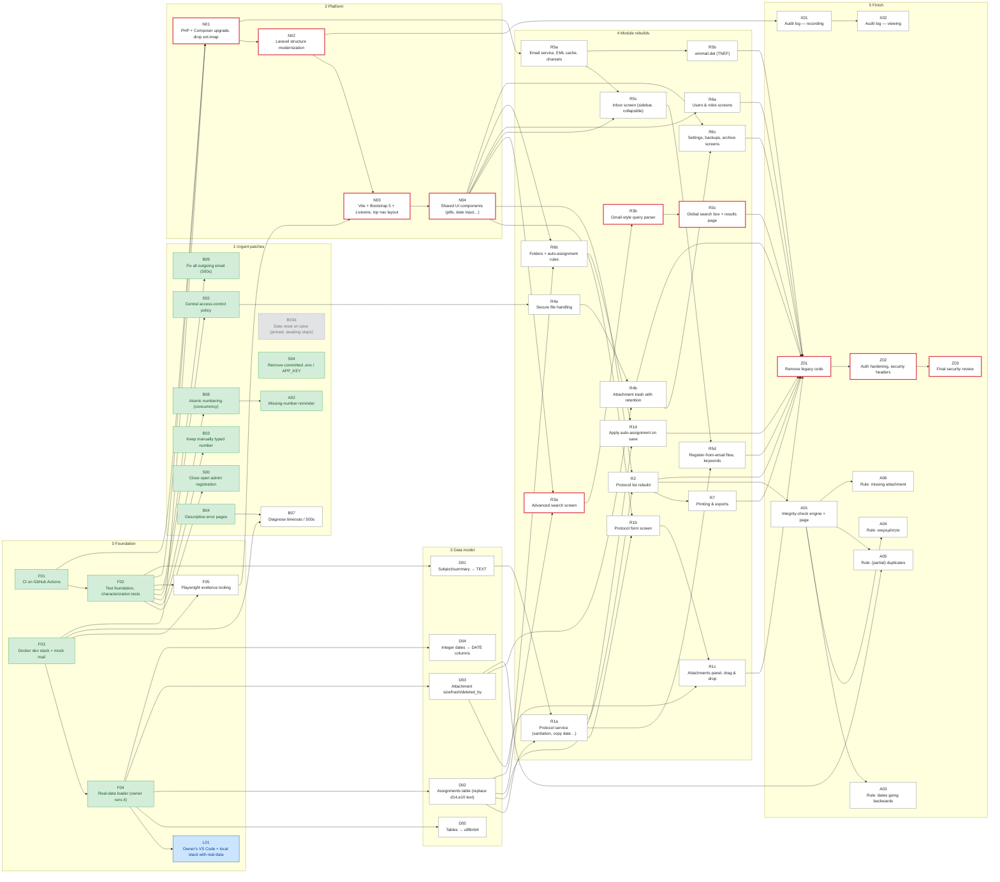
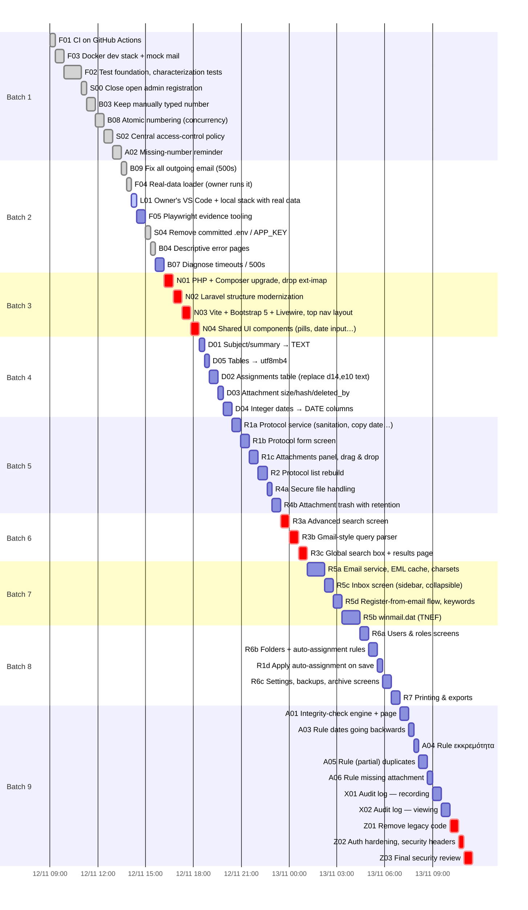

# Development progress (PERT / CPM)

> Generated by `python3 docs/plan/tools/pert.py` from [`tasks.toml`](tasks.toml) — do not edit by hand.
> Task descriptions: [BACKLOG.md](BACKLOG.md) · Hand-off notes: [HANDOFF.md](HANDOFF.md).

## Summary

| | |
|---|---|
| Tasks done | **12 / 52** `███████░░░░░░░░░░░░░░░░░░░░░░░` 23% |
| Effort done (PERT) | **5.8 / 26.6 h** `███████░░░░░░░░░░░░░░░░░░░░░░░` 22% |
| Remaining effort, one agent in sequence | **20.8 h ± 0.7** of agent working time (calendar time depends on plan usage limits and your reviews) |
| Remaining critical path (if work could run in parallel) | 5.3 h ± 0.4 |
| In progress | L01 |
| Next task | **F05** — Playwright evidence tooling |
| On hold | B03d (Date reset on save (pinned, awaiting steps)) |

**Critical path (remaining):** N01 → N02 → N03 → N04 → R3a → R3b → R3c → Z01 → Z02 → Z03

## Batches

| Batch | Tasks | Done | Progress |
|---|---|---|---|
| 1 | ✅F01 ✅F03 ✅F02 ✅S00 ✅B03 ✅B08 ✅S02 ✅A02 | 8/8 | `██████████` |
| 2 | ✅B09 ✅F04 🔄L01 ⬜F05 ✅S04 ✅B04 ⬜B07 | 4/7 | `██████░░░░` |
| 3 | ⬜N01 ⬜N02 ⬜N03 ⬜N04 | 0/4 | `░░░░░░░░░░` |
| 4 | ⬜D01 ⬜D05 ⬜D02 ⬜D03 ⬜D04 | 0/5 | `░░░░░░░░░░` |
| 5 | ⬜R1a ⬜R1b ⬜R1c ⬜R2 ⬜R4a ⬜R4b | 0/6 | `░░░░░░░░░░` |
| 6 | ⬜R3a ⬜R3b ⬜R3c | 0/3 | `░░░░░░░░░░` |
| 7 | ⬜R5a ⬜R5c ⬜R5d ⬜R5b | 0/4 | `░░░░░░░░░░` |
| 8 | ⬜R6a ⬜R6b ⬜R1d ⬜R6c ⬜R7 | 0/5 | `░░░░░░░░░░` |
| 9 | ⬜A01 ⬜A03 ⬜A04 ⬜A05 ⬜A06 ⬜X01 ⬜X02 ⬜Z01 ⬜Z02 ⬜Z03 | 0/10 | `░░░░░░░░░░` |

## Dependency network

Green = done · blue = in progress · white = to do · grey = on hold · **red border = remaining critical path**.

## Timeline (one agent, execution order)

Bars are PERT expected **agent working hours** laid end to end in batch order — not calendar dates.

## CPM table (all tasks, unlimited parallelism)

te = expected hours; ES/EF = earliest start/finish; LS/LF = latest start/finish; slack = LS − ES (hours).

| | ID | Task | Deps | te | σ | ES | EF | LS | LF | Slack | PR |
|---|---|---|---|---|---|---|---|---|---|---|---|
| ✅ | **F01** 🔴 | CI on GitHub Actions | — | 0.3 | 0.1 | 0.0 | 0.3 | 0.0 | 0.3 | 0.0 | #3 |
| ✅ | **F03** | Docker dev stack + mock mail | — | 0.5 | 0.1 | 0.0 | 0.5 | 0.9 | 1.4 | 0.9 | #2 |
| ✅ | **F02** 🔴 | Test foundation, characterization tests | F01 | 1.1 | 0.2 | 0.3 | 1.4 | 0.3 | 1.4 | 0.0 | #4 |
| ✅ | **S00** | Close open admin registration | F02 | 0.3 | 0.1 | 1.4 | 1.7 | 6.4 | 6.7 | 4.9 | #5 |
| ✅ | **B03** | Keep manually typed number | F02 | 0.5 | 0.1 | 1.4 | 2.0 | 6.1 | 6.7 | 4.7 | #6 |
| ✅ | **B08** | Atomic numbering (concurrency) | F02 | 0.5 | 0.1 | 1.4 | 2.0 | 5.6 | 6.1 | 4.2 | #7 |
| ✅ | **S02** | Central access-control policy | F02 | 0.5 | 0.1 | 1.4 | 2.0 | 3.3 | 3.8 | 1.9 | #8 |
| ✅ | **A02** | Missing-number reminder | B08 | 0.5 | 0.1 | 2.0 | 2.5 | 6.1 | 6.7 | 4.2 | #9 |
| ✅ | **B09** | Fix all outgoing email (500s) | F02 | 0.3 | 0.1 | 1.4 | 1.7 | 6.4 | 6.7 | 4.9 | #14 |
| ✅ | **F04** | Real-data loader (owner runs it) | F03 | 0.3 | 0.1 | 0.5 | 0.9 | 2.7 | 3.1 | 2.2 | #15 |
| 🔄 | **L01** | Owner's VS Code + local stack with real data | F04 | 0.3 | 0.1 | 0.9 | 1.2 | 6.4 | 6.7 | 5.5 | #16 |
| ⬜ | **F05** | Playwright evidence tooling | F02, F03 | 0.5 | 0.1 | 1.4 | 2.0 | 2.0 | 2.5 | 0.5 |  |
| ✅ | **S04** | Remove committed .env / APP_KEY | — | 0.3 | 0.1 | 0.0 | 0.3 | 6.4 | 6.7 | 6.4 | #18 |
| ✅ | **B04** | Descriptive error pages | — | 0.3 | 0.1 | 0.0 | 0.3 | 5.8 | 6.1 | 5.8 | #19 |
| ⬜ | **B07** | Diagnose timeouts / 500s | F03, B04 | 0.5 | 0.1 | 0.5 | 1.1 | 6.1 | 6.7 | 5.6 |  |
| ⬜ | **N01** 🔴 | PHP + Composer upgrade, drop ext-imap | F01, F02, F03 | 0.5 | 0.1 | 1.4 | 2.0 | 1.4 | 2.0 | 0.0 |  |
| ⬜ | **N02** 🔴 | Laravel structure modernization | N01 | 0.5 | 0.1 | 2.0 | 2.5 | 2.0 | 2.5 | 0.0 |  |
| ⬜ | **N03** 🔴 | Vite + Bootstrap 5 + Livewire, top nav layout | N02, F05 | 0.5 | 0.1 | 2.5 | 3.1 | 2.5 | 3.1 | 0.0 |  |
| ⬜ | **N04** 🔴 | Shared UI components (pills, date input…) | N03 | 0.5 | 0.1 | 3.1 | 3.6 | 3.1 | 3.6 | 0.0 |  |
| ⬜ | **D01** | Subject/summary → TEXT | F02 | 0.3 | 0.1 | 1.4 | 1.7 | 3.3 | 3.6 | 1.9 |  |
| ⬜ | **D05** | Tables → utf8mb4 | F04 | 0.3 | 0.1 | 0.9 | 1.2 | 6.4 | 6.7 | 5.5 |  |
| ⬜ | **D02** | Assignments table (replace d14,e10 text) | F04 | 0.5 | 0.1 | 0.9 | 1.4 | 3.1 | 3.6 | 2.2 |  |
| ⬜ | **D03** | Attachment size/hash/deleted_by | F04 | 0.3 | 0.1 | 0.9 | 1.2 | 3.8 | 4.2 | 3.0 |  |
| ⬜ | **D04** | Integer dates → DATE columns | F04 | 0.5 | 0.1 | 0.9 | 1.4 | 6.1 | 6.7 | 5.3 |  |
| ⬜ | **R1a** | Protocol service (sanitation, copy date…) | D01, D02 | 0.5 | 0.1 | 1.7 | 2.3 | 3.6 | 4.2 | 1.9 |  |
| ⬜ | **R1b** | Protocol form screen | R1a, N04 | 0.5 | 0.1 | 3.6 | 4.2 | 4.2 | 4.7 | 0.5 |  |
| ⬜ | **R1c** | Attachments panel, drag & drop | R1b, D03 | 0.5 | 0.1 | 4.2 | 4.7 | 4.7 | 5.3 | 0.5 |  |
| ⬜ | **R2** | Protocol list rebuild | N04, D02 | 0.5 | 0.1 | 3.6 | 4.2 | 4.2 | 4.7 | 0.5 |  |
| ⬜ | **R4a** | Secure file handling | S02 | 0.3 | 0.1 | 2.0 | 2.3 | 3.8 | 4.2 | 1.9 |  |
| ⬜ | **R4b** | Attachment trash with retention | R4a, D03 | 0.5 | 0.1 | 2.3 | 2.8 | 4.2 | 4.7 | 1.9 |  |
| ⬜ | **R3a** 🔴 | Advanced search screen | N04, D02 | 0.5 | 0.1 | 3.6 | 4.2 | 3.6 | 4.2 | 0.0 |  |
| ⬜ | **R3b** 🔴 | Gmail-style query parser | R3a | 0.5 | 0.1 | 4.2 | 4.7 | 4.2 | 4.7 | 0.0 |  |
| ⬜ | **R3c** 🔴 | Global search box + results page | R3b | 0.5 | 0.1 | 4.7 | 5.3 | 4.7 | 5.3 | 0.0 |  |
| ⬜ | **R5a** | Email service, EML cache, charsets | N01 | 1.1 | 0.2 | 2.0 | 3.1 | 3.1 | 4.2 | 1.1 |  |
| ⬜ | **R5c** | Inbox screen (sidebar, collapsible) | R5a, N04 | 0.5 | 0.1 | 3.6 | 4.2 | 4.2 | 4.7 | 0.5 |  |
| ⬜ | **R5d** | Register-from-email flow, keywords | R5c, R1a | 0.5 | 0.1 | 4.2 | 4.7 | 4.7 | 5.3 | 0.5 |  |
| ⬜ | **R5b** | winmail.dat (TNEF) | R5a | 1.1 | 0.2 | 3.1 | 4.2 | 4.2 | 5.3 | 1.1 |  |
| ⬜ | **R6a** | Users & roles screens | N04 | 0.5 | 0.1 | 3.6 | 4.2 | 4.7 | 5.3 | 1.1 |  |
| ⬜ | **R6b** | Folders + auto-assignment rules | N04, D02 | 0.5 | 0.1 | 3.6 | 4.2 | 4.4 | 4.9 | 0.8 |  |
| ⬜ | **R1d** | Apply auto-assignment on save | R1a, R6b | 0.3 | 0.1 | 4.2 | 4.5 | 4.9 | 5.3 | 0.8 |  |
| ⬜ | **R6c** | Settings, backups, archive screens | N04, R4b | 0.5 | 0.1 | 3.6 | 4.2 | 4.7 | 5.3 | 1.1 |  |
| ⬜ | **R7** | Printing & exports | R2 | 0.5 | 0.1 | 4.2 | 4.7 | 4.7 | 5.3 | 0.5 |  |
| ⬜ | **A01** | Integrity-check engine + page | R2 | 0.5 | 0.1 | 4.2 | 4.7 | 5.6 | 6.1 | 1.4 |  |
| ⬜ | **A03** | Rule: dates going backwards | A01 | 0.3 | 0.1 | 4.7 | 5.0 | 6.4 | 6.7 | 1.6 |  |
| ⬜ | **A04** | Rule: εκκρεμότητα | A01 | 0.3 | 0.1 | 4.7 | 5.0 | 6.4 | 6.7 | 1.6 |  |
| ⬜ | **A05** | Rule: (partial) duplicates | A01, D03 | 0.5 | 0.1 | 4.7 | 5.3 | 6.1 | 6.7 | 1.4 |  |
| ⬜ | **A06** | Rule: missing attachment | A01 | 0.3 | 0.1 | 4.7 | 5.0 | 6.4 | 6.7 | 1.6 |  |
| ⬜ | **X01** | Audit log — recording | N02 | 0.5 | 0.1 | 2.5 | 3.1 | 5.6 | 6.1 | 3.1 |  |
| ⬜ | **X02** | Audit log — viewing | X01 | 0.5 | 0.1 | 3.1 | 3.6 | 6.1 | 6.7 | 3.1 |  |
| ⬜ | **Z01** 🔴 | Remove legacy code | R1c, R1d, R2, R3c, R4b, R5b, R5d, R6a, R6c, R7 | 0.5 | 0.1 | 5.3 | 5.8 | 5.3 | 5.8 | 0.0 |  |
| ⬜ | **Z02** 🔴 | Auth hardening, security headers | Z01 | 0.3 | 0.1 | 5.8 | 6.1 | 5.8 | 6.1 | 0.0 |  |
| ⬜ | **Z03** 🔴 | Final security review | Z02 | 0.5 | 0.1 | 6.1 | 6.7 | 6.1 | 6.7 | 0.0 |  |
| ⏸️ | **B03d** | Date reset on save (pinned, awaiting steps) | — | 0.3 | 0.1 | 0.0 | 0.3 | 6.4 | 6.7 | 6.4 |  |

Whole-project critical path 🔴: F01 → F02 → N01 → N02 → N03 → N04 → R3a → R3b → R3c → Z01 → Z02 → Z03 = 6.7 h ± 0.4
