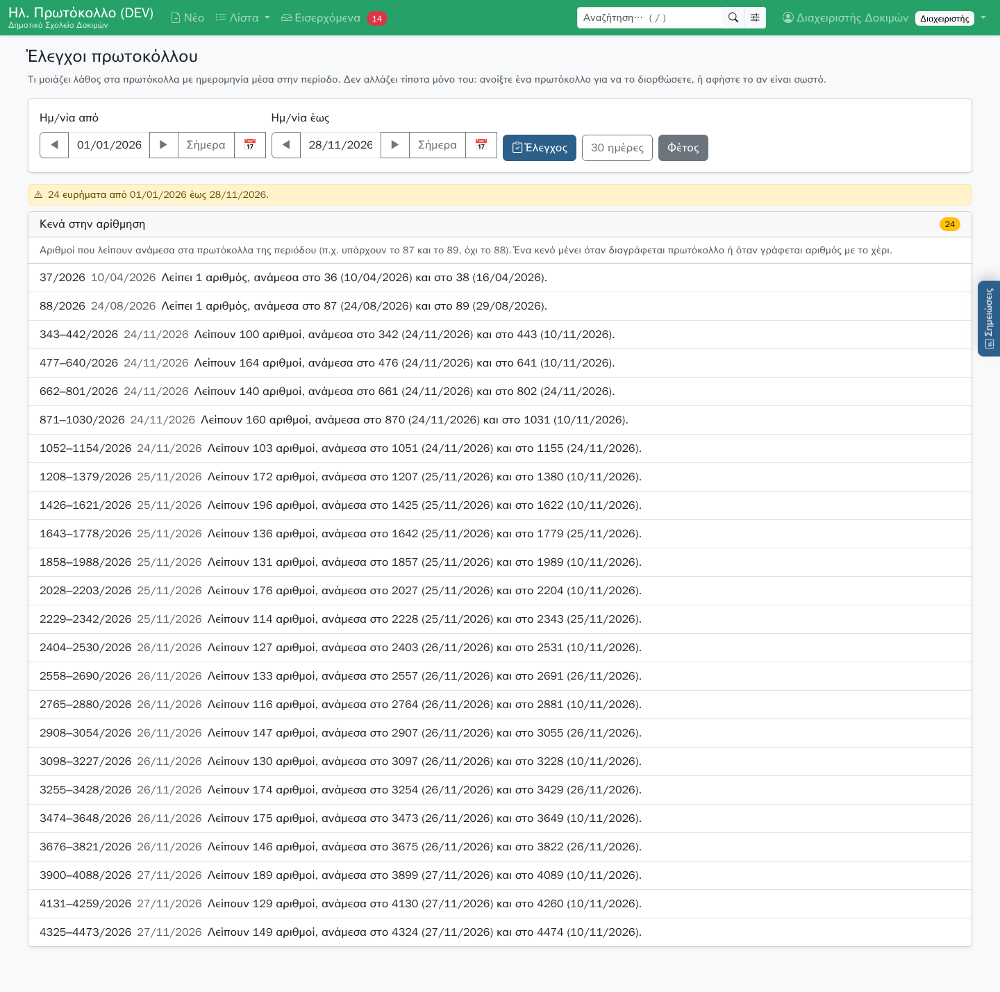

# A01: Έλεγχοι πρωτοκόλλου (integrity-check engine, page, list line)

| | |
|---|---|
| Status | ✅ Done |
| Branch | `task/A01-integrity-checks` |
| Batch | 10 (first task) |

## What was asked (backlog, Phase 5)
«Integrity check engine + "Έλεγχοι" page + list banner (absorbs A02 gap rule, adds last-30-days report)». The next
tasks add the checks themselves: A03 dates going backwards, A04 εκκρεμότητα, A05 duplicates, A06 missing attachment.

## What was there
- The list's yellow *Κενά στην αρίθμηση* notice and «ΚΕΝΟ» rows (A02, R2c), only for the last *N months*.
- Dates out of order flagged in the list and the form (R2f), and *Έλεγχος εκκρεμοτήτων* on the search page: each in its
  own place, none of them in one report for a chosen period.

## What changed
- **New page *Έλεγχοι πρωτοκόλλου*** (user menu, group *Φάκελοι*; `/checks`), for administrators, assigners and writers:
  - a range of protocol dates, the **last 30 days** by default; *30 ημέρες* and *Φέτος* in one click; at most three
    years; the range is in the address;
  - each check in its own card: title, what it checks, the number of findings (green *κανένα* when none), one line per
    finding linked to its protocol;
  - *Κανένα πρόβλημα από … έως …* when nothing is found.
- **The first check: Κενά στην αρίθμηση.** One line per run of missing numbers, with the protocols on either side, e.g.
  *88/2026 — Λείπει 1 αριθμός, ανάμεσα στο 87 (24/08/2026) και στο 89 (29/08/2026).* A gap right at the edge of the
  range counts too. The administrator who may choose numbers gets *Καταχώριση με το 88*, as in the list.
- **The list:** the gaps notice links to *Έλεγχοι*; a second line *Έλεγχοι: N ευρήματα τις τελευταίες 30 ημέρες* appears
  when the other checks (from A03 on) find something.
- **Engine** (`App\Services\Integrity`): one class per check (`Rule`), `Finding`, `Checks` (the list of checks, who sees
  which finding: with *Περιορισμός λίστας* a writer sees only findings about protocols they may open). Adding a check =
  one class + one line.
- **Feature guide: [docs/CHECKS.md](../CHECKS.md)** (for users; for developers: where the code is, how to add a check,
  the rules the code keeps).

## How it was verified
**PHPUnit** — `tests/Feature/IntegrityChecksTest.php` (12 tests): gaps in a range, at its edges, across New Year and with
the start number; the gap messages with their neighbours; the page's default range and findings; «no problems»; wrong
ranges refused; quick ranges; who may open it (reader 403, guest to login) and the menu entry; a limited writer does
not see findings about other users' protocols; the list's line and that the gaps are not counted twice.
`ModernLayoutTest` updated for the new menu entry. `NumberGapsTest` unchanged and passing.

**Browser** — `e2e/tests/checks.spec.js`: from the user menu to the page, *Φέτος*, the gaps with their neighbours, a
typed range kept in the address, a wrong range refused; the gaps notice's link; a reader gets 403.

(The dev database has many gaps left by earlier browser-test runs; the owner's data will have few.)

## Owner actions
- Try step 118 in [OWNER-TODO.md](../../OWNER-TODO.md).
