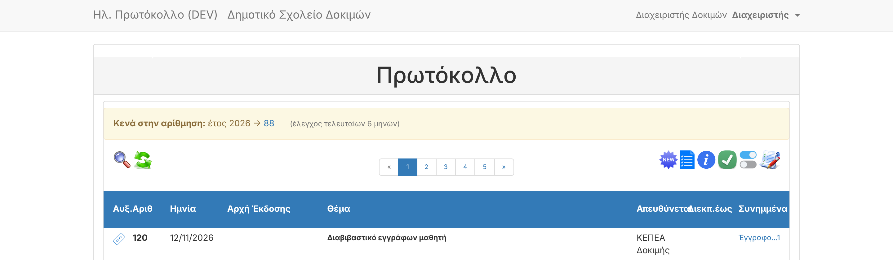
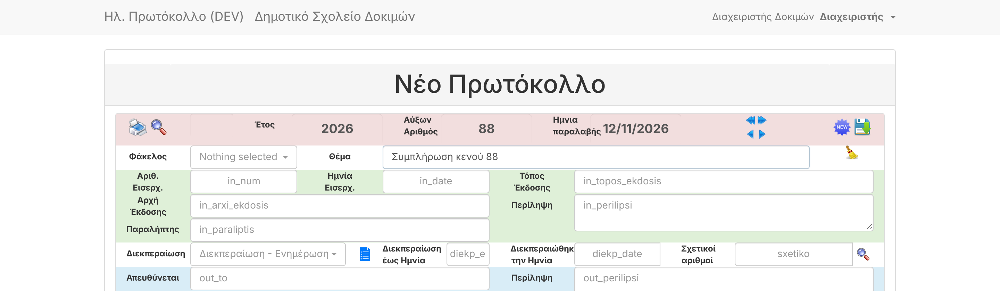
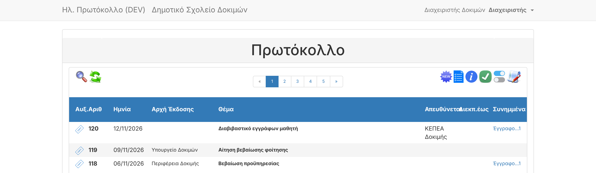

# A02 — Missing protocol numbers reminder

| | |
|---|---|
| Status | ✅ Done |
| Branch | `task/A02-gap-banner` |
| Tests | 87 tests / 243 assertions pass (11 new) |

## What it does
- Every time the protocol list loads (including the automatic refresh), the app looks for **numbers that
  are missing** — e.g. 999 and 1001 exist but 1000 doesn't — and shows them in a yellow banner at the top:
  **«Κενά στην αρίθμηση: έτος 2026 → 88 (έλεγχος τελευταίων 6 μηνών)»**.
- It is only a **reminder**: nothing is filled automatically (your answer to Q-2).
- For users who are allowed to type protocol numbers (administrator with *Έλεγχοι καταχώρισης* OFF) each
  missing number is a link that opens a new protocol **with that number pre-filled**; saving stores it
  under that number (B03 logic). Other writers/assigners see the numbers as plain text; readers don't see the banner.
- Long lists are cut after 30 numbers with a compact summary (`37, 88, 100–105`).

## New settings (Ρυθμίσεις → near "Αρ.Πρωτοκόλλου για ξεκίνημα")
| Setting | Default | Meaning |
|---|---|---|
| Έλεγχος κενών: από Αρ.Πρωτοκόλλου | empty (from the start) | numbers below it are ignored in the current year |
| Έλεγχος κενών: τελευταίοι μήνες | 6 | only protocols dated within the last N months (1–24) |

Numbering restarts every year, so a window that crosses New Year checks each year separately (Q-3).

## Evidence

**Browser (demo data has deliberate gaps at 37 and 88; 37 is older than 6 months, so only 88 is reported):**
```
banner: Κενά στην αρίθμηση: έτος 2026 → 88 (έλεγχος τελευταίων 6 μηνών)
form number prefilled: 88
saved as: 88
banner after filling the gap: gone (no gaps left)
```




**Automated** — `tests/Feature/NumberGapsTest.php`: single missing number · no gaps · only inside the month window ·
start-number setting · window across New Year (two years) · compact formatting · banner shown to writers ·
hidden without gaps and for readers · link pre-fills number for admin · filling the gap clears it ·
settings saved and validated.

## Security tightening (follow-up to B03)
B03 let the server accept a typed number whenever it differed from the proposed one. The number field is
only editable for administrators with *Έλεγχοι καταχώρισης* OFF, so a writer could have chosen a number by
crafting a request. The server now applies the same rule as the form
(`ProtocolNumbering::userMayChooseNumber`, test `writer_cannot_choose_a_number_with_a_crafted_request`).

## Notes
- Demo data now spreads dates from 8 January to today (closer to real usage).
- A01 (integrity-check page, Phase 5) will reuse this service and add the 30-day report.
