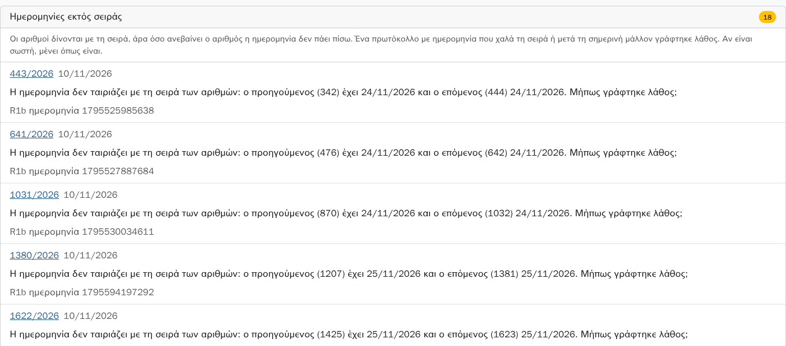

# A03: Έλεγχοι: ημερομηνίες εκτός σειράς (dates going backwards)

| | |
|---|---|
| Status | ✅ Done |
| Branch | `task/A03-date-order-rule` |
| Batch | 10 |

## What was asked (backlog, Phase 5)
«Rule: dates must not go backwards as numbers increase», as a check of the *Έλεγχοι* page (A01).

## What was there
- R2f flags a date out of order (or after today) with ⚠ in the list, for the protocols of the page shown, and warns in
  the form while it is typed (`App\Services\DateOrder`).
- No report for a period: a wrong date on another page of the list was found only by scrolling to it.

## What changed
- **Second check on *Έλεγχοι πρωτοκόλλου*: Ημερομηνίες εκτός σειράς.** One line per protocol whose date breaks the order
  of the numbers, or is after today, with the same explanation as the ⚠ of the list, e.g. *88/2026 — Η ημερομηνία δεν
  ταιριάζει με τη σειρά των αριθμών: ο προηγούμενος (87) έχει 03/11/2026 και ο επόμενος (89) 04/11/2026. Μήπως
  γράφτηκε λάθος;* The number links to the protocol, where the date is corrected (or left, if it is right).
- **Same judgement as the list:** `DateOrder` decides which protocols are out of order (the fewest whose removal leaves
  the dates in order), over each numbering year of the protocols dated in the range.
- **A wrong date outside the range is found too:** a protocol counts when it, or the protocol before or after it by
  number, is dated in the range. So 11/2026 typed as 20/11 among protocols of 3–4/11 is found when checking 1–10/11, and a
  date typed a year wrong (2025 for 2026) is found among the protocols around it.
- **The list's line** *Έλεγχοι: N ευρήματα τις τελευταίες 30 ημέρες* now counts these (the gaps keep their own notice).
- **Who sees what:** with *Περιορισμός λίστας* a writer sees only their own protocols' findings, and the message does not
  name another user's protocol (number and date), as the ⚠ of the list (review of R2f). For this, every check is now
  given the user who reads it (`Rule::findings($from, $to, $viewer)`).
- [docs/CHECKS.md](../CHECKS.md): the new row, the code table, the rules the code keeps.

## How it was verified
**PHPUnit** — `tests/Feature/IntegrityChecksTest.php` (+5, 19 in all): a date going backwards found when its neighbours
are in the range, and not when nothing near it is; a date after today; a date typed a year wrong found in its book year;
a limited writer sees only their own finding, without the other user's number in the message; the page's card and the
list's line count it. Full suite: 741 tests, green.

**Browser** — `e2e/tests/checks.spec.js` (+1): a protocol registered with a date 20 days back → the list's line → *Προβολή*
→ the finding in *Ημερομηνίες εκτός σειράς* with its neighbours → opened, the date corrected → no longer in the check.

(The dev database has dates out of order left by earlier browser-test runs; the owner's data should have few.)

## Owner actions
- Try step 119 in [OWNER-TODO.md](../../OWNER-TODO.md).
