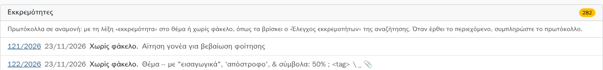
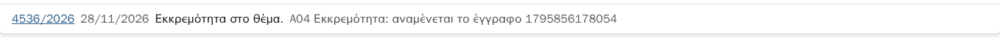

# A04: Έλεγχοι: εκκρεμότητες (pending protocols)

| | |
|---|---|
| Status | ✅ Done |
| Branch | `task/A04-pending-rule` |
| Batch | 10 |

## What was asked (backlog, Phase 5)
«Rule: contains "εκκρεμότητα" (accent/case-insensitive)», as a check of the *Έλεγχοι* page (A01). Owner (2026-11-18): a
protocol without a folder is on hold until its content reaches the department, not an error; A04 may list it as
pending.

## What was there
- *Αναζήτηση → Έλεγχος εκκρεμοτήτων για το έτος / τις ημερομηνίες* (R3a): protocols without a folder or with
  «ΕΚΚΡΕΜΟΤΗΤΑ» in the subject, with a badge saying which.
- The list marks a protocol without a folder (R2n).

## What changed
- **Third check on *Έλεγχοι πρωτοκόλλου*: Εκκρεμότητες.** One line per pending protocol dated in the period, with
  *Εκκρεμότητα στο θέμα.*, *Χωρίς φάκελο.* or both, its subject and a link to it.
- **Same meaning as the search's check:** the word *εκκρεμότητα* in any case or accents (*ΕΚΚΡΕΜΟΤΗΤΕΣ*, *εκκρεμοτητα*),
  or no folder. A placeholder (*ΕΛΕΥΘΕΡΟ*) without a folder is pending too.
- **A reminder, not a mistake:** the list's *Έλεγχοι: N ευρήματα* line does not count these (the list marks a missing
  folder itself), so it keeps meaning «something looks wrong».
- With *Περιορισμός λίστας*, a writer sees only their own (the engine of A01).
- [docs/CHECKS.md](../CHECKS.md): the new row, where the code is, the rules the code keeps.

## How it was verified
**PHPUnit** — `tests/Feature/IntegrityChecksTest.php` (+2, 21 in all): which protocols are pending (accents, capitals,
plural, no folder, empty folder, both, a placeholder) and only those dated in the range, with their messages; the card
on the page, not in the list's line, a limited writer sees only their own. The other tests' protocols now get a folder
(the test factory leaves it empty, which now means pending). Full suite: 743 tests, green.

**Browser** — `e2e/tests/checks.spec.js` (+1): a writer registers a protocol with *Εκκρεμότητα* in the subject → it is
in *Εκκρεμότητες* with *Εκκρεμότητα στο θέμα.* and its subject.

(The dev database has many protocols without a folder left by earlier browser-test runs.)

## Owner actions
- Try step 120 in [OWNER-TODO.md](../../OWNER-TODO.md).
