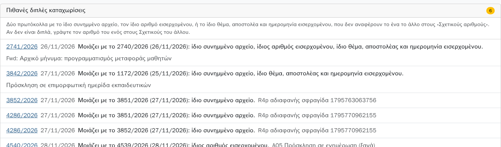

# A05: Έλεγχοι: πιθανές διπλές καταχωρίσεις (possible duplicates)

| | |
|---|---|
| Status | ✅ Done |
| Branch | `task/A05-duplicates-rule` |
| Batch | 10 |

## What was asked (backlog, Phase 5)
«Rule: identical / partially identical protocols (subject, in_num, sender, attachment hash) without `sxetiko`», as a
check of the *Έλεγχοι* page (A01), using D03's file fingerprints.

## What was there
Nothing compared protocols with each other. A document registered twice (e.g. once from the inbox, once by hand) was
found only by chance.

## What changed
- **Fourth check on *Έλεγχοι πρωτοκόλλου*: Πιθανές διπλές καταχωρίσεις.** Two protocols are alike when they have:
  - the **same attached file** (identical content, D03's SHA-256);
  - the **same incoming number** (*Αριθμός εισερχομένου*), unless both senders are written and differ;
  - the **same subject, sender and incoming date** (all three written; not an «ΕΛΕΥΘΕΡΟ» placeholder).

  Case, accents and spaces around do not matter.
- **Not reported:** two protocols that name each other in *Σχετικοί αριθμοί* (a reply or a follow-up); a file, number
  or subject that more than 3 protocols share (a logo, an e-mail signature, a routine number: on the dev data a few
  repeated values alone gave 5,000 pairs); a deleted attachment.
- **One line per pair**, about the later protocol, e.g. *4540/2026 — Μοιάζει με το 4539/2026 (28/11/2026): ίδιος αριθμός
  εισερχομένου.*, with every reason that applies. With *Περιορισμός λίστας* a writer sees their own protocol's line,
  and the other is named only if they may see it («με άλλο πρωτόκολλο» otherwise).
- **Counted in the list's *Έλεγχοι* line.** To keep the list fast, the other protocol is looked for in the same
  numbering year and the one before (about 100 ms for the list's count on the dev data, 14 ms of it in the database).
- [docs/CHECKS.md](../CHECKS.md): the new row, where the code is, the rules the code keeps, what to check before
  changing it.

## How it was verified
**PHPUnit** — `tests/Feature/IntegrityChecksTest.php` (+6, 27 in all): the same file (and a file in 4 protocols, and a
deleted attachment); the same incoming number with case and spaces, different senders, a missing sender, a number
shared by 4; the same subject, sender and date (not another day, not without a sender, not placeholders); one line with
all reasons, and none when either protocol names the other; a limited writer without the other's number; the page's
card and the list's line. Full suite: 749 tests, green.

**Browser** — `e2e/tests/checks.spec.js` (+1): a writer registers the same incoming document twice → the second is in
*Πιθανές διπλές καταχωρίσεις* with «Μοιάζει με το …: ίδιος αριθμός εισερχομένου.»

## Owner actions
- Try step 121 in [OWNER-TODO.md](../../OWNER-TODO.md). On the real copy, the «same file» reason needs
  `./dev.sh real artisan attachments:fill-metadata` once (it is also in the final-deployment steps).
