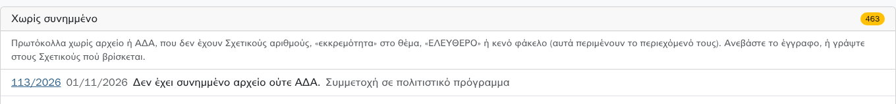
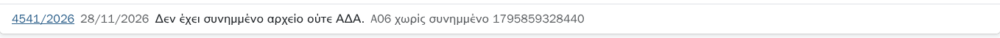

# A06: Έλεγχοι: χωρίς συνημμένο (missing attachment)

| | |
|---|---|
| Status | ✅ Done |
| Branch | `task/A06-missing-attachment-rule` |
| Batch | 10 (last of the checks A01–A06) |

## What was asked (backlog, Phase 5)
«Rule: no attachment and none of `sxetiko` / "εκκρεμότητα" / "ΕΛΕΥΘΕΡΟ" / no folder». Owner (2026-11-18): a protocol
without a folder is on hold or a placeholder until the content reaches the department, not an error here.

## What was there
Nothing showed a protocol registered without its document, unless it was opened.

## What changed
- **Fifth check on *Έλεγχοι πρωτοκόλλου*: Χωρίς συνημμένο.** Protocols dated in the period with no attachment: no file
  and no *ΑΔΑ* row (an ΑΔΑ row is the document on Διαύγεια, R1m; a deleted attachment does not count).
- **Left out when the protocol says why:** *Σχετικοί αριθμοί* written (the document is in the related protocol);
  *εκκρεμότητα* in the subject (it is coming: *Εκκρεμότητες*, A04); the «ΕΛΕΥΘΕΡΟ» placeholder; no folder (on hold).
- **Counted in the list's *Έλεγχοι* line.** If on the owner's data these are many and expected (documents kept only on
  paper), the line can stop counting them: one line of code (`inList()`), asked in step 122.
- **A05's browser test made rerunnable:** its subjects were the same on every run, so a second run on the same
  database found the first run's protocols alike as well (found while running the whole spec for this task).
- [docs/CHECKS.md](../CHECKS.md): the new row, the code, the rules it keeps; how the tests keep one check from counting
  another's protocols.

The five checks are complete: gaps (A01), dates out of order (A03), pending (A04), possible duplicates (A05), without
an attachment (A06).

## How it was verified
**PHPUnit** — `tests/Feature/IntegrityChecksTest.php` (+2, 29 in all): without anything → found; an ΑΔΑ row, a file →
not; a deleted attachment → found; related numbers, εκκρεμότητα, ΕΛΕΥΘΕΡΟ, no or blank folder → not; blank related
numbers → found; only the protocols dated in the period; the page's card and the list's line. The other checks' test
protocols are now complete (a folder and an ΑΔΑ row). Full suite: 751 tests, green.

**Browser** — `e2e/tests/checks.spec.js` (+1, 6 in all, run twice on the same database): a writer registers a protocol
without a file → in *Χωρίς συνημμένο* → opened, a PDF added and saved → no longer in the check.

## Owner actions
- Try step 122 in [OWNER-TODO.md](../../OWNER-TODO.md), and say whether the list's line should count these.
