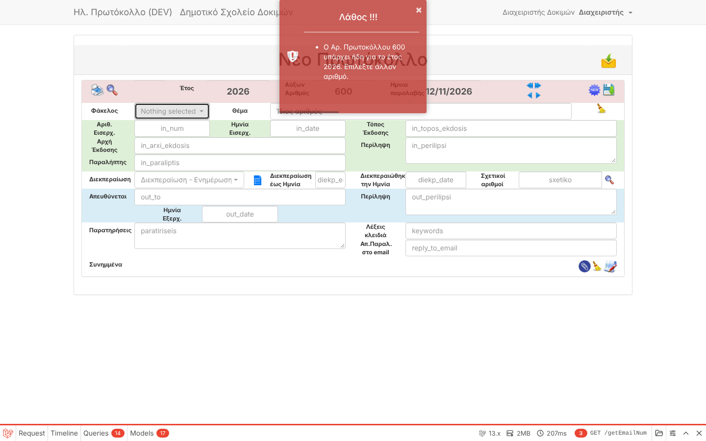
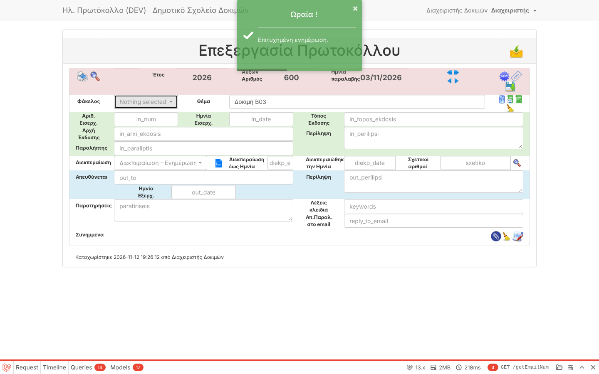

# B03 — Manually entered protocol number is overwritten on save

| | |
|---|---|
| Status | ✅ Number fixed · ⚠️ date reset not reproducible — owner input needed (see end) |
| Branch | `task/B03-manual-number` |

## Root cause
The number and date fields are editable only for an **administrator** when *Έλεγχοι καταχώρισης*
(`protocolValidate`) is OFF. The setting *Ασφαλής νέος Αρ.Πρ* (`safeNewProtocolNum`, ON by default)
made `store()` **ignore the submitted number** and always use max+1. It could not tell a number the
user typed from the one the form pre-filled.

Reproduced in the browser before the fix (admin, checks OFF, safe numbering ON): typed **501** → saved as **122**.

A second, related defect: uploaded attachment files were named with the *typed* number, so after the
replacement the file of protocol 122 was named `501-...`.

## Fix
- The new-protocol form sends the number it proposed in a hidden field (`protocolnum_proposed`).
- Server (`App\Services\ProtocolNumbering`): if the submitted number differs from the proposed one,
  it is a **manual** number and is stored exactly as typed — after checking it is free for the year.
- If the manual number is already used → the form comes back with the message
  **«Ο Αρ. Πρωτοκόλλου N υπάρχει ήδη για το έτος YYYY. Επιλέξτε άλλον αριθμό.»** and every field kept.
- Safe mode still does its job for users who did **not** touch the number: if someone else took it in the
  meantime, the next free number is used.
- Attachment file names use the number actually stored.
- Next-number logic moved into one service (reused by B08 next).

## Evidence

**Automated** — 59 tests / 175 assertions pass. New tests in `tests/Feature/Legacy/ProtocolStoreTest.php`:

| Test | Asserts |
|---|---|
| `typed_number_and_date_are_kept_when_safe_numbering_is_on` | typed 50 + date 02/03 stored as typed (replaces the `known_bug` test) |
| `untouched_proposed_number_is_replaced_by_next_free_when_taken_meanwhile` | safe mode still prevents duplicates |
| `typed_number_already_used_is_refused_with_message_and_input_kept` | clear Greek message, nothing lost, nothing stored |
| `attachment_file_name_uses_the_stored_number` | file `12-...` for protocol 12 |
| `new_protocol_form_sends_the_proposed_number` | hidden field present |

**Browser (dev stack, admin, checks OFF, safe numbering ON)**

| Scenario | Before | After |
|---|---|---|
| Type 600 and date 03/11 → save | saved as next number (122) | saved as **600 / 03/11/2026** |
| Type an existing number → save | — | message «υπάρχει ήδη», number and subject kept |

## ⚠️ The date reset — needs your help
In every path I tested the typed date **was kept** (new protocol with keyboard typing and date picker,
editing an existing protocol). Email registration always uses today's date and next number by design
(that page has no number/date fields). To find the date problem, please tell me:
1. Which screen (new protocol, copy of a protocol, edit, email)?
2. Your user role and whether *Έλεγχοι καταχώρισης* is ON or OFF in Settings.
3. Do you change the year as well, or only day/month?
