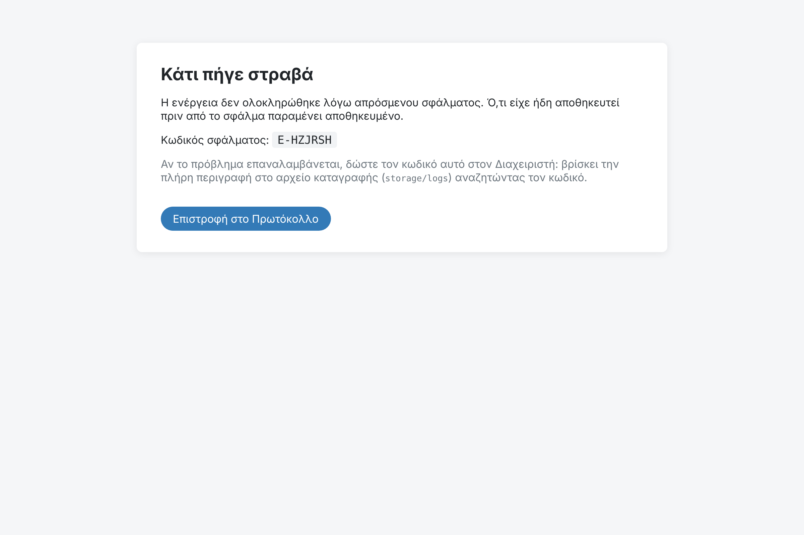
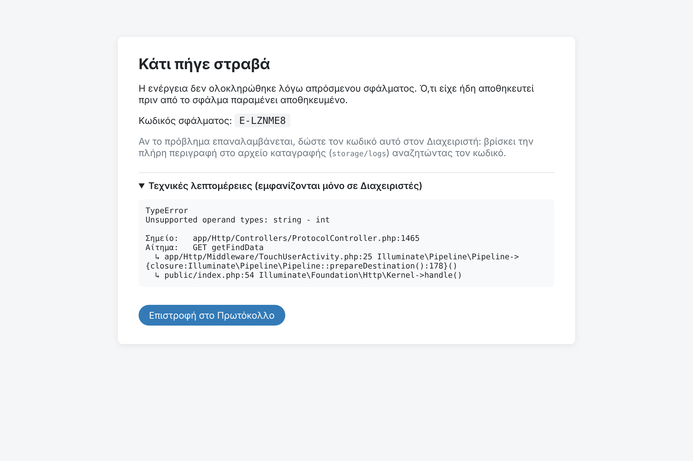

# B04 — Descriptive error pages instead of a bare "500 Server Error"

| | |
|---|---|
| Status | ✅ Done |
| Branch | `task/B04-error-pages` |
| Tests | 104 tests / 301 assertions (7 new) |

## What changed
- **Every unexpected error gets a reference code** (e.g. `E-LZNME8`), shown on the page and written to the log
  together with the full error, URL and method. A user can say "I got E-LZNME8" and the administrator finds the
  exact cause with `grep E-LZNME8 storage/logs/laravel.log`.
- **Everyone** sees a clear Greek page: what happened, that data saved before the error stays saved, what to do.
- **Administrators only** also see the technical summary: error type, message, location in the app's code,
  request, the app's own call chain (no vendor frames, no request data).
- **AJAX requests** get JSON with the message and the reference code (details only for admins).
- Greek pages for the common HTTP errors: **404** not found / no access, **403** not allowed,
  **419** page expired (explains to refresh with F5), **429** too many attempts.
- The pages use a standalone layout, so they still render when the database or session is down.
- Development (`APP_DEBUG=true`) keeps Laravel's full debug page.

## Evidence
**Running app, debug off as in production** — a real crash that exists today (search with a non-numeric
"from number", tracked in B07):

| User | Page | Code | Technical details |
|---|---|---|---|
| writer | "Κάτι πήγε στραβά" | `E-HZJRSH` | hidden |
| admin | "Κάτι πήγε στραβά" | `E-LZNME8` | shown: `TypeError: Unsupported operand types: string - int` at `ProtocolController.php:1465` |

Log entry: `"error_id":"E-LZNME8","url":"http://localhost:8080/getFindData?aponum=abc…"`

**Automated** (`tests/Feature/ErrorPagesTest.php`): friendly page + code without details for a writer · details for
admin · the shown code is the one in the log entry with the error · JSON for AJAX without details · Greek 404 and
403 · real CSRF expiry → 419 page · debug mode keeps Laravel's page.

## Note
The search crash used above is not fixed here; it is one of the 500 sources handled in **B07** (next task).
