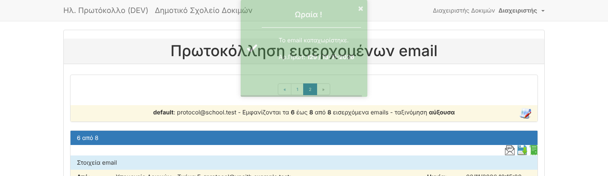

# B07 — Random timeouts and 500 errors: diagnosis and fixes

| | |
|---|---|
| Status | ✅ Fixed what B07 can fix · two causes need later tasks (recommend moving them earlier) |
| Branch | `task/B07-500s` |
| Tests | 104 PHPUnit · 8 browser (new: e-mail registration end-to-end) |

## How the causes were found
Characterization tests (F02), the mock mailbox (F03), browser tests (F05), the error reference codes (B04),
reading the code paths behind each 500, and measuring every main page.

## Causes and fixes

| # | Cause | Effect for users | Fix |
|---|---|---|---|
| 1 | **E-mail library bug** (`webklex/php-imap` 6.2 `Message::move()`): EXAMINE on the target folder leaves a read-only mailbox selected; the move and EXPUNGE then fail | **Registering an e-mail: protocol stored, then error page, e-mail still in the inbox** — matches your report | `App\Support\Imap\MessageMover`: re-select the inbox, move by UID (IMAP MOVE, or COPY+delete+EXPUNGE) |
| 2 | Same library: `createFolder()` runs EXPUNGE with no mailbox selected | first registration ever (folder "inProtocol" missing) → 500 | create without EXPUNGE |
| 3 | Folder lookup by name with `/` as default separator; the app's folders are `INBOX.inProtocol` | on mail servers that use `.` (common: Dovecot, Courier) **every second registration → "already exists" → 500** | look up by full path, then by name, in all 6 places |
| 4 | Moving the e-mail ran after the protocol was saved, unprotected | any IMAP hiccup turned a successful save into a 500 | wrapped: warning «το πρωτόκολλο έχει ήδη καταχωριστεί — μην το καταχωρίσετε ξανά» |
| 5 | Search / print: non-numeric "από/έως αριθμό", wrong date format | 500 | invalid values ignored, a note lists them |
| 6 | Search by assignee name that matches nobody | 500 | no results |
| 7 | **Update check on login** called the *original author's* GitHub | wait for a network timeout on servers without internet; advice to apply another project's changes | disabled (route still forwards to the landing page) |
| 8 | All outgoing e-mail (fixed in **B09**) | 500 after saving | — |
| 9 | Mail server without timeout (fixed in **B09**) | a slow SMTP server could hang a save | 10 s timeout |

### Measured page times (dev stack, median of 3, 118 protocols)
| Page | ms |
|---|---|
| Protocol list | 47 |
| New protocol form | 45 |
| Search page / results | 27 / 42 |
| Print page | 32 |
| Settings | 32 |
| **Inbox (9 small e-mails, 5 per page)** | **1 782** |

## Remaining causes — need later tasks
1. **The inbox downloads every e-mail on the page in full, attachments included, on every visit** (and the page
   then re-parses each one). With a real mailbox over the internet this easily takes tens of seconds → the
   "random" timeouts. Fix = **R5a** (local e-mail cache). **Recommendation: move R5a earlier.**
2. **E-mails with emoji in the subject can't be registered** (database uses 3-byte `utf8`, found in B09).
   Fix = **D05** (convert to `utf8mb4`). **Recommendation: move D05 earlier.**

## Evidence
- Browser test `e2e/tests/email-registration.spec.js`: registers an e-mail from a freshly started mock
  mailbox, asserts the request is not a 500, the message «Το email καταχωρίστηκε» without the
  "not moved" warning, and that the inbox count drops by one. **Before the fix it failed** with
  `NO EXPUNGE failed. Command not valid in this state`; after: 8/8 browser tests pass, twice in a row.
- Direct check: two moves in a row → inbox 9 → 7, "inProtocol" 2, no errors.
- `tests/Feature/RobustnessTest.php`: invalid number/date filters, only-invalid filters, valid filters unchanged,
  unknown assignee, print with invalid filters, login still lands on the list, no network call in the update check.

### Caught during this task (before it reached a PR)
Replacing the update check with an empty response broke **login** (the login redirects through that route).
The browser tests caught it immediately; the route now forwards to the landing page as before, and a test covers it.
