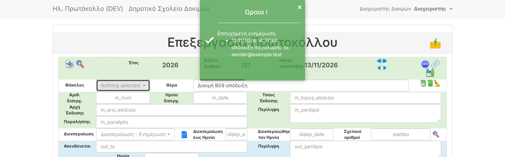

# B09 — All outgoing e-mail crashed (HTTP 500)

| | |
|---|---|
| Status | ✅ Fixed |
| Branch | `task/B09-mail` |
| Tests | 97 tests / 275 assertions pass |

## What was wrong
All five places that send e-mail used the SwiftMailer API (`$message->setBody()`, `Mail::failures()`),
removed in Laravel 9. On Laravel 13 every send threw an exception → **HTTP 500**, although the protocol had
already been saved. Affected:

| Where | Trigger |
|---|---|
| Save protocol with a receipt e-mail | `reply_to_email` filled |
| "Αποστολή απόδειξης" button | receipt for an existing protocol |
| Assignment (ανάθεση) | e-mail to the assignees (διεκπεραίωση / ενημέρωση) |
| Assignment on save | setting *sendEmailOnDiekperaiosiChange* |
| E-mail registration with receipt | e-mail registered from the inbox |

In e-mail registration the crash happened **after** the protocol was stored and **before** the e-mail was moved
to the "registered" folder: protocol created, e-mail still in the inbox, user sees an error — consistent with your
report of e-mails that were "neither registered nor deleted".

## Fix
- `App\Services\OutgoingMail::sendHtml()` — single place for sending, current Laravel API, never throws:
  failures are logged (recipient, subject, error) and return `false`.
- All five call sites use it. On failure the save still succeeds and the success message gets an extra line
  **«Μη δυνατή αποστολή … με email σε …»** (previously the warning was overwritten by the success message).
- The "send receipt" button returns a clear message (no technical details) on failure.
- SMTP timeout 10 s (`MAIL_TIMEOUT`), so an unreachable mail server can't hang a save (was: no limit).
- Also fixed: undefined `$message` when a notification failed; a broken `</li` tag.

## Evidence

**Automated** (`tests/Feature/Legacy/MailSendingTest.php`, replaces the two `known_bug_*` tests):
receipt on save is sent and noted in Παρατηρήσεις · receipt button sends · assignment sends one e-mail to the
διεκπεραίωση user and one to the ενημέρωση user through the internal mailer · **unreachable mail server: save
still succeeds** with a warning line · receipt button with unreachable server → clear 502 message.

**Running app (dev stack, Mailpit catches all mail):**
```
1 save with receipt  → "Επιτυχημένη ενημέρωση … απόδειξη παραλαβής σε sender@example.test"
2 receipt button     → "Επιτυχής αποστολή βεβαίωσης καταχώρισης με Email"
3 register e-mail    → protocol 122 created, receipt sent to oldsystem@example.test
Mailpit received: oldsystem@example.test, another@example.test, sender@example.test
```


## New findings (not part of B09)
1. **E-mails with emoji can't be registered.** The synthetic e-mail with 📎 in the subject fails with
   *Incorrect string value '\xF0\x9F\x93\x8E' for column 'thema'*: tables use 3-byte `utf8`.
   Task **D05** (utf8mb4) — **recommend moving it earlier** (emoji in subjects are common).
2. **Moving a registered e-mail to the "registered" folder fails** on the mock server with
   *NO EXPUNGE failed. Command not valid in this state* → 500 after the protocol is stored and the receipt sent;
   the e-mail stays in the inbox. Same visible symptom as your report. May be specific to the mock server or a
   library issue; to be investigated in **B07**.
3. `dev.sh`: the "already seeded?" check never matched (leading space in the output), so a second
   `./dev.sh up` re-seeded and failed. Fixed in this PR.
