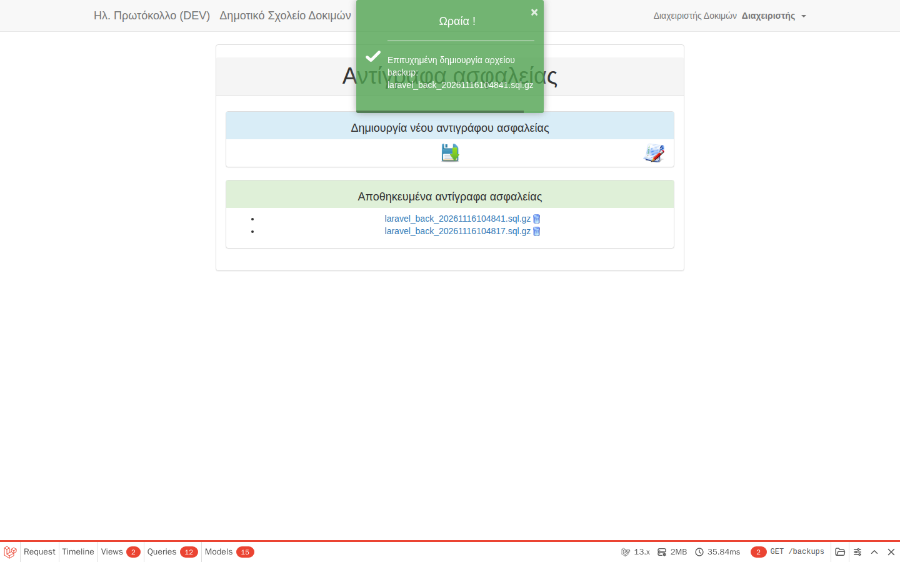

# B10: Ρυθμίσεις → Backup creates empty files and reports success

| | |
|---|---|
| Status | ✅ Fixed in the code; reaches the production server only when it is deployed |
| Branch | `task/B10-backup-fix` |
| Found by | the owner (2026-11-16): the backup files are empty, so the real-data copy was made with phpMyAdmin |

## What was wrong (`ConfigController@backup`)
- `mysqldump … | gzip > file` ran through the shell and only **gzip's** exit code was checked. When mysqldump
  failed, the result was an empty `.gz` and the message "Επιτυχημένη δημιουργία".
- Most likely reason for the failure: no `--no-tablespaces`. Since MySQL 8.0.21, mysqldump then needs the PROCESS
  privilege, which an application user normally doesn't have. Also `--host=localhost` was fixed (the `.env` host and port were ignored).
- The password was put **unquoted** into a shell command (breaks with `$ & " ` or spaces, visible in `ps`), and the
  `mysqldumpPath` setting was run by the shell (an administrator could run any command).
- Wrong file name: `date("YmdHms")` repeats the month where the minutes belong, and the Linux name had a literal `\_`.
- Download/delete took any file name (`Storage::get('arxeio/backups//' . $name)`), the path-traversal issue noted under R6c.
- **Found by the new browser test:** `config/imapFolders.php` began with 6 spaces/newlines before `<?php`. Laravel loads
  every config file on every request, so these 6 bytes were sent **before every page and every download**, and the
  last 6 bytes of each download were cut off (the length header stays the file size). A downloaded backup therefore
  could not be opened even when it was complete. Attachments were affected the same way (PDF readers usually tolerate it).

## Fix
`App\Services\DatabaseBackup`: runs mysqldump **without a shell**, reads the password from a private temporary options file
(mode 0600, deleted afterwards), uses the `.env` host/port/socket, passes `--single-transaction --no-tablespaces
--default-character-set=utf8mb4`, checks the exit code **and** the closing `-- Dump completed` line, and only then compresses
the dump in PHP. On failure the admin sees the reason (first line of mysqldump's message) and no file is left.
Only a program named `mysqldump`/`mariadb-dump` is run; a wrong setting falls back to the one on PATH.
Name: `<db>_back_<YmdHis>.sql.gz`. Download/delete accept only such names (otherwise 404).
The dev image now includes `mysql-client` (mysqldump 8.4).
The stray bytes were removed from `config/imapFolders.php`.

`./dev.sh real load` also accepts a phpMyAdmin `.zip` export (until this fix reaches the server, phpMyAdmin is how
the owner exports the database).

## How verified
- `tests/Feature/BackupTest.php` (7 tests, real mysqldump against the test database): complete compressed dump with
  tables and rows; wrong password → error message, no file; password with shell characters; setting `/bin/sh` or
  `mysqldump; touch …` is not run; Windows path on Linux falls back; download/delete reject `../` names; non-admins
  can't create backups.
- `tests/Unit/PhpFilesNoStrayOutputTest.php`: every PHP file in `app/ config/ routes/ bootstrap/ database/` starts with
  `<?php` and doesn't end in `?>` + whitespace (fails on the old `imapFolders.php`).
- Browser, `e2e/tests/backup.spec.js`: press Backup → success message with the file name → the file is listed →
  the download un-gzips to a dump with `CREATE TABLE \`protocols\`` and `-- Dump completed` → `../backups/dummy` is
  refused (404) → delete removes it from the list.
  
- `tests/shell/dev-sh.test.sh`: `real load` with a `.zip`.
- Full suite: 125 PHPUnit tests, 9 browser tests, dev.sh checks green.

## Owner actions
- Until this is deployed, export the database with **phpMyAdmin** (see `docs/LOCAL-REAL-DATA.md`).
- After deploying: on the server, `which mysqldump` should print a path; press Backup once, download the file and
  check that it opens (e.g. with 7-Zip) and is not tiny.
