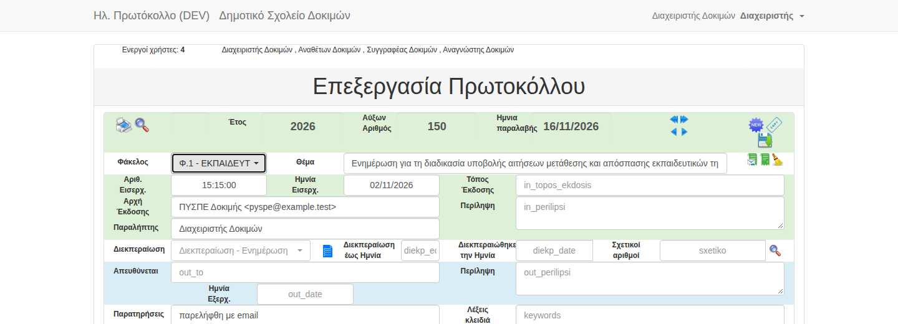

# D01: long subjects, senders and summaries (VARCHAR(255) → TEXT)

| | |
|---|---|
| Status | ✅ Fixed (takes effect on the production server at the final deployment, when `migrate` runs) |
| Branch | `task/D01-long-text-columns` |

## What was wrong
Owner, 2026-11-16: an e-mail whose subject is longer than 255 characters could not be registered; the inbox just
reloaded with the e-mail still there. The columns `thema` (subject), `in_arxi_ekdosis` (sender), `in_perilipsi` and
`out_perilipsi` (summaries) were `VARCHAR(255)`, and MySQL refused anything longer ("Data too long for column
'thema'"). Two more problems on the way:
- the error message shown was the **raw database error**, which contains the whole SQL statement with the e-mail's
  data (and was shown as HTML);
- with *Έλεγχοι καταχώρισης* on, the protocol form refused subjects and senders over 255 characters.

## What changed
- Migration `2026_11_16_000002_protocols_long_text_columns`: the four columns become `TEXT` (65,535 bytes, at least
  16,383 characters). None of them is indexed, so searches work as before. Not reversible automatically (going back
  would cut text); the backup taken before the deployment is the way back.
- `Protocol::LONG_TEXT_MAX = 16000` characters: the form's checks (when on) allow up to that for subject, sender and
  both summaries, with the normal validation message beyond it; e-mail subjects and senders are cut there (only an
  e-mail with a subject of over 16,000 characters would notice).
- Registering an e-mail: when the database refuses the protocol for any other reason, the message now reads
  *"Υπήρξε κάποιο πρόβλημα… Το email δεν καταχωρίστηκε και παραμένει στα εισερχόμενα. Κωδικός σφάλματος: E-XXXXXX"*;
  the code is the one written to the log with the full error (as on the error pages, B04). The SQL is never shown.
- Found by the new browser test in CI and fixed: on the inbox page, the "has attachments" flag that decides whether
  the *Φάκελος* field must be filled was written for the wrong e-mail (a variable left over from an earlier loop), so
  for the last e-mail of a page the save button could silently do nothing (a hidden field failed the check). Each
  e-mail now gets its own flag.
- Unchanged on purpose: the summary taken automatically from the e-mail's text is still its first 250 characters
  (it is a summary; the whole e-mail is attached to the protocol).

## How verified
- `StoreFromEmailTest`: the two `known_bug_*subject_over_255*` tests replaced by
  `test_email_with_subject_over_255_characters_is_registered_in_full` (280-character subject in encoded words) and
  `test_subject_over_255_characters_posted_by_the_inbox_form_is_registered` (the owner's case); new
  `test_long_sender_name_is_registered_in_full` and `test_database_error_shows_a_reference_code_never_the_sql` (no
  `SQLSTATE`, no SQL, no e-mail data; reference code present).
- `ProtocolStoreTest`: `test_long_subject_sender_and_summaries_are_saved_in_full` (2,400+ characters in all four
  fields, checks on and off, also when editing); `test_subject_over_255_characters_is_rejected` (the old limit)
  replaced by `test_subject_over_the_text_limit_is_refused_with_a_message`.
- `AdoptLegacySchemaTest`: a production-shaped backup (VARCHAR columns, no migration records) gets TEXT columns
  after `migrate:adopt-legacy` + `migrate`.
- Run against the old code: without the migration 5 tests fail; with the old controller 2 fail (message, form limit).
- Browser (`e2e/tests/email-registration.spec.js`): the synthetic e-mail *07-long-subject-plain-only* (300-character
  subject) is registered from the inbox, leaves the inbox, and the protocol's subject has all 300 characters:

  

  (The current form shows the subject in a one-line field; the rebuilt protocol screen, R1b, is where to show long
  subjects better.)
- Full suites: PHPUnit 194, browser 21/21.

## Owner actions
1. Optional, after `git pull`: **Real data: load** again (runs `migrate`). Then register an e-mail with a long subject
   in your local copy.
2. Final deployment: nothing extra (`php artisan migrate`, after the backup).
