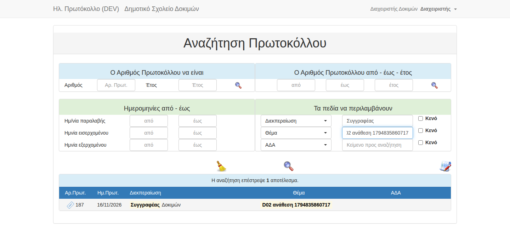
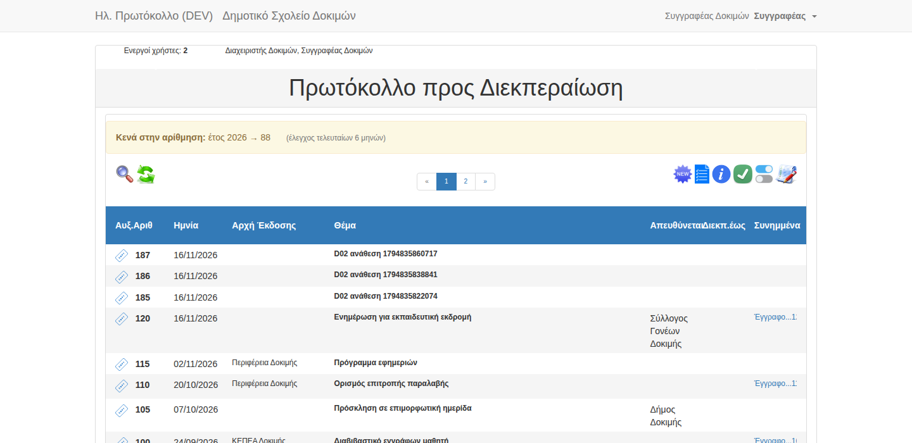

# D02: assignments in their own table

| | |
|---|---|
| Status | ✅ Done (takes effect on the production server at the final deployment, when `migrate` runs) |
| Branch | `task/D02-assignments-table` |

## What was wrong
Who a protocol is assigned to was stored only as text in `protocols.diekperaiosi`, e.g. `d14,e10` (user 14 for
διεκπεραίωση, user 10 for ενημέρωση). Every list, search and access check looked inside that text with
`LIKE '%d14,%'`: about 20 copies of the same query, none of them able to use an index. Two real bugs came from it:
- **Search by assignee missed protocols.** *Αναζήτηση → Διεκπεραίωση = name* compared the whole text with `d14`, so
  a protocol assigned to that user *and* to someone for ενημέρωση (`d14,e10`) was not found.
- **The search results showed no name** for those protocols (the name was looked up from `14,e10`).
- *Κενό* (search for "no assignee") found only protocols where the text was NULL; the form saves an empty text, so
  most unassigned protocols were not found.

## What changed
- New table `protocol_assignments` (protocol, user, type `d`/`e`; one row per user and type; deleted with the
  protocol). The migration fills it from the existing text of every protocol (in chunks; repeats and stray commas or
  spaces are tolerated, junk is ignored). An assignment to a user deleted since is kept, as the text kept it.
- The old form still sends the text, so the column stays for now and every save copies it into the table: on the
  model's save event, and explicitly after the form's edit query (which bypasses model events). The text column goes
  when the protocol screen is rebuilt (R1a).
- Everything that *reads* assignments now uses the table: the lists *προς Διεκπεραίωση / Ενημέρωση / Διεκπεραιώθηκε*
  (own, another user's, all users), the *limitProtocolAccessList* restriction (list, search, "go to number",
  autocomplete), the access rules (`ProtocolPolicy`) and the protocol form's "assigned to me" checks.
- Search by assignee: all users whose name matches (the old code took only the first), type διεκπεραίωση;
  *Κενό* = nobody assigned for διεκπεραίωση. Results show the names of the assigned users.
- Not done on purpose: a "done" date per assignee. The application has one done date per protocol
  (*Διεκπεραιώθηκε την*); a copy of it per row could drift from the original. It will be added when a screen lets each
  assignee mark their own part done.

## How verified
- `AssignmentsTest` (10 tests): parsing of the text variants; create / edit / clear through the model, the protocol
  form (new and edit), the assign button; deleting a protocol; backfill of rows written without the model (as in a
  backup), run twice; search by assignee with an extra "e" user and the name in the results; *Κενό* with empty and
  NULL text; the three list filters for oneself, for another user and for all users; user ids that share digits
  (13 / 131).
- Against the old controller 3 of them fail (search by assignee, empty-assignee search, form edit sync).
- `AdoptLegacySchemaTest`: a production-shaped backup without the table gets it, filled, after
  `migrate:adopt-legacy` + `migrate`.
- Browser (`e2e/tests/assignments.spec.js`): the administrator assigns a new protocol to *Συγγραφέας* (διεκπεραίωση)
  and *Αναγνώστης* (ενημέρωση); the search finds it by the writer's name and shows the name (fails on the old code at
  this step); the writer sees it in *προς Διεκπεραίωση*, the reader in *προς Ενημέρωση* and not in the other list.

  

  
- Full suites: PHPUnit 242, browser 26/26.

## Owner actions
1. Optional, after `git pull`: **Real data: load** again (runs `migrate`, which fills the new table). Then open
   *Λίστα → προς Διεκπεραίωση* for a user and compare with what you expect.
2. Final deployment: nothing extra (`php artisan migrate`, after the backup).
