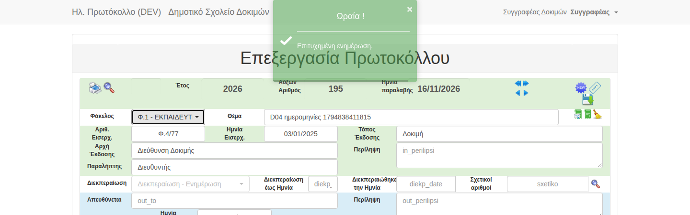
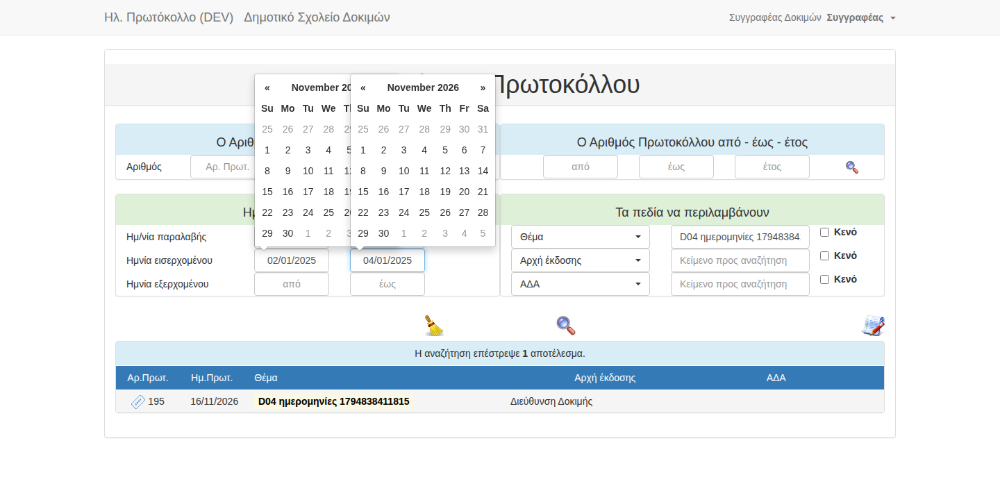

# D04: dates as real DATE columns

| | |
|---|---|
| Status | ✅ Done (takes effect on the production server at the final deployment, when `migrate` runs) |
| Branch | `task/D04-date-columns` |

## What was wrong
All dates were stored as whole numbers: 5 January 2026 was `20260105`. The database could not tell a date from any
other number, so it accepted impossible dates (`20260231`, `0`, a digit missing), and every date calculation had to
be done in PHP. Affected: the registration date, incoming and outgoing date, "to be handled by" and "handled on"
dates of protocols, and the expiry date of attachments.

## What changed
- Migration `2026_11_16_000005_integer_dates_to_date_columns`: the six columns become `DATE`; MySQL converts each
  valid number itself (`20260105` → `2026-01-05`). It checks every value first:
  - a value that is not a real date (e.g. `0`, `20260231`, `2026015`) is **not lost**: it is copied to the new table
    `legacy_invalid_dates` (table, row id, column, old value) and the date is left empty;
  - the registration date is required, so if one of those is not a real date the migration **stops before changing
    anything** and names the protocol ids, so they can be corrected first.
  It can run again safely, and can be reversed (back to numbers).
- The old screens (about 80 places in the code) still work with the numbers: a transitional converter
  (`App\Casts\LegacyYmdDate`) shows them `20260105` and accepts it back. New code reads real dates
  (`$protocol->dateOf('in_date')`). The converter goes when the old screens are removed (Z01).
- Searches that compare dates (search and print date ranges, expired attachments, "same incoming number on the same
  date", the number-gap check) now compare with real dates.
- From now on MySQL refuses an impossible date instead of storing it.

## How verified
- `DateColumnsTest` (8 tests): the columns are `DATE`; numbers, text and dates are stored and read back as the old
  code expects, while new code gets dates; an impossible date is refused; the protocol form saves and shows all four
  dates; list, search by registration date and by incoming date; expired attachments go to the trash and a future
  one stays; "same incoming number" check.
- `DateColumnsMigrationTest` (4 tests, on number columns as in a production backup): valid numbers become the right
  dates; invalid ones are kept in `legacy_invalid_dates` and emptied; an impossible registration date stops the
  migration with nothing changed, and after correcting it the migration runs; running it twice; going back.
- `AdoptLegacySchemaTest`: a production-shaped backup with number columns gets date columns after
  `migrate:adopt-legacy` + `migrate`.
- `tests/shell/dev-sh.test.sh` still passes with the extra summary line in `real load`.
- All earlier tests pass unchanged on the new columns (they still use the numbers the old code uses).
- Browser (`e2e/tests/dates.spec.js`): a writer saves a protocol with incoming date 03/01/2025; the form shows it
  again; the search with incoming dates 02/01/2025–04/01/2025 finds it, 04/01/2025 onwards does not.
- Full suites: PHPUnit 263, browser 27/27.

  

  

## Owner actions
1. After `git pull`: **Real data: load** again (runs `migrate`). If it stops with *"protocol(s) have a registration
   date that is not a real date"*, send me only that message's first line without the ids; we'll decide together
   how to correct them. Otherwise open a few protocols and check their dates look as before, and try a search by
   date range.
2. At the end, *Real data: load* now also prints *Dates that were not real dates (kept in legacy_invalid_dates,
   D04): N*. Send me only that number. If it is not 0, the old values are kept in that table of your local copy.
3. Final deployment: nothing extra (`php artisan migrate`, after the backup). It goes into the deployment guide.
