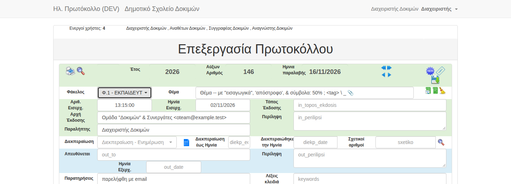

# D05: tables → utf8mb4 (emoji in e-mails and forms)

| | |
|---|---|
| Status | ✅ Fixed (takes effect on the production server at the final deployment, when `migrate` runs) |
| Branch | `task/D05-utf8mb4` |

## What was wrong
The database connection and every table used MySQL's `utf8`, which is really `utf8mb3`: at most 3 bytes per
character. Emoji (📎 😀 🎉) and some symbols (𝔸) need 4 bytes, so MySQL refused them:
- an e-mail with an emoji in its subject or sender's name could not be registered (owner's example);
- an emoji in an attachment name left a protocol **without that attachment** (owner's example);
- an emoji typed in a protocol form (subject, remarks) made saving fail.

## What changed
- `config/database.php`: connection `utf8mb4`, collation `utf8mb4_general_ci`. This collation compares exactly like
  the old `utf8_general_ci` (upper/lower case, accents and final sigma are folded: `συσκεψη` finds `Σύσκεψη`), so
  **searches find the same protocols as before** and unique keys (folder codes, user names) can't suddenly clash.
- Migration `2026_11_16_000001_convert_tables_to_utf8mb4`: converts the database default and **every table that is
  not utf8mb4 yet** (found in `information_schema`, so tables of older installations are included). Stored text is
  unchanged: every utf8mb3 character is also a utf8mb4 character. Two details for old databases:
  - a table in the old `COMPACT`/`REDUNDANT` row format allows index keys of only 767 bytes, less than a utf8mb4
    `VARCHAR(255)` (1020 bytes); such tables get the `DYNAMIC` format (MySQL's default since 5.7);
  - MySQL turns `TEXT` columns into `MEDIUMTEXT` where needed, so they keep their length in characters.
- The migration can't be undone automatically (going back would destroy any emoji stored since); the backup taken
  before the deployment is the way back.

## How verified
- `tests/Feature/Utf8mb4ConversionTest.php` (3):
  - a new installation has only utf8mb4 tables and columns;
  - a database shaped like the production backup (all tables utf8mb3, one in `COMPACT` format, Greek text and
    symbols such as `΄΄ « » € ‰`) is converted, the text is unchanged and an emoji can then be stored;
  - case, accent and final-sigma folding in searches and the unique folder code work as before.
- `StoreFromEmailTest`: `test_known_bug_emoji_in_attachment_name_leaves_a_protocol_without_its_attachment` replaced by
  `test_emoji_in_attachment_name_is_stored_with_the_attachment`; new
  `test_email_with_emoji_in_subject_sender_and_text_is_registered`.
- `ProtocolStoreTest::test_emoji_typed_in_the_form_is_stored_and_found` (also found by a search).
- Run against the old code: 5 of the 6 new tests fail (the sixth checks that searches stay the same, so it passes
  both before and after).
- Browser (`e2e/tests/email-registration.spec.js`): registers the synthetic e-mail *05-special-characters* (subject
  `Θέμα -- με "εισαγωγικά", … _ 📎`) from the inbox; the e-mail leaves the inbox and the protocol shows the 📎:

  
- Full suites: PHPUnit 191, browser 20/20.
- Not run by Claude: the owner's local real-data copy (Claude never touches it). The test above uses the same shape
  (utf8mb3 tables) with invented data.

## Owner actions
1. Optional, after `git pull`: **Real data: load** again. It runs `migrate`, which converts your local copy (a few
   seconds per table). The last line should read `Loaded: …` as before; then register an e-mail with an emoji.
2. Final deployment: nothing extra. The conversion runs with `php artisan migrate`; take the database backup first
   (already in the list).
