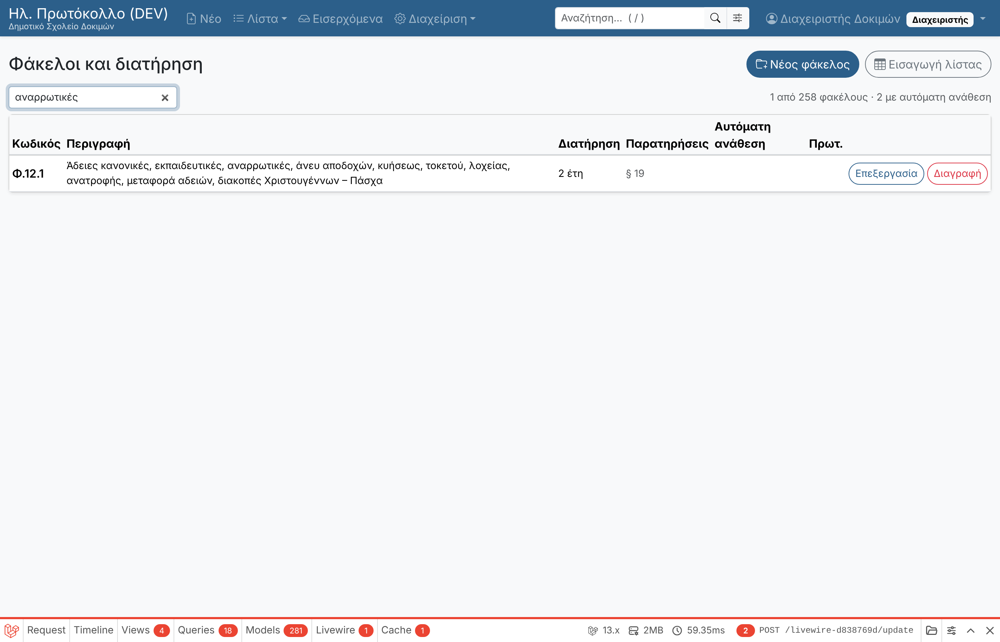
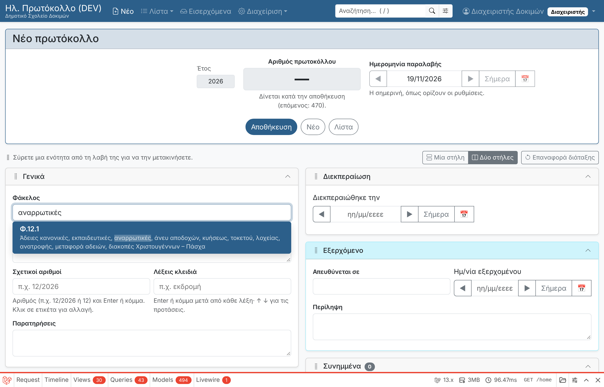

# D07 — Folder glossary: your folder list in the app, Φ.43 merged into Φ.46

| | |
|---|---|
| Status | ✅ Done in the code · 👤 you apply it to your real copy (try-it **38**), then at deployment |
| Branch | `task/D07-folder-glossary` |
| Tests | `FolderGlossaryTest` (8), `FolderAdminTest` (+2); 545 PHPUnit in total (see "Verification") |

## What you asked (2026-11-19)
Your document *Φάκελοι αρχείου* holds every folder with its full description. Older versions could keep only 255
characters, so most descriptions in the app were cut. Store it in the folders table and treat it as the folders
glossary. Your decisions:
- publish the list in the repository;
- move the protocols of Φ.43 to Φ.46, and do it again in the move to the new version;
- keep Φ.13 with «(Καταργήθηκε)»;
- keep heading and text together in one description.

## What changed
| | |
|---|---|
| **The glossary** | `database/data/folders.json` (source) and [docs/FOLDERS.md](../FOLDERS.md) (the same list to read; a test keeps it up to date): 88 folders and 1 merge. Φ.37–Φ.42 (*see table keepvalues*) are not in it, so they stay exactly as they are in your database. |
| **Command** | `php artisan folders:glossary` only **shows** what would change: new, changed and unchanged folders, folders not in the glossary, and the merge with its counts. `--apply` writes it. The import of *Φάκελοι και διατήρηση* (R6b) does the writing, so only the **description** changes; *Διατήρηση*, remarks and automatic assignments stay. Running it again changes nothing. |
| **Merge Φ.43 → Φ.46** | Protocols take Φ.46; their «last changed» time stays (not a user's change). Attachment files in `arxeio/Φ.43/` move to `arxeio/Φ.46/` (trash likewise). A name already taken becomes «name (2).pdf», so nothing is overwritten. Φ.43's automatic assignments join Φ.46's (διεκπεραίωση wins over ενημέρωση), then Φ.43 is removed. Recorded in the glossary's `merges` so the move to the new version repeats it. Sub-folders such as Φ.43.1 are **not** merged: the preview names them so you can tell me what to do. |
| **Scan typos corrected** | «διαδικαδία» → «διαδικασία» (Φ.19.1), «προγράμαμτα» → «προγράμματα» (Φ.22.1), «κλειστά διδάκτρια» → «κλειστά διδακτήρια» (Φ.3.2), «Εκπαίδευτικοί» → «Εκπαιδευτικοί» (Φ.43, now merged). Trailing commas and full stops removed. |

## Two bugs found in the folder import (R6b), fixed
1. **A cell ending in «Π» broke the import.** `trim()` with the non-breaking space works on bytes, and Π is the bytes
   `CE A0`. The import cut off the A0, so «ΑΣΕΠ» was saved as «ΑΣΕ» plus half a letter, and MySQL refused the save
   (error 1366). This affected the glossary too: Φ.26 ends with «ΑΣΕΠ». Cells are now trimmed by characters.
   The test failed before the fix and passes after it.
2. **A folder written as «Φ2.1» in your list was duplicated by an import containing «Φ.2.1».** The pasted code was
   normalised but the code in the list was not. Both are now compared in their normalised form. An existing folder
   also keeps its code exactly as written, because your protocols refer to it.

## Automated review (2 findings, both real, fixed with tests)
1. **Attachments trashed before R4b** still recorded `arxeio/Φ.43/…`, while the file was in `trash/Φ.43/`. The
   merge treated the file as missing and the trash then could not find it. Files in the trash are now found where
   the trash keeps them, moved to `trash/Φ.46/`, and their restore address follows. The test restores one: it comes
   back under Φ.46.
2. **A file that was not found** got the new path. If another attachment's file already had that name in Φ.46, the
   missing attachment would have opened that other document. A file that is not found now keeps its path.

## Verification
- PHPUnit `FolderGlossaryTest` checks:
  - the glossary file: 88 unique, valid codes; Φ.13 «(Καταργήθηκε)»; Φ.6 heading + text; no Φ.37–Φ.42; the merge;
  - `docs/FOLDERS.md` is up to date;
  - the preview changes nothing;
  - `--apply` replaces descriptions longer than 255 characters but keeps retention and remarks, leaves Φ.38 alone, adds a missing folder, and has nothing left to do on a second run;
  - a code written «Φ. 2.1» is updated, not duplicated;
  - the merge, with protocols in «Φ.43» and «φ.43»:
    - moves 2 live files and 2 in the trash (one trashed before R4b, later restored under Φ.46) and renames 1 whose name was taken;
    - leaves 1 file that was not found at its old path;
    - leaves alone a file in a sub-directory and a Φ.43.1 protocol;
    - keeps «last changed», merges the rules and removes the emptied directories;
  - running the merge again does nothing; a target that doesn't exist is refused; `--apply` adds Φ.46 first when it is missing.
- `FolderAdminTest`: «ΑΣΕΠ» / «ΠΥΣΠ» at the end of a cell, and «Φ714.1» updated by «Φ.714.1».
- The whole suite: 545 tests. The only 3 failures are `BackupTest`, because this sandbox's old app image has no
  `mysqldump`. CI builds the current image. Browser tests: 81 passed. The 3 failures (backup, print → Excel,
  native file drag) fail the same way on `master` in this sandbox.
- In the running demo, after `folders:glossary --apply`, searching «αναρρωτικές» finds Φ.12.1 with its full
  description. The demo's retention «2 έτη» and remark «§ 19» are kept. The demo data was reset afterwards; the
  browser tests use the demo's own folders.

## Your actions
1. Try-it **38** in [OWNER-TODO](../../OWNER-TODO.md): on your real copy, preview, then `--apply`. Send me the
   *Folders:* and *Merge* lines, and any *Sub-folders of Φ.43* line.
2. If you have sub-folders Φ.43.1, Φ.43.2 …, tell me where they go: Φ.46 itself, new Φ.46.x, or keep them.
3. At deployment: `php artisan folders:glossary --apply` (added to the deployment steps).
