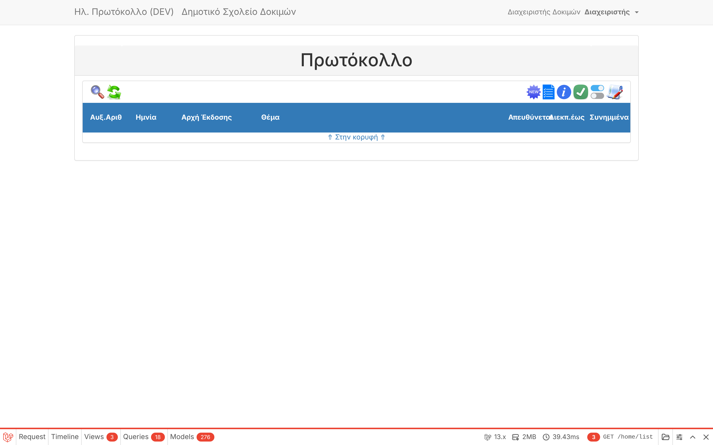
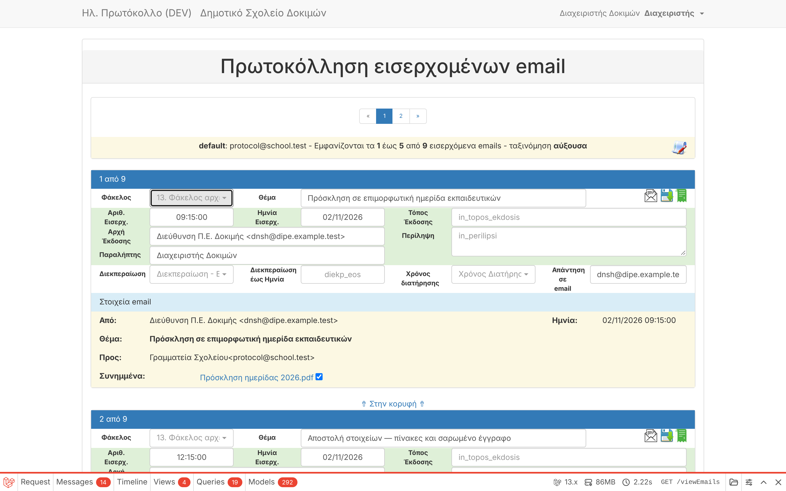

# F03 — Local Docker development stack

| | |
|---|---|
| Status | ✅ Done |
| Branch / PR | `task/F03-docker` |
| Verified on | Docker 29.9, image `electronic-protocol-app` (Ubuntu 26.04, PHP 8.5.4), MySQL 8.4, GreenMail 2.1.3, Mailpit |

## What was done

1. **Dockerfile rewritten.** The previous one (`php:8.4-fpm` + `docker-php-ext-install imap`) cannot build:
   `ext-imap` was removed from PHP core in 8.4. New image: Ubuntu 26.04 LTS + distribution PHP 8.5
   (PHP version is a build argument), all required extensions, Composer, PHP-FPM on port 9000.
   `ext-imap` is intentionally not installed (unmaintained c-client library).
2. **docker-compose.yml** (production-like): MySQL **8.4 LTS** (8.0 reached end of life in April 2026)
   with health check, nginx stable, app waits for a healthy DB.
3. **docker-compose.dev.yml** (development extras): GreenMail mock IMAP/SMTP mailbox, Mailpit for
   outgoing mail, MySQL port for DB clients, separate `testing` database for the test suite.
   The app reads `.env.development`; the owner's `.env` is never touched.
4. **`./dev.sh`** one-command helper: `up`, `down`, `test`, `mail`, `reset`, `artisan`, `shell`, `logs`.
5. **Synthetic test emails** (`docker/dev/make-emails.php` → `tests/fixtures/emails/synthetic/`):
   8 invented emails covering UTF-8, ISO-8859-7, Windows-1253, Outlook-style attachment names,
   multiple attachments, special characters (`--`, quotes, `%`, emoji), forwarded message,
   >255-character subject, raw 8-bit headers, plus a 12 MB attachment generated only for the mock server.
   Private emails can be placed in git-ignored `local-data/emails/`.
6. **Demo data** `DevSeeder`: users `admin`, `anathetis`, `writer`, `reader` (password `password`),
   email module pointed at the mock mailbox. Refuses to run in production.
7. **MySQL config:** server charset `utf8mb4`; **general query log switched off** (it was on: it logs every
   query including data and slows the server); slow-query log on (> 1 s) for task B07.
8. **Seeders fixed:** `database/seeds` → `database/seeders` with namespace. Before this, `db:seed`
   (and therefore `docker-install.sh`) could not find `DatabaseSeeder` on Laravel 13.
9. **Install scripts:** `docker-install.sh/.bat` use `migrate --seed` instead of `migrate:refresh --seed`
   (the old command **wipes the database** if the script is run again). SQLite compose file removed (MySQL only).
10. **PHPUnit config** updated to PHPUnit 11 format, tests run on MySQL (`.env.testing`, no real secrets).
11. **PHP 8.5 deprecation** fixed in `config/database.php` (`PDO::MYSQL_ATTR_SSL_CA`).

### Pulled forward from B02: email header decoding without ext-imap
While verifying the mailbox, subjects showed as raw `=?UTF-8?B?...?=`. Cause: `webklex/php-imap`
falls back to returning the encoded text unchanged when `ext-imap` is missing. Added
`App\Support\Imap\HeaderDecoder` (configured in `config/imap.php`) that decodes RFC 2047 in any
charset, handles folded headers and raw 8-bit headers, and never substitutes `?`.
This is likely related to the owner's **"??" symptom**: `imap_utf8()`/c-client turns bytes it can't
interpret into `?`, and a Greek letter is 2 bytes in UTF-8 → `??`. The rest of B02 (form fields) stays in R5a.

## How it was verified

| Check | Result |
|---|---|
| Image builds, PHP 8.5.4 with pdo_mysql, gd, zip, intl, mbstring, bz2 | ✅ |
| `docker compose ... up` — all 5 containers running, DB healthy | ✅ |
| Migrations + seeders on MySQL 8.4 | ✅ |
| Mock mailbox serves 9 emails (IMAP `EXAMINE INBOX` → `9 EXISTS`) | ✅ |
| Login as `admin` → protocol list | ✅ screenshot 01 |
| Inbox page shows Greek subjects, senders, attachment names correctly | ✅ screenshot 02 |
| `./dev.sh test` — 11 tests, 49 assertions (decoder tests on all fixtures + existing example test) | ✅ |

## Findings for later tasks
- **B07 (timeouts):** the app calls GitHub on page load to check for updates (`chkForUpdates`); on a server
  without internet this waits for a network timeout. The IMAP inbox fetch on page load also took ~2 s for 9 emails.
- **R5a:** `webklex` splits sender names on spaces and decodes word by word, inserting stray spaces
  ("Δοκιμή ς") when a name is split across encoded words. The inbox page is unaffected (it uses its own parser) but
  stored data may be.
- **Data (new):** existing tables use `utf8` (3-byte) charset — emoji and some symbols can't be stored and cause
  errors. A conversion to `utf8mb4` should be added to the data-model phase (proposed **D05**).
- **N01:** `league/flysystem` and `league/flysystem-local` both ship the same classes (ambiguous autoload warning).
- `public/tmp` must be writable by the web server (added to install scripts).

## Owner action
None required. To try it: `./dev.sh up` (see `docs/DEVELOPMENT.md`).
