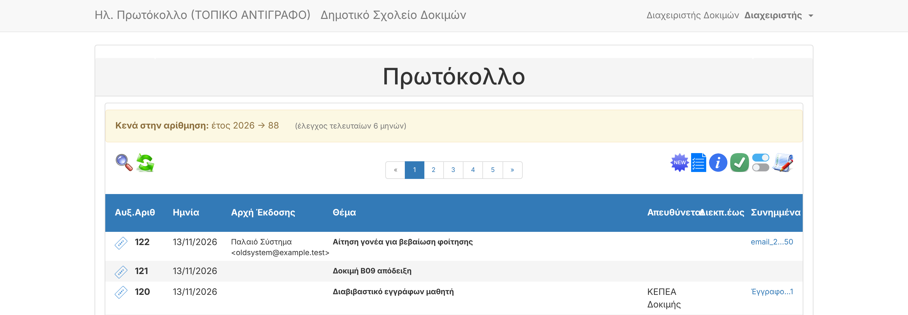

# F04 — Local copy with real data (loader)

| | |
|---|---|
| Status | ✅ Done — tested with a fake "production" backup; **you run it with the real one** |
| Branch | `task/F04-real-data` |
| Guide | [docs/LOCAL-REAL-DATA.md](../LOCAL-REAL-DATA.md) |

## What it does
`./dev.sh real load` imports a production backup into a **separate local stack** at http://localhost:8081:

- own Compose project `electronic-protocol-real`, containers `ep-real-*`, database `protocol_real` in its
  own volume: the demo stack (8080) and any normal installation are untouched;
- accepts `.sql` or `.sql.gz` (the app's own backup format), also dumps made with `--databases`;
- applies the database changes made since the backup (`migrate`), keeping all data;
- uses the attachments directly from `local-data/storage/app` (mounted with `:z` for Fedora/SELinux) —
  they are never copied into the project folder;
- prints **counts only** (no data), including how many attachment files were found.

## Safety
| Risk | Prevention |
|---|---|
| Copy e-mails real people (receipts, notices) | all mail goes to Mailpit (http://localhost:8026) |
| Copy connects to the real mailbox | mailbox setting forced to the local test mailbox on load; IMAP settings point to the mock server |
| Real files committed to the public repo | `local-data/`, `.env.real` ignored; **new CI check** fails a PR that tracks stored files or local data |

### Found and fixed while building this
`storage/app/.gitignore` did not ignore anything the app stores (attachments, trash, backups). In this
sandbox, **464 invented demo PDFs** had been committed to `master` by an earlier PR. They contain nothing
real, but on any machine holding real attachments, a `git add -A` would have staged them for a public push.
Now: `storage/app/*` is ignored, the demo PDFs are removed from git (not from disk), and the CI check above
guards it.

## Evidence (with a fake "production" backup made from the demo database by `mysqldump --databases`, gzipped)
```
$ ./dev.sh real load
Importing fake-production-backup.sql.gz into database 'protocol_real' (replaces its current content)...
INFO  Nothing to migrate.
Loaded: 120 protocols, 4 users, 59 attachments (58 files found in local-data/storage/app)
```
(58/59: the copy was made before one attachment's file existed — the check reports it correctly.)

| Check | Result |
|---|---|
| Login on http://localhost:8081 with the backup's own users | ✅ title "Ηλ. Πρωτόκολλο (ΤΟΠΙΚΟ ΑΝΤΙΓΡΑΦΟ)" |
| Attachment download served from `local-data/storage/app` | ✅ 200 `application/pdf` |
| Mailbox setting after load | ✅ `default` (local test mailbox), 1 e-mail from `local-data/emails/` shown |
| Demo stack still running unchanged on 8080 | ✅ both stacks side by side |
| CI data-hygiene check on this branch | ✅ no stored files tracked |



## Owner action
When you set up VS Code (next task, L01), follow [LOCAL-REAL-DATA.md](../LOCAL-REAL-DATA.md) steps 1–3.

## Review follow-up
| Finding | Fix | Verified |
|---|---|---|
| CI data-hygiene check caught a test e-mail (`storage/app/arxeio/emails/122-…eml`, synthetic) committed by B09 | removed from git | CI check green |
| Codex: a failed import was hidden (`|| true`) and the load continued on a partial database | import failure now stops the load with exit 1 and a clear message | truncated `.sql.gz` → `IMPORT FAILED …`, exit 1; good backup still loads |
| Codex: on a fresh clone `real load` ran artisan before PHP packages were installed | `real up` installs them first (as your user) | same command as the demo stack's `up` |
