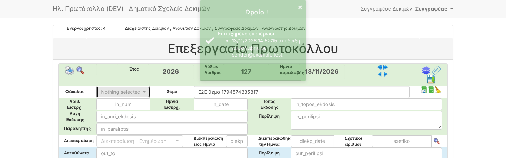

# F05 — Browser (end-to-end) tests and evidence tooling

| | |
|---|---|
| Status | ✅ Done |
| Branch | `task/F05-e2e` |

## What was added
- `e2e/` — Playwright suite (`@playwright/test` 1.63.0, pinned) that drives a real Chromium against the running
  dev stack. Shared helpers: `login(page, role)`, `toasts(page)`, `evidence(page, name)`.
- `./dev.sh e2e [args]` — runs it; uses Node on the host if present, otherwise the official Playwright container
  (nothing to install on your computer).
- `EVIDENCE=<TASK-ID> ./dev.sh e2e` — the same tests also save screenshots into `docs/reports/img/<TASK-ID>/`
  for that task's report. Replaces the one-off scripts used in Batch 1.
- **New CI job "Browser tests (full Docker stack)"**: on every PR GitHub builds the whole stack with
  `./dev.sh up` (image, Composer, MySQL, demo data, mock mailbox) and runs the suite; on failure it uploads the
  HTML report, traces and the Laravel log.
- `CLAUDE.md` workflow step 3 now says: user-visible changes get an e2e spec.

## First suite (`@smoke`, 7 tests)
| Test | Checks |
|---|---|
| admin / anathetis / writer / reader | login, protocol list with demo data, search page; settings only for admin |
| writer creates a protocol with receipt e-mail | real form submit, redirect to the saved protocol, receipt confirmation (B09) |
| missing-number reminder | banner lists gap 88 (A02) |
| inbox | mock mailbox shown with decoded Greek subjects, no raw `=?UTF-8?` (F03 decoder) |

## Evidence
```
$ ./dev.sh e2e      → 7 passed (12.2s)   (run twice in a row: stable)
$ EVIDENCE=F05 ./dev.sh e2e → screenshot docs/reports/img/F05/e2e-protocol-saved.png
```


The CI run of this PR is the first full-stack run on GitHub — see the "Browser tests" job.
