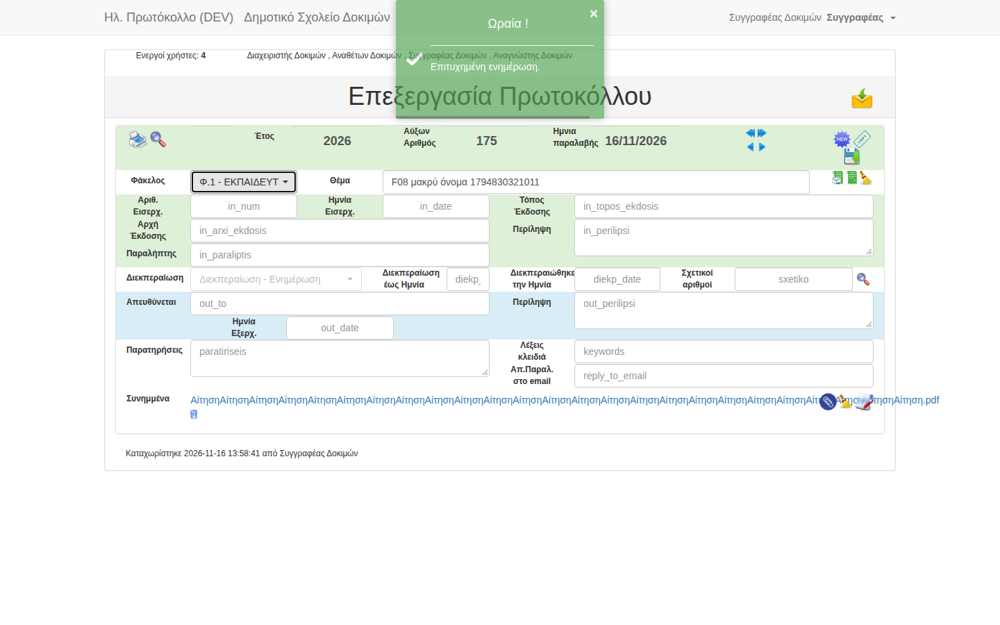

# F08: attachment file names fit Linux's 255 bytes

| | |
|---|---|
| Status | ✅ Fixed for new attachments; existing files: check before moving them (owner action) |
| Branch | `task/F08-attachment-name-bytes` |

## What was wrong
Stored attachment files are named `<number>-<date>_[<part>_]<name>`. Names were cut at 120 **characters**, but Linux
(the Docker production stack, also Docker Desktop on WSL 2) allows 255 **bytes** per file name, and a Greek letter
takes 2 bytes (an emoji 4). A long Greek name therefore did not fit: the attachment was recorded without its file
and registration said "success" (since R5a: the whole registration was refused). Found with the owner's e-mails.
Also: a name made only of illegal characters lost its extension (`???.pdf` → `pdf`), and an attachment without a name
got an empty one. Windows (NTFS) allows 255 *characters*, so files already on the old server can have names that
Linux refuses when they are copied.

## What changed
- `App\Support\FileNames`, used for uploads in the protocol form (new and edit) and for e-mail attachments:
  - `fit()`: the stored name is cut **by bytes on a character boundary** to ≤ 255 bytes (and ≤ 200 characters, since
    `savedPath` also holds `arxeio/<folder>/` in a 255-character column), **keeping the extension**. The name shown in
    the app (`attachments.name`) stays whole.
  - `clean()`: the same character filter as before (one place now); a name without usable characters becomes
    `συνημμένο.<its extension>`, a missing name `συνημμένο.<extension of its type>` (e.g. `.pdf`).
- `tools/check-attachment-names.php`: counts existing files whose names are over 255 bytes. Standalone, runs with the
  old server's PHP 8.1 on Windows; prints counts only (file names only with `--list`, keep that list to yourself).
  `./dev.sh real check-names` runs it on the local real-data copy.

## How verified
- `tests/Unit/FileNamesTest.php` (11): short names unchanged; 7 kinds of long names (Greek with/without spaces,
  emoji, mixed, ASCII, no extension, very long "extension") fit in bytes and characters, keep the extension, never cut
  a character; unsafe characters replaced as before (`../`, `/`, `\`, `:`); names without usable characters.
- `StoreFromEmailTest`: the two F08 `known_bug_*` tests replaced by
  `test_long_greek_attachment_name_is_registered_with_a_shortened_file_name` and
  `test_attachment_names_without_usable_characters` (`συνημμένο.pdf`).
- `ProtocolStoreTest::test_uploaded_file_with_a_long_greek_name_is_stored` (form upload).
- Against the previous code: these 3 tests fail.
- `tests/Unit/CheckAttachmentNamesScriptTest.php` (3): counts by bytes, lists names only on request, exit codes; the
  script also passes `php -l` on PHP 8.1. `tests/shell/dev-sh.test.sh`: `real check-names` runs it.
- Browser (`e2e/tests/attachment-names.spec.js`): a file named `Αίτηση`×25`.pdf` (304 bytes with the prefix) is
  uploaded through the protocol form, listed with its whole name and downloads:

  

  (The very long name overflows the old screen's layout; the rebuilt protocol screen, R1b, will wrap it.)
- Full suites: PHPUnit 230, browser 25/25.

## Owner actions
1. **Before the final deployment** (when copying the attachment files from the Windows server), on the server:
   `php tools\check-attachment-names.php C:\…\storage\app\arxeio` (PHP from XAMPP, after `git pull` of this file or
   copying it). Send me only the three numbers it prints. If "Names over 255 bytes" is not 0, I'll add a step to the
   deployment guide that shortens those files and updates their database rows.
2. Or, on your Fedora copy: `./dev.sh real check-names` (counts only).
