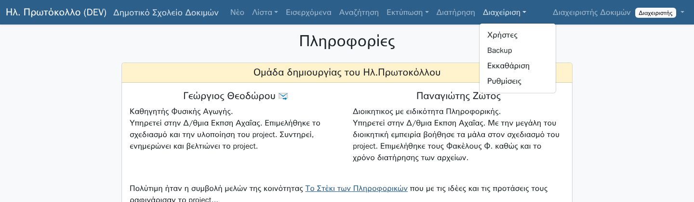
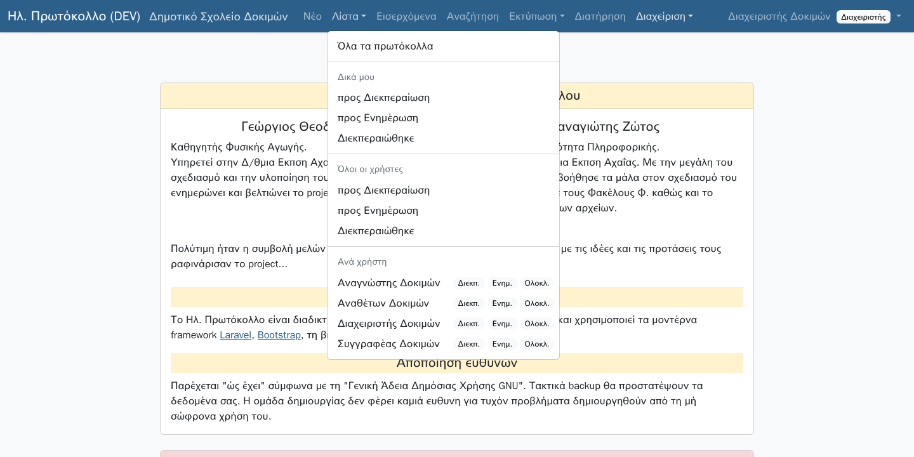
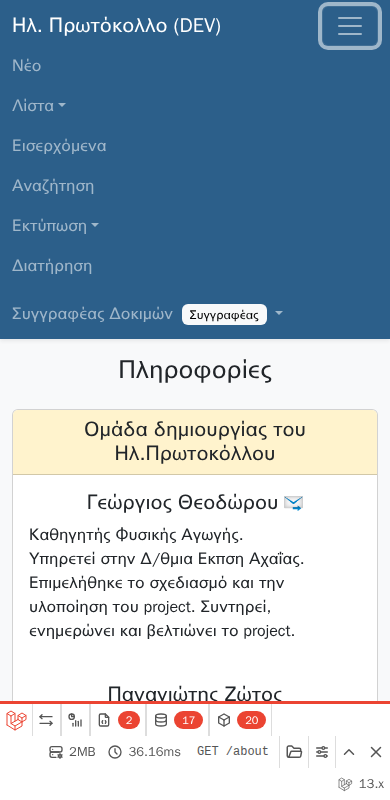

# N03: Vite + Bootstrap 5 + Livewire, layout with navigation at the top

| | |
|---|---|
| Status | ✅ Done. Visible change: only the *Περί…* page uses the new layout; all other pages are unchanged until their module is rebuilt |
| Branch | `task/N03-frontend-toolchain` |

## What changed
**Toolchain.** Vite 7 + `laravel-vite-plugin`, Bootstrap 5.3, Sass; Livewire 4.4 (includes Alpine). Node 22 comes from
Ubuntu's own packages **inside the app image**, so neither your PC nor the Windows server needs Node:
- the production image builds the frontend while it is built (`npm ci && npm run build`, then `node_modules` is removed);
- the dev stack mounts the source, so `./dev.sh up` (and *Real data: start / load*) builds it in the container as your
  user (~5 s); `./dev.sh assets` rebuilds on demand. Output `public/build/` is git-ignored.
- The old Laravel Mix / gulp configs were removed (they could not run any more). The old pages keep using their prebuilt
  files in `public/css`, `public/js`; their sources (`resources/js`, `resources/sass`) go with the old frontend in Z01.

**Layout `layouts/modern`** (`resources/views/layouts/modern.blade.php`): Bootstrap 5 top bar with the institution name
and colour from Ρυθμίσεις, the menu, the user menu (Περί…, Έξοδος as a POST form), a slot for the global search
(`@section('search')`, filled by R3c), notifications as alerts, and Livewire's scripts.

**Menu as data** (`App\Support\Navigation`): the same items and role rules as the old menu, now testable per role:
Νέο · Λίστα (own lists; for admin/Αναθέτων also all users and per user) · Εισερχόμενα (not readers; account set and
user allowed) · Αναζήτηση · Εκτύπωση (hidden when the list is limited for writers/readers) · Διατήρηση · Διαχείριση (admin).
- The inbox rule now lives in `App\Support\InboxAccess`, used by both the menu and the `/viewEmails` middleware.
- Fixed on the way (new menu only): the old menu's "προς Ενημέρωση" of all users linked to the *Διεκπεραίωση* list.
- "Ενημερώθηκε" is gone (its update check was removed in B07).

**Safer than the old layout:** the top-bar colour setting is used only if it is a colour (the old layout pasted it into
the page unchecked); notification messages are escaped and only bare `  <strong> <b> <i> <em> <ul> <li>` are kept.
The about page's PayPal tracking pixel was dropped (the donate button stays); otherwise its text is unchanged.

## How verified
- `tests/Feature/ModernLayoutTest.php` (8 tests): page uses the new layout and the logout form has the CSRF token; menu
  items per role (admin, Αναθέτων, writer, reader); inbox link vs account / allowed-users setting (same rule as the
  middleware); print hidden when the list is limited; all-users and per-user lists (correct `/e` link); colour setting
  injection (`red;}</style><script>…`) ignored; notification with `onclick`/`<script>` neutralised; a Livewire component
  works (`Livewire::test`) and renders inside the layout.
- Browser (`e2e/tests/modern-layout.spec.js`, 3 tests): Vite CSS/JS load (no failed `/build/` request, Bootstrap styles
  applied), dropdowns open, reader's shorter menu, logout from the user menu, narrow screen (390 px): menu behind the
  button and nothing wider than the screen.
  Full browser suite 12/12; PHPUnit 145 tests; `dev.sh` checks; `composer audit` and `npm audit`: no advisories.

| Admin menu | Λίστα (admin) | Phone width |
|---|---|---|
|  |  |  |

## Owner actions
None. After your next `git pull`, *Demo: start* / *Real data: start* build the new frontend by themselves (first time
also rebuilds the app image, a few minutes).
