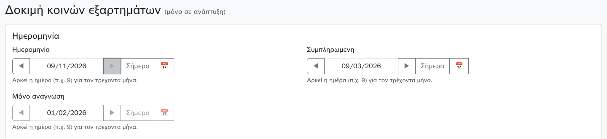
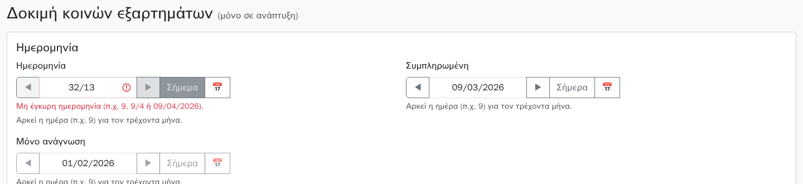
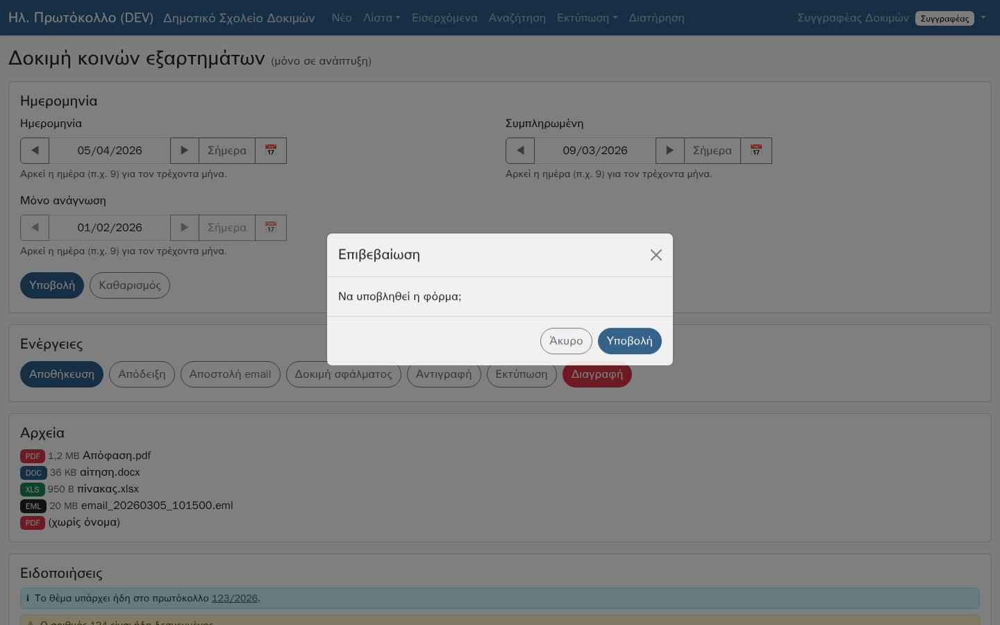
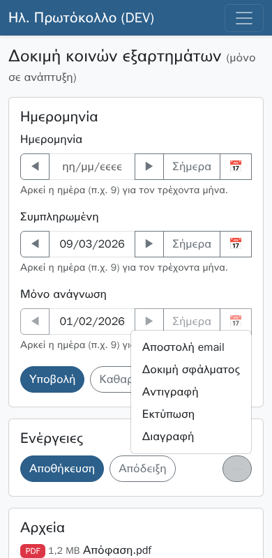
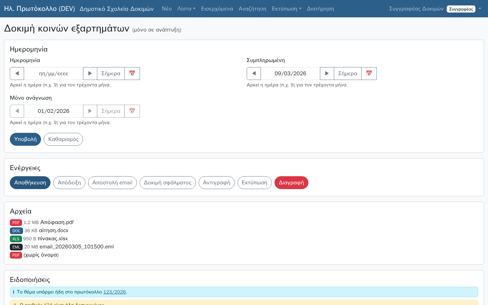
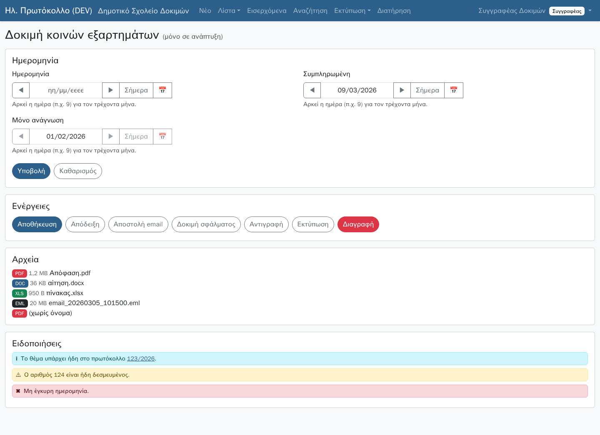

# N04: shared UI components

| | |
|---|---|
| Status | ✅ Done. Nothing changes for users yet: the components are used by the rebuilt screens (R1b onwards) |
| Branch | `task/N04-ui-components` |

## What's there
Blade components for pages on `layouts/modern` (N03), with plain JavaScript (event delegation: works on any page,
with or without Livewire, also on content Livewire adds later).

| Component | Use | Behaviour |
|---|---|---|
| `<x-date-input name label value>` | every date field | Type `9` → `09/<this month>/<this year>`; also `9/4`, `9/4/25`, `9.4.2025`, `0904`, `09042025`. ◀ ▶ (and ↑ ↓) one day earlier/later, *Σήμερα*, 📅 calendar (the browser's own). An impossible date (32/13, 29/2/2025) is marked with a message instead of being changed silently. Read-only: buttons disabled. Shows the server's validation error for its field. Posts `dd/mm/yyyy` |
| `<x-pill-actions>` + `<x-pill>` | action buttons | Pills in one row. On a narrow screen the ones that don't fit go to a **⋯** menu; choosing one there runs the original button/link (forms, confirms, Livewire actions all still work) |
| `<x-file-badge name size mime>` | attachments, e-mail parts | PDF/DOC/XLS/PPT/IMG/ZIP/EML/HTML/DAT label + size as Windows shows it, Greek comma (`1,2 MB`); works for nameless attachments by MIME type |
| `<x-notice type>` | inline, non-blocking messages (replaces the YES/NO dialogs in R1b) | info / warning / error / success; content escaped |
| toasts | short confirmations | `appToast(message, type)` in JS, `session('toast')` from the server, `$this->dispatch('toast', …)` from Livewire; always text, never HTML |
| confirm dialog | delete and other irreversible actions | `data-confirm="Ερώτηση;"` (and optional `data-confirm-yes="Διαγραφή"`) on any button, link or form: a proper dialog instead of the browser's `confirm()`; *Άκυρο* does nothing |

**One set of date rules, two implementations, one list of cases.** `App\Support\DateInput` (PHP, for the server)
and `resources/modern/date-input.js` (browser) are both checked against the same 27 cases (22 typed inputs, 5 previous/next) in
`tests/fixtures/date-input-cases.json` (PHPUnit and Playwright), so the field and the server can't drift apart.

`/dev/ui` shows all components on one page for trying them and for the browser tests. It exists only in the
development and test environments (checked: `route:list` in production has no such route).

## How verified
- `tests/Unit/UiHelpersTest.php` (29): all date cases + previous/next across month and year ends; file kinds; sizes.
- `tests/Feature/SharedComponentsTest.php` (8): markup of each component (Livewire `wire:` attributes go on the input
  only, read-only disables the buttons, validation error shown, links vs buttons, escaped notice content, session
  toast passed as text), `/dev/ui` needs login and is absent in production.
- Browser `e2e/tests/components.spec.js` (6): the browser applies the same date cases as the server; typing `9`,
  ◀ ▶ ↑, *Σήμερα*, invalid date marked; confirm dialog cancel / confirm for a form (the date reaches the server as
  `05/04/2026`) and for a link; toasts show HTML as text; pills in one row, ⋯ menu at 390 px whose items still work
  (Διαγραφή still asks first), no horizontal scrolling; badges and notices.
- Full suites: PHPUnit 182, browser 18/18.

| Date typed as `9` | Invalid date | Confirm dialog |
|---|---|---|
|  |  |  |

| Narrow screen: ⋯ menu | Toasts | Files and notices |
|---|---|---|
|  |  |  |

## Owner actions
None. To try the components: *Demo: start*, log in, open http://localhost:8080/dev/ui
