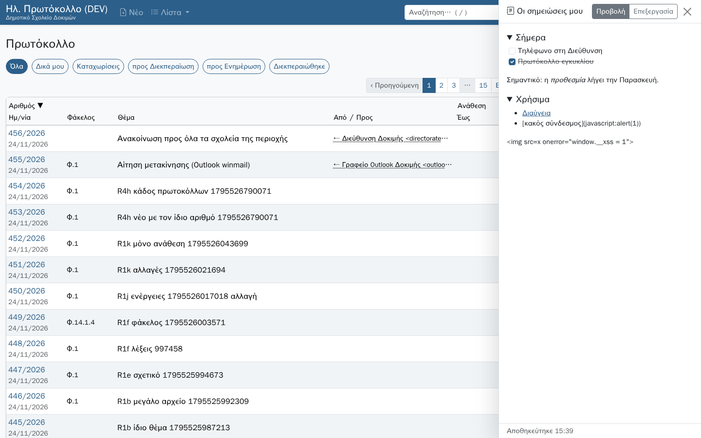
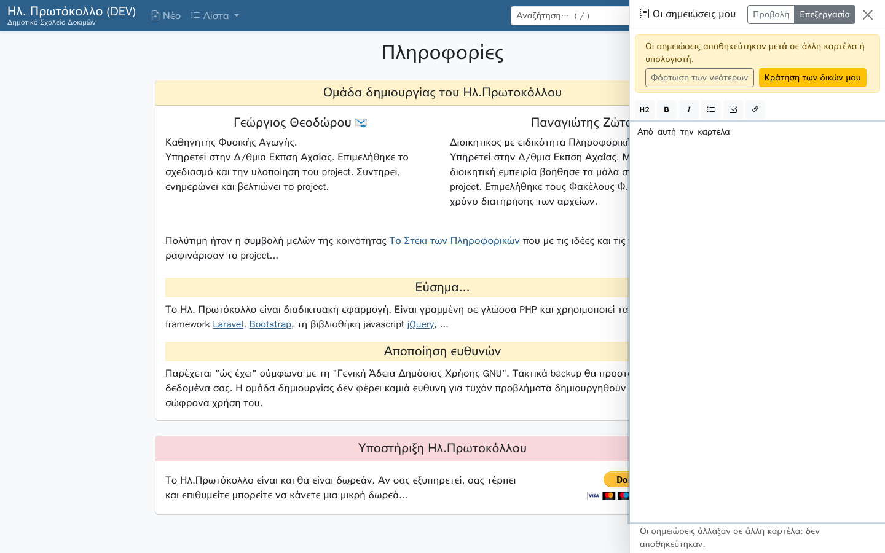

# N05: a notepad for each user

| | |
|---|---|
| Status | ✅ Done |
| Branch | `task/N05-notepad` |

## What was asked (owner, 2026-11-23)
A personal notepad on every page: to keep things to do and short notes, with sections, to-dos and a little
formatting, saved by itself, private to each user.

## What changed
- **A tab «Σημειώσεις»** on the right edge of every page (every role). It opens a side panel; open / closed is
  remembered in this browser; *Escape* or × closes it.
- **One note per user** (new table `user_notes`), **private**: only its owner reads or changes it (administrators
  too: nobody sees another's note).
- **Προβολή / Επεξεργασία.** In *Επεξεργασία*, plain text with a small toolbar (section, bold, italic, list, to-do,
  link). In *Προβολή*, it is shown formatted:
  - `# Τίτλος` (or `##`, `###`) starts a **section that folds** with a click (remembered in this browser);
  - `- [ ] κάτι` is a **to-do**: ticked with a click (and saved), shown crossed out when done;
  - `**έντονα**`, `*πλάγια*`, `` `κώδικας` ``, lists with `-` or `1.`, links `[κείμενο](https://…)`.
- **Safety:** the text is escaped before any formatting, so nothing written in it can run (`` shows as
  text); only `http`, `https` and `mailto` links are made (a `javascript:` link stays plain text); links open in a new
  tab without access to the application.
- **Saves itself** about a second after typing stops, with *Αποθηκεύτηκε HH:MM* (also when leaving the page with a
  change pending).
- **Two tabs:** every save says which copy it started from. A tab with an older copy is not allowed to overwrite a
  newer one: it says *Οι σημειώσεις αποθηκεύτηκαν μετά σε άλλη καρτέλα ή υπολογιστή* and offers *Φόρτωση των
  νεότερων* or *Κράτηση των δικών μου*. Coming back to a tab with no unsaved changes loads the newer copy by itself.
- Up to 100,000 characters.

## How verified
- PHPUnit `NotepadTest` (5): read and save (versions, time, emptied), private (another user's note never read or
  written, a `user_id` sent is ignored, guests to login), an older copy refused with the newer one (409) and kept only
  when the user chooses, wrong saves refused (too long, no version, not text), the tab on every page and not on the
  login page. Route snapshot: both addresses need login; saves are rate-limited. Full suite: 649 tests, green.
- Browser (`notepad.spec.js`): closed by default; sections, bold, italic, the https link with `rel=noopener`, the
  `javascript:` link and the `` as plain text (and nothing ran); autosave; a to-do ticked with a click is
  saved into the text; a folded section stays folded on the next page, where the panel is still open; a second tab
  saves, the first is told and keeps its own.

## Owner actions
None. To try it: step 72 in [OWNER-TODO.md](../../OWNER-TODO.md).
