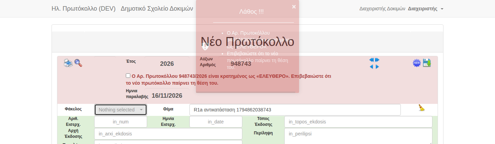
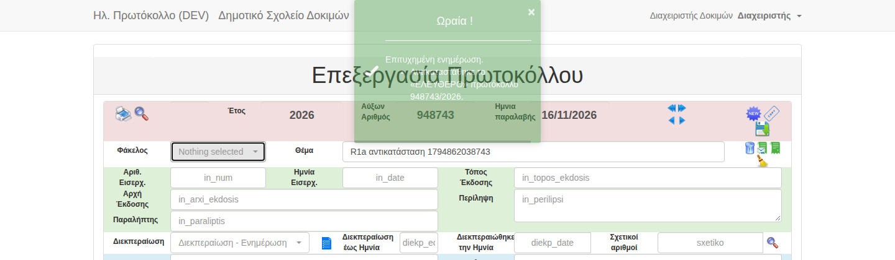
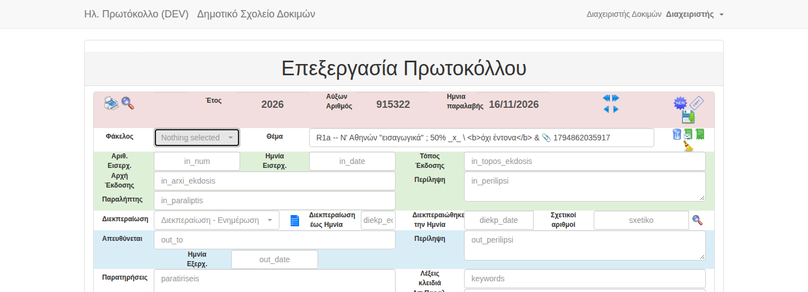

# R1a: one service saves every protocol

| | |
|---|---|
| Status | ✅ Done (takes effect on the production server at the final deployment, when `migrate` runs) |
| Branch | `task/R1a-protocol-service` |

## What was wrong
Saving a protocol was two long controller methods (`store`, `update`) that trusted whatever the browser posted. The
rules about who may change what lived only in the form, as read-only fields. Problems found:

- **A writer who saved a protocol emptied its assignments.** The assignment list is disabled for writers, so the
  browser does not send it, and the save wrote "nobody" (checked against the old code with a test).
- **Read-only fields were only read-only in the browser.** Number, year, date, the parts locked by the time limit,
  and the deadline (*Διεκπεραίωση έως*) were stored as posted.
- **Search results printed stored text and the search word unescaped.** A subject containing `<script>` would run in
  the browser of anyone whose search found it.
- **Autocomplete suggestions were pasted into a script between quotes.** A value with `'` (e.g. *Ν' Αθηνών*) broke
  the click, and a crafted value could run script.
- **Impossible dates were accepted.** `31/02/2026` was stored as 3 March.
- **A file that failed to save** still got an attachment row with an empty path, and the save reported success.
- **The stamp files (`arPr.png`, `toStamp.pdf`, `stamped.pdf`) were written to the web root under fixed names.**
  Two users saving at the same moment overwrote each other's files, and the stamp image could be downloaded.
- The folder name became part of the file path without a check (`../`).

I could not find the `--` failure the owner mentioned in the old code: `--` and the other test characters
(`' " ; % _ \ < > &`, Greek, emoji) were stored correctly. The new tests check every text field with them, and the
fixes above cover the places where such text was shown wrongly. If it happens again, please send the steps (see
OWNER-TODO).

## What changed
- `App\Services\Protocols\ProtocolWriter` saves new and existing protocols, for the old form now and the new form
  (R1b) next. Steps:
  1. clean every text (`App\Support\TextInput`);
  2. apply who may change what;
  3. validate;
  4. take the number;
  5. save the protocol and its assignments;
  6. store the attachments;
  7. send the e-mails.
  Errors the user can fix come back as messages on the field. Nothing typed is lost.
- **Input cleaning** removes only invisible or broken characters: control characters, byte-order mark, zero-width
  spaces from copy-paste, invalid UTF-8, spaces at both ends. It also joins a letter typed as letter + accent into one
  letter, so searches find it. Everything else is stored exactly as typed.
- **Who may change what** (`ProtocolAccess`): the old form's rules, moved into one place and now applied by the
  server too. Locked parts keep their stored value. Only administrators and assigners change assignments and the
  deadline. One rule differs from the old form: with *Δυνατότητα Επεξεργασίας = ΚΑΝΕΙΣ* and no time limit, the form
  used to open everything for writers while the server refused the save (S02). Now both refuse.
- **Protocol date:** set only by administrators with *Έλεγχοι καταχώρισης* OFF, as the number is, or by
  writers/assigners when the new setting *Ο Συγγραφέας μπορεί να αλλάξει την ημερομηνία πρωτοκόλλου* (Ρυθμίσεις) is
  ΝΑΙ. Otherwise a new protocol gets today's date. Short dates are completed as in the date field (N04): `3/2` →
  `03/02/<this year>`. Impossible dates are refused.
- **Copy as new keeps the date** of the original when the user may set the date. Otherwise it gets today's date, as
  saving would set.
- **ΕΛΕΥΘΕΡΟ placeholder:** when the chosen number belongs to a protocol whose subject is *ΕΛΕΥΘΕΡΟ*, the form asks
  for confirmation (a tick box). Then the new protocol takes over that row, keeping its number and year. A real
  protocol, or a placeholder with attachments, is never replaced.
- **Assignments:** the text column `protocols.diekperaiosi` (`d14,e10`) is dropped after one last copy into
  `protocol_assignments` (D02). Prints, receipts and the inbox still use the text form through the model, which now
  reads and writes the table. Assignment e-mails go only to users added by this save. The server works this out
  itself; it no longer trusts a list sent by the browser.
- Attachments: a file that cannot be stored is reported (*Το αρχείο … δεν αποθηκεύτηκε*) and gets no row. Changing
  the folder moves only that protocol's files and never overwrites a file of the same name. The stamp uses temporary
  files per save.
- Search results and autocomplete escape stored text (`App\Support\Highlight`, JSON arguments).
- Lengths are checked against the columns (255 / 16,000 characters), so too-long text gets a message instead of an
  SQL error.

## How verified
- `ProtocolWriterTest` (18 tests):
  - round trip of 6 strings with `--`, quotes, `;`, `%`, `_`, `\`, `<script>`, `&`, emoji and Greek accents, in every
    text field;
  - escaped output in the form, the list and the search results; autocomplete arguments;
  - cleaning rules; a writer's save keeps the assignments and the deadline; locked parts keep their values (number,
    date, head, incoming);
  - the time limit is enforced by the server; the ΕΛΕΥΘΕΡΟ flow (refused without confirmation, replaced with it,
    never for a real protocol or one with files);
  - copy keeps the date per role and setting; a file that can't be stored is reported; a folder change moves the
    files; folder `../` refused;
  - e-mails only to users added by this save; unknown users can't be assigned; empty protocol with checks on; text
    too long for its column.
- `AssignmentsColumnMigrationTest` checks text in every old variant on a production-shaped table: copied, column
  dropped, safe to run twice; `down()` brings the text back. `AdoptLegacySchemaTest` checks a production backup gets
  the change through `migrate:adopt-legacy` + `migrate`.
- Against the old code: the writer-save test fails (assignments emptied).
- Changed tests (rules changed on purpose, nothing weakened):
  - the writer date tests now check that the date is ignored unless the setting allows it;
  - `3/2/2026` is now accepted (completed) and `31/02` refused;
  - the handler's save includes the done date, which the form already required.
- Browser (`e2e/tests/protocol-service.spec.js`): a subject with all the characters above is saved and shown exactly
  in the form and the list (and not as bold text). An administrator reserves a number as ΕΛΕΥΘΕΡΟ, then saves a new
  protocol with it: the form keeps the text and asks; after the tick the protocol takes the number.

  

  

  
- Review findings (Codex), all confirmed and fixed with tests:
  - an old assignment to a deleted user blocked the others' saves;
  - number/year like `12.5` or `2026x` were cut to integers;
  - a failure after the protocol was saved sent the user back to register it again (a second protocol).
- Found while making the browser test stable: the old form page asks for the inbox count when it loads. If that answer
  arrives between saving and the next page, the error message and the typed values are lost (the user sees an empty
  form). The test now waits for the page to settle. The rebuilt form (R1b) does not have this problem.
- Full suites: PHPUnit 288, browser 29/29.

## Owner actions
1. Optional, after `git pull`: **Real data: load** again (runs `migrate`, which drops the old assignments text after
   copying it). Assignments should look the same as before in the lists and in the protocol form.
2. If you want writers to set the protocol date: *Ρυθμίσεις → Ο Συγγραφέας μπορεί να αλλάξει την ημερομηνία
   πρωτοκόλλου = ΝΑΙ*.
3. Final deployment: nothing extra (`php artisan migrate`, after the backup).
