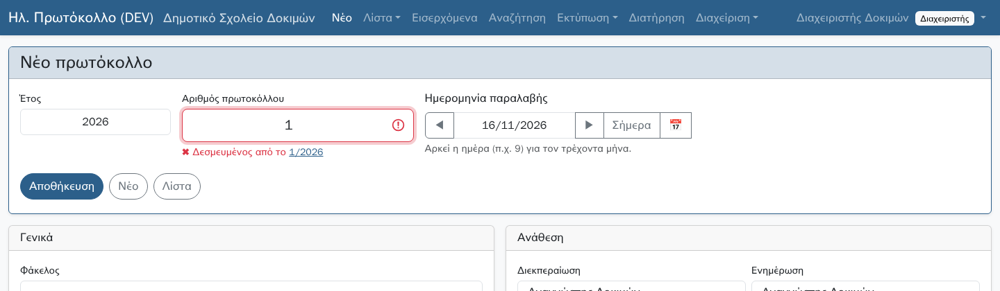
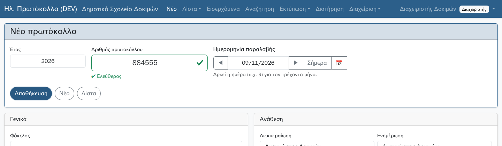
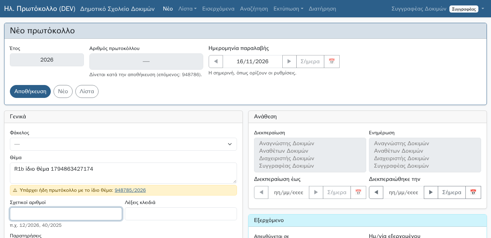
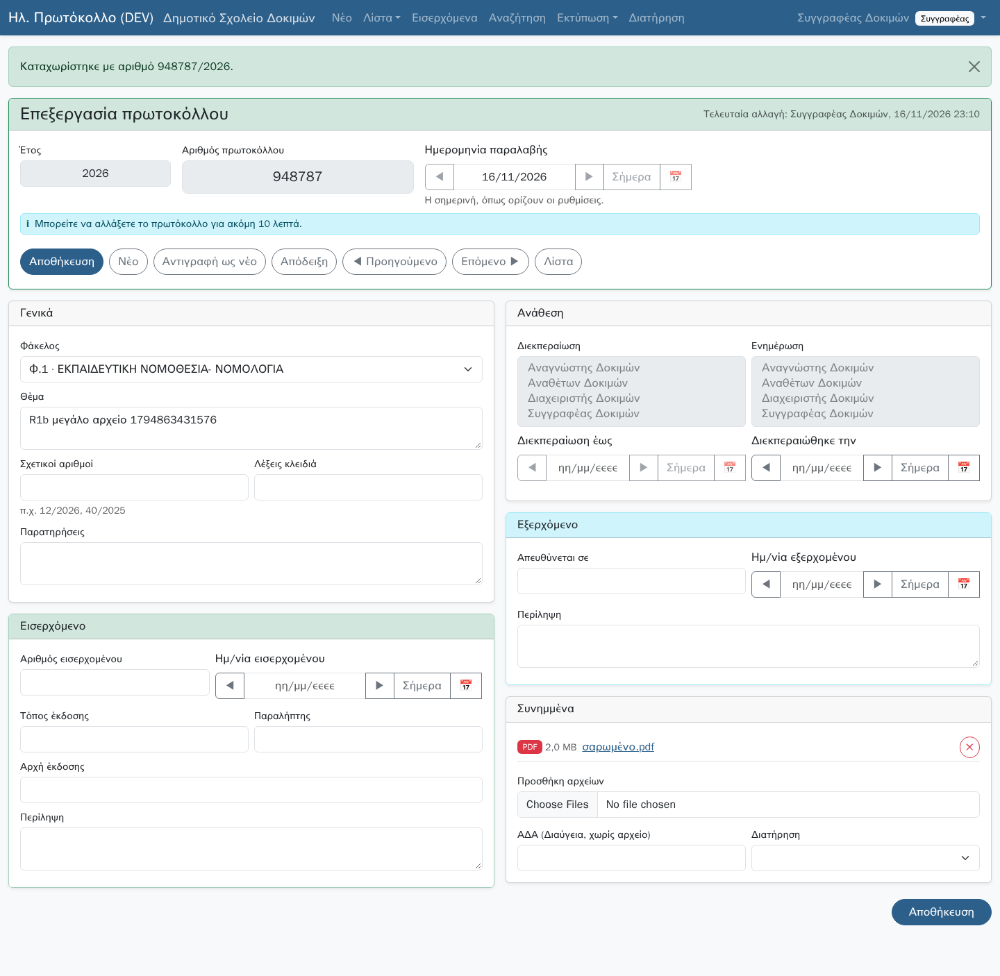

# R1b: the protocol form, rebuilt

| | |
|---|---|
| Status | ✅ Done (reaches the production server with the final deployment) |
| Branch | `task/R1b-protocol-form` |

## What was wrong
The protocol form (*Νέο*, a protocol's page, *Αντιγραφή ως νέο*) was a 1,175-line page on the old layout (Bootstrap 3,
jQuery plugins). Owner's requests for this screen:
- show whether a typed number is free or already used (*Δεσμευμένος*);
- TAB from the number goes to the day of the date;
- date fields with buttons and a calendar;
- a notice instead of the YES/NO dialog for an existing subject or incoming number;
- action buttons as pills.

Found on the way:
- **On the Docker stack, uploads over 1 MB failed.** nginx refused them (413), in the old form too. The Docker stack
  is the production target, so a scanned document could not have been attached there.

## What changed
- New page at the same addresses: `/home` (new), `/home/{id}` (open / edit), `/home/{id}/1` (copy as new),
  `/home?num=N` (A02 gap link). It uses the new layout, with the Livewire component `App\Livewire\ProtocolForm`.
  Saving goes through R1a's `ProtocolWriter`, so the server applies the same rules the screen shows.
- **Number:** for users who may choose it (administrator, *Έλεγχοι καταχώρισης* OFF), each keystroke shows one of:
  - *✔ Ελεύθερος*;
  - *✖ Δεσμευμένος από το N/YYYY*, with a link;
  - *Κρατημένος ως «ΕΛΕΥΘΕΡΟ»*, with the tick box to replace it (R1a).

  Left empty, the next free number is given on save (shown in grey). Other users see *Δίνεται κατά την αποθήκευση
  (επόμενος: N)*.
- **TAB from the number goes straight to the date**, and entering the date selects it, so typing `9` and TAB gives
  the 9th of this month. The date's helper buttons (◀ ▶ Σήμερα 📅) are out of the TAB order; ↑ / ↓ change the day
  from the keyboard. This changes the shared date field (N04), so it applies everywhere.
- **Notices instead of the YES/NO dialog:** *Υπάρχει ήδη πρωτόκολλο με το ίδιο θέμα* and *… με τον ίδιο αριθμό και
  ημερομηνία εισερχομένου* appear under the field when you leave it. They link to those protocols, only to ones the
  user may see. They never block saving.
- Sections as cards (Γενικά, Εισερχόμενο, Ανάθεση, Εξερχόμενο, Συνημμένα). Parts the user may not change are greyed
  out (R1a rules).
- Actions as pills:
  - *Αποθήκευση*, *Νέο*, *Αντιγραφή ως νέο*, *Απόδειξη*, *◀ Προηγούμενο / Επόμενο ▶*, *Λίστα*;
  - *Ανάθεση*, for assigners when the rest is locked; it always e-mails the users it adds, as the old button did;
  - *Διεκπεραιώθηκε*, for the user assigned to handle it when they can't save the form, readers included;
  - *Διαγραφή*, with a confirmation.
- While typing, the form offers values used in recent protocols: place, authority, recipient, addressee, keywords.
- Attachments: the list with type and size, download, move to the trash (with confirmation), adding files and an ΑΔΑ
  without a file, *Διατήρηση*, *Χωρίς σφραγίδα*. The larger attachments panel (drag and drop on the whole window,
  subject from the file name) is R1c.
- Uploads: nginx and Livewire now accept up to 64 MB, PHP's limit (`client_max_body_size`, `config/livewire.php`).
  The checks of type and size per file come in R4a.
- Removed with the old form:
  - the view `protocol.blade.php` and its helper views and routes;
  - `GET /delprotocol`, `GET /attach/del` (actions through GET links, S03), `POST /anathesiSe`, `POST /setDiekpDate`,
    `POST /checkInNum`.

  Their access rules are now checked by the form's actions (the same policy). `POST /home` and `POST /home/{id}` stay
  as thin adapters to the service (tests, removed in Z01).

## How verified
- `ProtocolFormTest` (13 tests):
  - number states (free, used, ΕΛΕΥΘΕΡΟ, invalid, other year); the hint for users who can't choose;
  - save opens the new protocol; errors next to the fields keep what was typed;
  - the same-subject notice links only to visible protocols and doesn't block;
  - read-only form for a reader; a reader assigned to handle it marks it done;
  - copy keeps content and assignments, gets a new number;
  - upload with the save, plus ΑΔΑ; attachment to the trash; administrator deletes a protocol (files removed);
  - suggestions on the page; nothing focusable between the number and the date.
- Tests of the removed routes moved to the same checks through the form:
  - writers and readers can't delete;
  - only administrators and assigners assign; marking done needs the assignment or the role;
  - attachment delete needs the update right; *Ανάθεση* e-mails the assignees.

  The route-middleware snapshot loses only the removed routes.
- Browser (`e2e/tests/protocol-form.spec.js`):
  - number 1 shows *Δεσμευμένος*; a free number shows *Ελεύθερος*; TAB goes to the date, `9` + TAB gives the 9th;
    ▶ moves to the 10th and the saved date is the 10th;
  - a second protocol with the same subject shows the notice with a link to the first and still saves;
  - a reader gets a read-only form;
  - a 2 MB PDF is uploaded, saved and downloaded intact (fails before the nginx change).

  The other browser tests that used the old form (assignments, dates, attachment names, smoke, e-mail registration,
  R1a) now use the new one.

  

  

  

  
- Full suites: PHPUnit 300, browser 33/33.

## Owner actions
1. Optional, after `git pull` and *Demo: start*: open *Νέο* and try the number field (as administrator with *Έλεγχοι
   καταχώρισης = ΟΧΙ*), TAB to the date, and a subject you have used before.
2. Final deployment: nothing extra.
