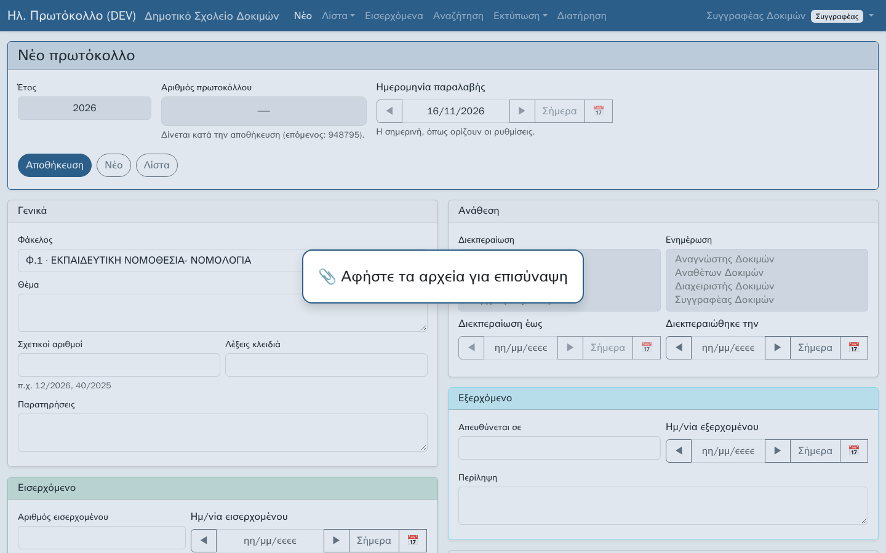
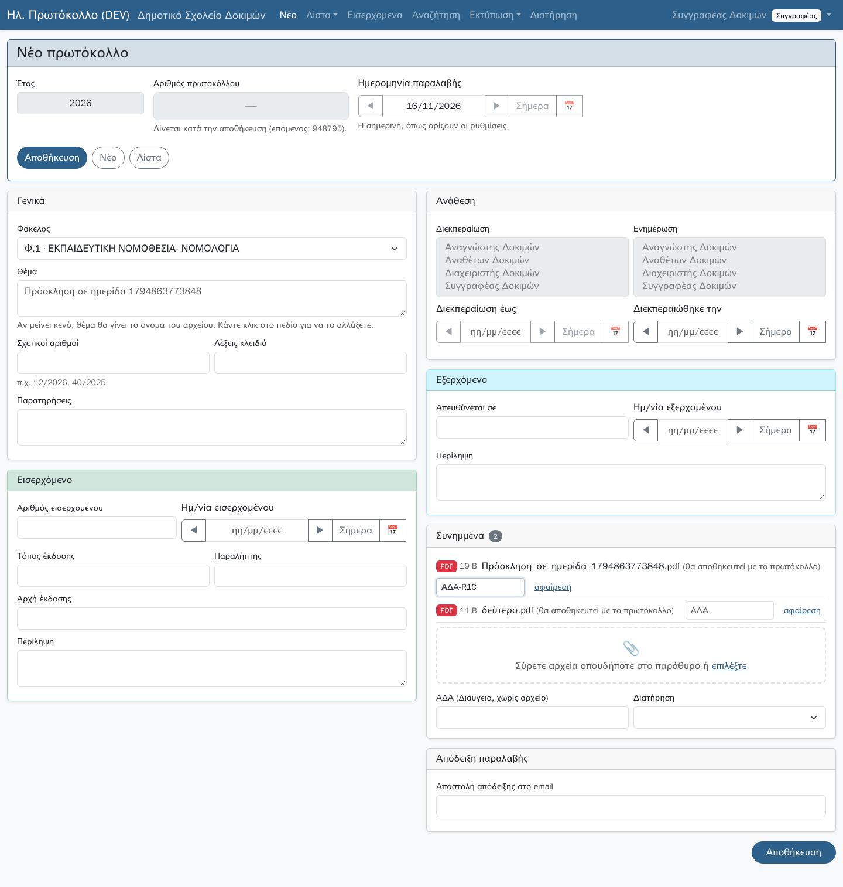
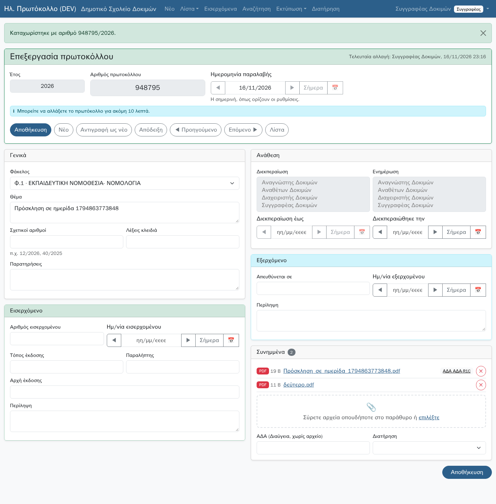

# R1c: attachments panel

| | |
|---|---|
| Status | ✅ Done (reaches the production server with the final deployment) |
| Branch | `task/R1c-attachments-panel` |

## What was wrong
In the old form, attachments meant extra steps. The panel opened only after a click on *add files*, which loaded file
fields three at a time. Each file had to be picked through its own field. The owner asked for:
- the panel always open on a new protocol and on a copy;
- dragging files anywhere onto the window;
- file icons and sizes;
- the subject taken from the file name when it is left empty.

## What changed
- The *Συνημμένα* panel of the rebuilt form (R1b) is always open. It shows the number of files, each with its type
  label and size (N04/D03).
- **Drag and drop on the whole window:** while files are dragged over the page, a full-window overlay says *Αφήστε τα
  αρχεία για επισύναψη*. Dropping attaches them, wherever the mouse is. *επιλέξτε* opens the usual file picker. A
  progress bar shows the upload. Files chosen or dropped later are added to the ones already there, never replacing
  them. Each one can be removed before saving.
- **ΑΔΑ per file:** every new file has its own ΑΔΑ field. Before, the ΑΔΑ fields were a separate list next to the
  file fields.
- **Subject from the file name:** while the subject is empty, the first file's name appears greyed in the subject,
  e.g. `Πρόσκληση_σε  ημερίδα.pdf` → *Πρόσκληση σε ημερίδα* (no extension; underscores become spaces). A note under
  the field explains it. A click into the field puts the text there to edit. If the subject is still empty on save,
  that text becomes the subject. A typed subject is never replaced. Names with no letters (a scanner's `00012.pdf`)
  are not offered. (`App\Support\SubjectFromFile`; R5d will use it for e-mail attachments.)
- The files are stored only when the protocol is saved, so nothing is left behind if the form is abandoned. Livewire's
  temporary uploads are cleaned up after 24 hours.

## How verified
- `AttachmentsPanelTest` (7 tests):
  - the panel is on the new form and on a copy;
  - choosing twice adds to the list, and removing one works;
  - each file keeps its own ΑΔΑ after another is removed;
  - the subject is offered from the file name and used on save; a typed subject is never replaced;
  - file-name rules (extension, `.final` kept, scanner numbers, only an extension);
  - a reader gets no upload controls.
- Browser (`e2e/tests/attachments-panel.spec.js`):
  - two PDFs are dropped on the page (a real `drop` event with a `DataTransfer`): the overlay shows while dragging,
    both files are listed, the first file's name appears as the subject suggestion, an ΑΔΑ is typed for it; after
    saving, the subject is the file name and both files with the ΑΔΑ are on the protocol;
  - a click into the suggested subject puts it in the field; the added words are saved.

  

  

  
- Full suites: PHPUnit 307, browser 35/35.

## Owner actions
1. Optional, after `git pull` and *Demo: start*: open *Νέο*, drag a PDF from a folder onto the page, and leave the
   subject empty.
2. Final deployment: nothing extra.
