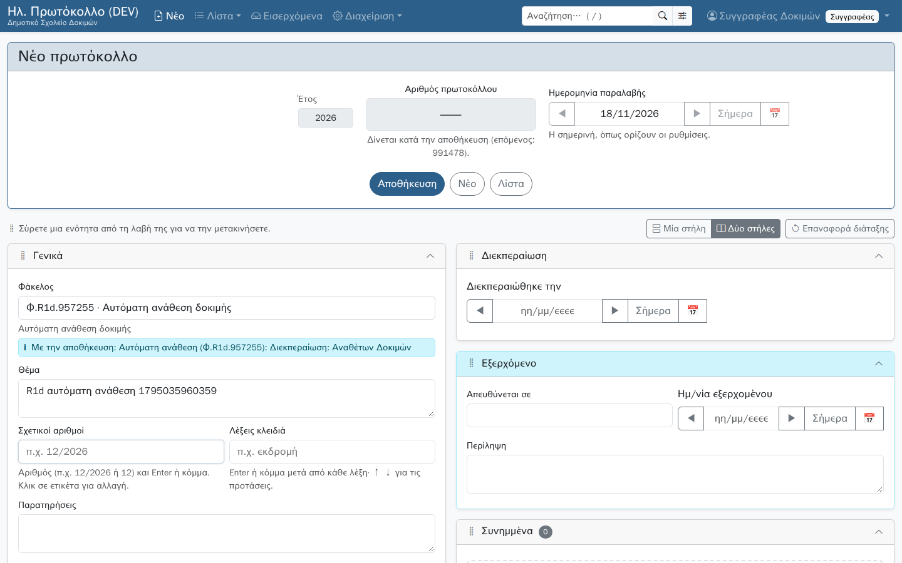
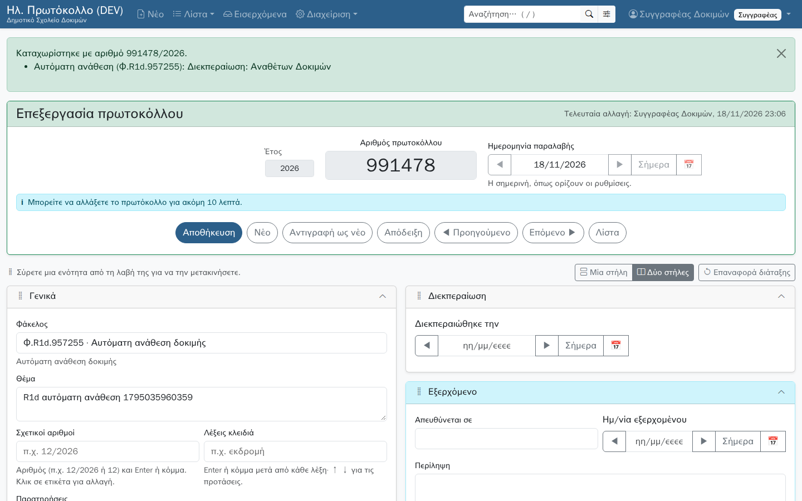

# R1d: automatic assignment on save

| | |
|---|---|
| Status | ✅ Done |
| Branch | `task/R1d-auto-assign` (on top of R6b) |

## What was asked (BACKLOG R1d)
"Auto-assignment on save using folder rules (rules UI in R6b)."

## What changed
- When a protocol is **registered in a folder that has automatic assignments** (R6b), or **moved into one**, the
  folder's users are added to its assignments (`App\Support\FolderRules`, called by `ProtocolWriter::create/update`).
  - This happens whoever saves: also writers and the inbox, who cannot assign by hand.
  - The added users get the usual assignment e-mail (when *Ρυθμίσεις* sends them), and the e-mail note is added to
    *Παρατηρήσεις* as for any assignment.
- **Assignments typed by hand stay.** A user is never added twice. Διεκπεραίωση takes the place of ενημέρωση for the
  same user, because it includes being informed.
- **Saving again in the same folder adds nothing.** An administrator or assigner who removed a user by hand is not
  overruled.
- **Inactive users** in a rule are skipped.
- The rules are added after the save checks, so they never cause a check message the writer cannot fix. For example,
  "Συμπληρώστε την ημερομηνία διεκπεραίωσης" for a writer who cannot assign.
- **The protocol form says it in advance.** Under *Φάκελος* a notice appears: *«Με την αποθήκευση: Αυτόματη ανάθεση
  (Φ.x): Διεκπεραίωση: … · Ενημέρωση: …»*. It is shown only when the save will apply the rules: a new protocol, or
  one moved to another folder.
- After saving, the same line appears in the saved message. In the inbox it appears in the e-mail's result.

## How it was verified
- PHPUnit `tests/Feature/FolderRulesTest.php` (7 tests):
  - a writer registers in a folder with rules: assignments, e-mails and message;
  - no folder, or a folder without rules: nothing changes;
  - assignments typed by hand are kept, and διεκπεραίωση replaces ενημέρωση;
  - inactive users are skipped;
  - moving into the folder adds the users; saving again does not bring back a removed one;
  - the form's notice;
  - the merge rule.
- Browser `e2e/tests/auto-assign.spec.js`:
  - the administrator makes a folder that assigns to *Αναθέτων Δοκιμών*;
  - the writer picks it: the notice appears, and after saving, the message names the assignment.
- Full PHPUnit: 488 green.

## Owner actions
None. Choose the users per folder in *Φάκελοι και διατήρηση → Επεξεργασία → Αυτόματη ανάθεση*.
