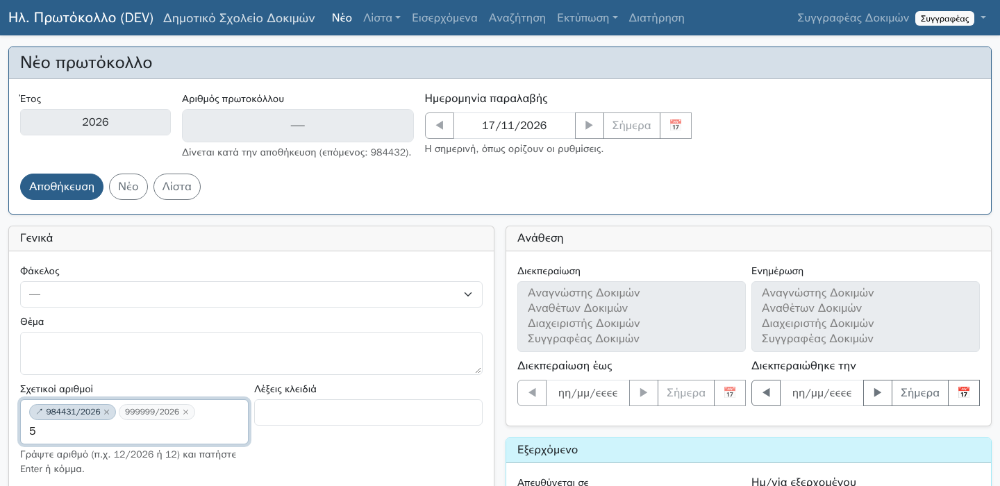
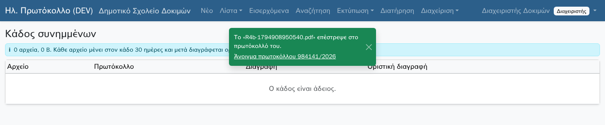
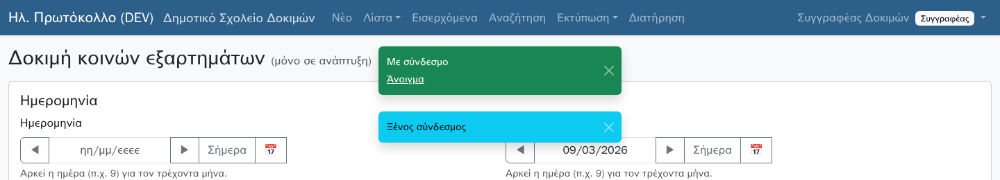

# R1e: form feedback after Batch 6 (drop on Firefox, related links, notices)

| | |
|---|---|
| Status | ✅ Done |
| Branch | `task/R1e-form-feedback` |

The owner tried Batch 6 and reported (2026-11-17):

## What was wrong
1. **A file dropped in the middle of the window was not attached** (the upload box worked). The owner uses Firefox on
   GNOME (Wayland). A real native drag in Chromium works everywhere, so this is Firefox-specific. Firefox on Wayland is
   known to announce dragged files late or without the `Files` type (only `application/x-moz-file` /
   `text/uri-list`, or nothing until the drop), and sometimes to send no `dragenter` at all. The R1c handler only
   accepted drags whose types contained `Files`, so such a drop was not accepted.
2. **The green notice sat at the bottom right, over the *Αποθήκευση* button**, for 5 seconds, and could only be closed
   with its small ✕.
3. **Σχετικοί αριθμοί** were plain text: no way to open the related protocol.
4. **The "restored" notice of the trash page** had no link to the protocol the file went back to.

## What changed
- **Drop:** a drag from outside the page counts when its types say `Files`, `application/x-moz-file` or
  `text/uri-list`, or say nothing yet; drags that start inside the page (selected text) are left alone. `dragover` alone
  also shows the drop overlay and accepts the drop (no `dragenter` needed). The drop uploads only when it really carries
  files.
- **Notices (toasts), everywhere:** top centre, just under the top bar; a click anywhere on one closes it; optional
  link (`appToast(message, type, {url, label})`, Livewire `dispatch('toast', …, url:, label:)`), same-site addresses
  only, text only as before.
- **Σχετικοί αριθμοί as tags** (owner's idea, 2026-11-17): Enter, a comma (or `;`) or leaving the box turns what was
  typed into a pill; a bare number gets the protocol's year (`12` → `12/2026`); pasting "12/2026, 40/2025" makes two;
  no repeats. An existing protocol the user may open is a blue link pill ↗ (new tab, its subject on hover); anything
  else is a grey pill. ✕ or Backspace in the empty box removes one. The stored value stays the same text
  ("12/2026, 40/2025"), so search, prints and old entries are unchanged (`App\Support\RelatedNumbers`). Users limited
  to their own protocols get no link and no subject for other people's protocols.
- **Trash page:** "Το «…» επέστρεψε στο πρωτόκολλό του." now ends with *Άνοιγμα πρωτοκόλλου N/YYYY*.

## How verified
- Full suites: PHPUnit 340, browser 46/46.
- PHPUnit: `test_related_numbers_are_tags_linking_to_existing_protocols` (bare number gets the year, pasted list, no
  repeats, links, subject on hover, unknown numbers, remove, saved text; a limited writer sees no link or subject); `TrashTest` checks the restore notice's link.
- Browser:
  - `attachments-panel.spec.js`: a **native** file drag (Chromium's DevTools input, as the operating system does it, not
    synthetic events) dropped on the subject field in the middle of the form is attached and nothing is typed into the
    field; a drop without any `dragenter` is attached. The drop tests also pass in Playwright's Firefox (the native drag
    test is Chromium only).
  - `components.spec.js`: the notice is under the top bar and centred, a click closes it, a link to another site is not
    shown.
  - `protocol-form.spec.js`: Enter and a comma make pills (Enter does not save), Backspace in the empty box removes
    the last one, the link pill opens the protocol in a new tab.
  - `trash.spec.js`: the restore notice's link opens the protocol.

  
  
  

## Owner actions
1. After `git pull` and *Demo: start*: drag a file from *Files* into the middle of the form in **Firefox**. If it is
   still not attached, try once more and **stop moving for a second** before letting go, and tell me which of the two
   worked. Firefox on Wayland sometimes sends nothing to the page until the mouse rests; a web page cannot fix that.
