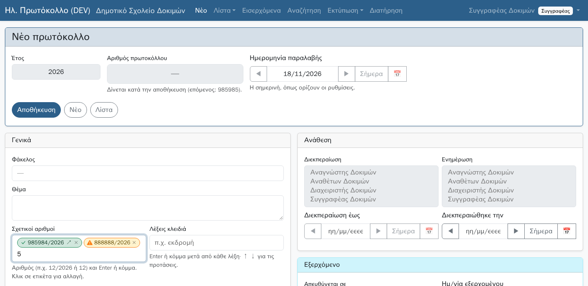
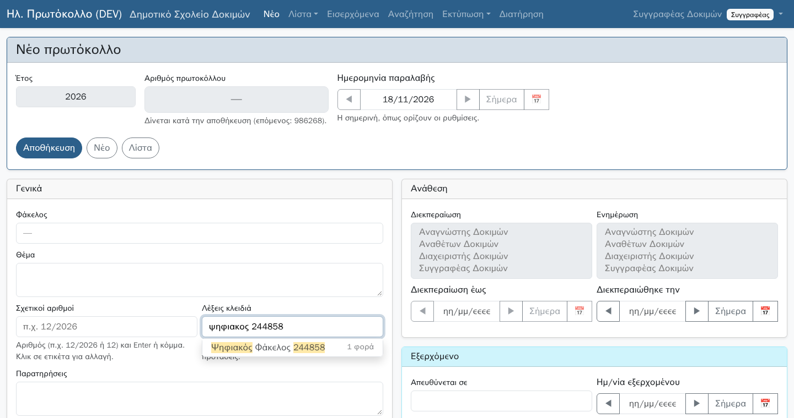
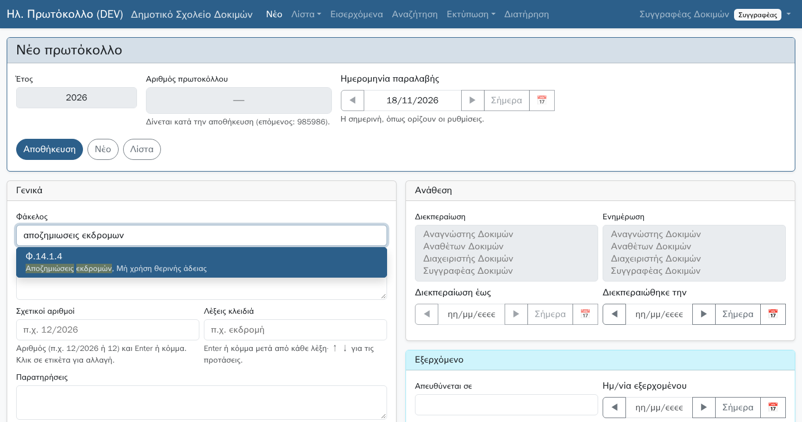

# R1f: checked tags (related numbers, keywords), folder filter

| | |
|---|---|
| Status | ✅ Done |
| Branch | `task/R1f-checked-tags` |

## What was asked (owner, 2026-11-18)
1. **Σχετικοί αριθμοί:**
   - the tags should be editable;
   - an existing protocol should look green with a small ✔ (the ↗ that opens it in a new tab stays: "works great");
   - a number that doesn't exist should be yellow/orange with a small ⚠.
2. **Λέξεις κλειδιά:** the same editable tags, and "very important" a robust auto-complete.
3. **Φάκελος:** type a word and the list narrows down.

## What changed
- **Both tag fields:**
  - Enter, a comma (or `;`) or leaving the box makes a tag; a pasted list makes several.
  - **A click on a tag's text edits it in place:** Enter or leaving the box keeps the change in the same position,
    Escape cancels, and an empty edit removes the tag.
  - ✕ or Backspace in the empty box removes a tag.
  - No repeats, ignoring case and accents.
  - The stored value is still plain text ("12/2026, 40/2025", "Διαύγεια, εκδρομή"), so search, prints and old entries are
    unchanged (`App\Support\TagList`).
- **Σχετικοί αριθμοί:**
  - A protocol that exists is a **green tag with ✔**: ↗ opens it in a new tab and its subject shows on hover.
  - A number with no protocol is an **orange tag with ⚠** ("Δεν υπάρχει πρωτόκολλο 77/2026"). Text that is not a
    number is also orange ⚠ ("Δεν είναι αριθμός πρωτοκόλλου").
  - Users limited to their own protocols see green ✔ for other people's protocols, with no link and no subject.
- **Λέξεις κλειδιά: suggestions while typing:**
  - Every keyword already used in the protocols the user may see is offered, the most used first, with how many times.
  - Matching ignores case and accents ("διαυγεια" finds "Διαύγεια") and finds words in any order. Results that start
    with what was typed come first, and the typed letters are highlighted.
  - ↑ ↓ and Enter, or a click, choose.
  - A keyword typed with other case or accents takes the known spelling, so the same keyword is not stored in two
    ways.
  - Spellings already stored that differ only in case or accents are offered once, in the most used spelling.
- **Φάκελος:**
  - A search box instead of the drop-down. Clicking it shows every folder (code and description), after "— Χωρίς
    φάκελο".
  - Typing narrows the list by code (`19.2`) or by words of the description, ignoring accents ("αποζημιωσεις
    εκδρομων").
  - ↑ ↓ Enter, Tab or a click choose; Escape keeps the previous folder.
  - Long descriptions (D06) fit in two lines in the list. The chosen folder's description shows under the box.
- **Speed:** keywords and folders are sent once with the page (as data, not as HTML) and searched in the browser, so
  typing does not wait for the server.

## How verified
- PHPUnit (`ProtocolFormTest`):
  - `test_related_numbers_are_checked_tags_linking_to_existing_protocols`: green/orange with ✔/⚠, link and subject,
    edit in place (position kept, bare number gets the year, duplicate dropped, empty removes), saved text, limited
    writer sees green without link or subject;
  - `test_keywords_are_tags`: no repeats ignoring accents, edit, remove, saved text, only these two fields;
  - `test_keyword_and_folder_suggestions`: counts, spellings merged, limited writer, data safe inside the page;
  - `test_fold_ignores_case_and_accents`: shared case list `tests/fixtures/fold-cases.json`.
- Browser (`protocol-form.spec.js`, 4 new or rewritten):
  - **related numbers:** green ✔ and ↗ to a new tab; orange ⚠ for 999999; a click edits 999999 → 888888 in place;
    Escape leaves a tag unchanged; Backspace removes.
  - **keywords:** "ψηφιακος …" without accents suggests "Ψηφιακός Φάκελος …" (highlighted); ↓ Enter takes the known
    spelling; the same text typed again is not added twice; a new keyword is added and edited in place.
  - **folder:** the list narrows to Φ.14.1.4 by description words without accents; the code `19.2` finds Φ.19.2;
    Escape keeps the choice; saved.
  - **case and accents:** the browser gives the same results as the server for the shared case list.
- All other browser tests now pick the folder through the new box (`fillProtocol`). Full suites: PHPUnit 354, browser 51/51.

  
  
  

## Owner actions
None.

## Review finding (Codex), fixed with a test
- After a suggestion was highlighted (↓) and the list closed with Escape, Enter failed instead of adding the typed
  keyword: the highlighted position was kept after the list was emptied. Closing the list now forgets it, and Enter
  only picks a suggestion that is still shown (browser test: ↓, Escape, Enter adds what was typed).
- The folder could no longer be cleared (the old drop-down had "—"). A protocol without attachments may have no folder,
  so the list starts with **— Χωρίς φάκελο**, and typing then deleting the text and pressing Enter also clears it
  (browser test).
