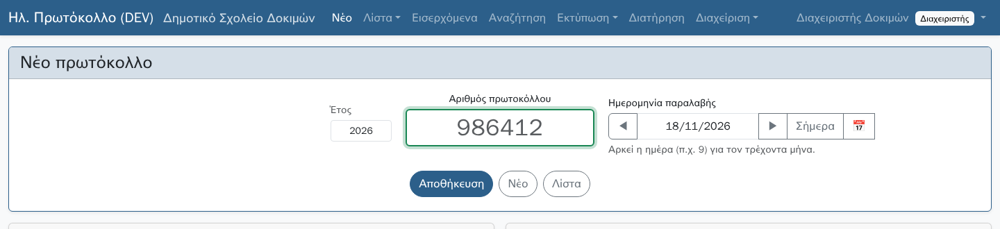
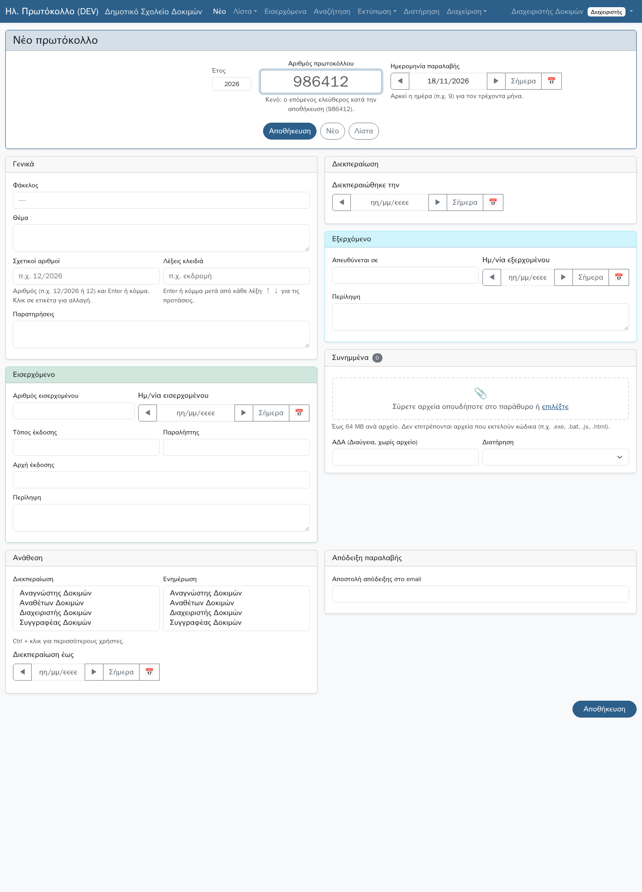

# R1g: form layout — the number in the middle, rarely used sections lower

| | |
|---|---|
| Status | ✅ Done |
| Branch | `task/R1g-form-layout` |

## What was asked (owner, 2026-11-18)
- The protocol number is the most important information on the page. Keep its green border and put it in the middle
  of the top section; centre that section's contents.
- "Ελεύθερος" under the number matters only when the user changes the number by hand.
- The year can be smaller: it is rarely changed.
- Used less often: the whole **Ανάθεση** section and **Απόδειξη παραλαβής με email**. Move them lower.
  **Διεκπεραιώθηκε την**, on the contrary, is used often.

## What changed
- **Top section:** year (small) | **number** (large, in the middle, green border) | date. The action buttons are
  centred under them. TAB from the number still goes straight to the date. On a phone, year and number share a row and
  the date goes below.
- **Number status:** nothing is said while the number is the proposed one (new protocol) or the protocol's own
  (editing).
  - After a change by hand, the status shows as before: ✔ Ελεύθερος / ✖ Δεσμευμένος / ΕΛΕΥΘΕΡΟ / invalid. A number
    emptied by hand says it will be given on save.
  - A number that came from a missing-number row (*Καταχώριση με αριθμό …*) counts as chosen, so it shows
    ✔ Ελεύθερος.
  - A taken number is always shown.
- **Sections:**
  - Left column (unchanged): Γενικά, Εισερχόμενο.
  - Right column: a small **Διεκπεραίωση** card with *Διεκπεραιώθηκε την* (and the deadline, when set), then Εξερχόμενο
    and Συνημμένα.
  - Below both columns: **Ανάθεση** (Διεκπεραίωση, Ενημέρωση, Διεκπεραίωση έως) and the **Απόδειξη παραλαβής** cards.

## How verified
- PHPUnit (`ProtocolFormTest`):
  - a new protocol says nothing about its number but has the green border;
  - typed numbers show their status, and an emptied number says it will be given on save;
  - an existing protocol says nothing until its number changes, and a number from a missing-number row says
    "Ελεύθερος";
  - the order on the page: year < number < date; done date above the outgoing section and the attachments; assignment
    and receipt below the attachments.
- Browser (`protocol-form.spec.js`):
  - the number is centred in the top section (within 20 px), its text more than twice the year's size, and it has the
    green border with no status;
  - typing shows "Ελεύθερος";
  - *Διεκπεραιώθηκε την* is above the attachments; Ανάθεση and the receipt are below them.
- Full suites: PHPUnit 356, browser 52/52.

  
  

## Owner actions
None. Tell me if *Διεκπεραιώθηκε την* would be better somewhere else (e.g. in the top section next to the date).
