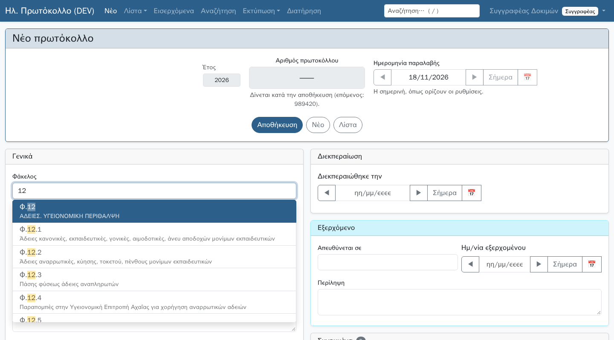

# R1h: folder codes as typed

| | |
|---|---|
| Status | ✅ Done |
| Branch | `task/R1h-folder-codes` |

## What was asked (owner, 2026-11-18)
- Typing `12` in *Φάκελος* should jump straight to Φ12, not to Φ40.12 or similar.
- The list was not scrolled to the right result.
- A code typed without dots, `φ11`, must mean only Φ.11, never Φ1.1 or Φ.1.1.

## What was wrong
- Search treated every symbol in a code as optional, so `φ11` also matched Φ1.1 and Φ.1.1 (R3a/R3c).
- The list ranked any code with a part starting with `12` equally, in list order, so Φ40.12 could come before Φ12.
- While typing, the list kept its earlier scroll position, so the first (chosen) result could be out of view.

## What changed
- **One rule** (`App\Support\FolderCode`, browser twin in `resources/modern/tags.js`, shared cases in
  `tests/fixtures/folder-code-cases.json`):
  - case and accents never count;
  - dots and spaces between the letters and the number are optional: `φ11` = Φ.11 = Φ11;
  - dots inside the number count: `φ11` is not Φ1.1 or Φ.1.1, and `φ1.1` = Φ1.1 = Φ.1.1;
  - a number typed alone is compared with the number part: `12` = Φ12 = Φ.12.
- **Folder picker** (protocol form and search screen), best first:
  1. the code itself (`12` → Φ.12);
  2. codes starting with it (Φ.12.1, Φ.12.2 …, Φ120);
  3. folders whose code and description hold the typed words.

  When the text changes, the list goes back to its top, so the chosen first result is visible.
- **Search** (`φάκελος:` and the search screen's folder field) uses the same rule: an exact code finds only that
  folder; other text finds codes starting with it, or folders whose code and description hold all the words.

## How verified
- PHPUnit:
  - `FolderCodeTest` (the shared cases);
  - `SearchTest`: `φ11` → Φ.11 only, `φ1.1` → Φ.1.1, `11` → Φ.11, the advanced-search link carries the exact code.
- Browser (`protocol-form.spec.js`):
  - the browser follows the same cases as the server;
  - in the picker, with the list scrolled down first, `12` puts Φ.12 first, chosen and at the top of the list, then
    Φ.12.1;
  - `φ11` offers Φ.11 and never Φ.1.1, and Enter chooses Φ.11.
- `search.spec.js` adjusted to the rule (`φ1.1` for Φ.1.1).

  

## Owner actions
None.
