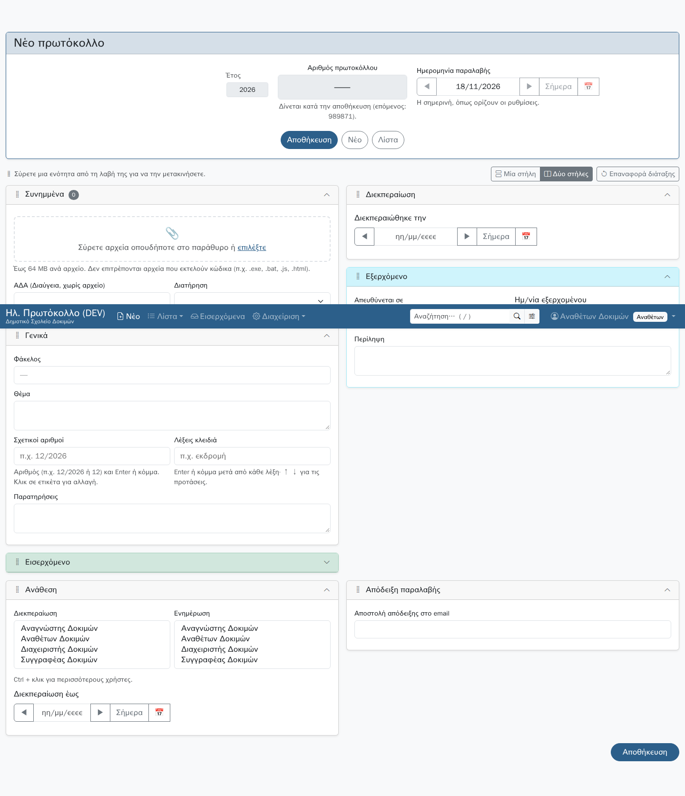
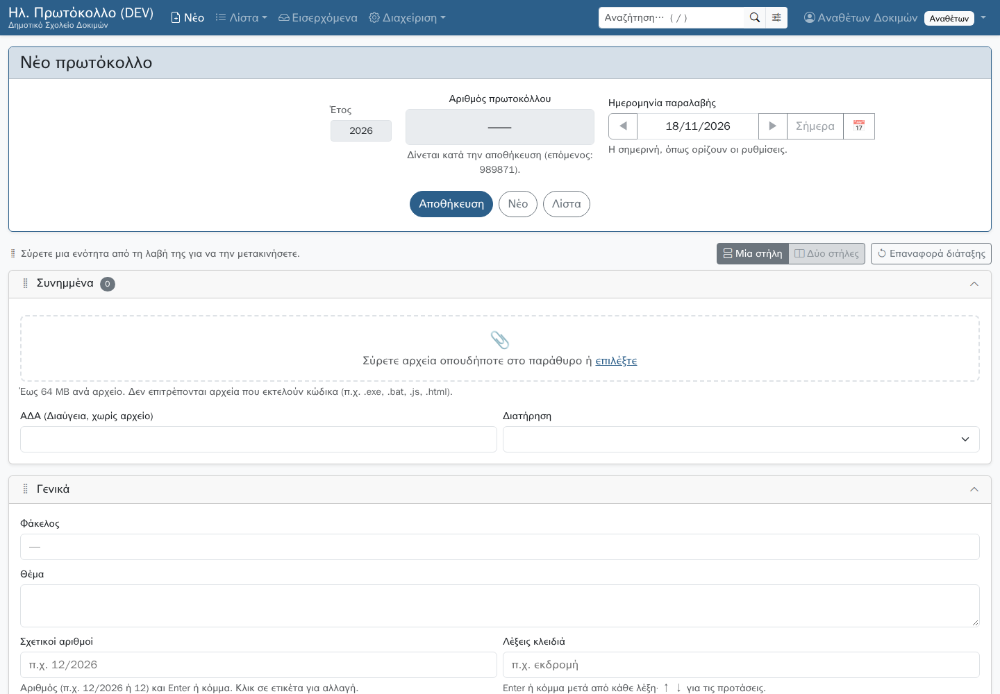

# R1i: protocol page sections arranged by each user

| | |
|---|---|
| Status | ✅ Done |
| Branch | `task/R1i-form-sections` |

## What was asked (owner, 2026-11-18)
Make the sections of the protocol page (Γενικά, Εισερχόμενο, Διεκπεραίωση, Εξερχόμενο, Συνημμένα, Ανάθεση,
Απόδειξη παραλαβής) collapsible and draggable, so each user chooses what to see and where. The answers to my questions:
- saved **per user**, on every computer;
- movable **between the columns** too;
- a choice of **one or two columns**.

## What changed
- **Three places:** the left column, the right column, and a full-width row below them.
  - The default is today's layout (R1g): Γενικά, Εισερχόμενο on the left; Διεκπεραίωση, Εξερχόμενο, Συνημμένα on
    the right; Ανάθεση and the receipt below.
  - A place may be left empty.
- **Move:** drag a section by its handle ⠿ at the left of its title onto another place or position. The handle is
  needed, so the fields themselves never start a drag.
- **Collapse:** the ▴/▾ button at the right of a title hides or shows the section's fields.
  - The values are kept: hidden fields are still in the form and saved.
  - A collapsed section opens by itself when one of its fields has an error, so a hidden error is impossible.
  - Files can still be dropped on the window while *Συνημμένα* is collapsed.
- **One / two columns:** buttons above the sections.
  - In one column, the places follow each other: left, then right, then the row below.
  - On a window narrower than 1200 px, or in the narrow page width (R3d), the page is one column anyway.
- **Επαναφορά διάταξης:** back to the default.
- **Storage:** the arrangement is saved with the account (`users.preferences.form`, from R3d) at each change, so it is
  the same on every computer. It is checked on the server: unknown sections are ignored, each section appears once,
  and sections added in the future go to their default place.
- **How it works:**
  - Livewire's `wire:sort` (SortableJS) on each place calls `ProtocolForm::moveSection(section, position, place)`;
  - `toggleSection`, `setColumns` and `resetLayout` are the other actions;
  - the page is drawn in the saved order (`UserPreferences::formLayout`), so what is typed is never lost while
    sections move.

## How verified
- PHPUnit (`ProtocolFormTest`):
  - moves within and between places, to the end, leaving a place empty;
  - collapse, one column;
  - unknown sections/places ignored;
  - another user keeps the default;
  - reset;
  - a collapsed section opens when one of its fields has an error;
  - the R1g order with the default arrangement.
- Browser (`protocol-form.spec.js`, a real mouse drag in small steps):
  - *Συνημμένα* dragged to the left column, above *Γενικά*, and it is really on the left;
  - *Εισερχόμενο* collapsed;
  - one column, sections full width;
  - kept after a reload;
  - another user still sees the default;
  - reset.
- Full suites: PHPUnit 416, browser 62/62.

  
  

## Owner actions
None.
