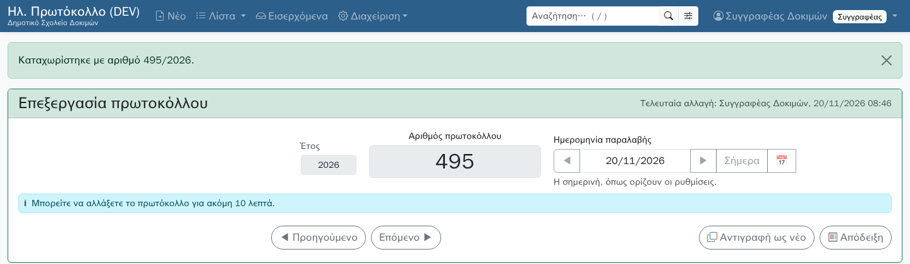
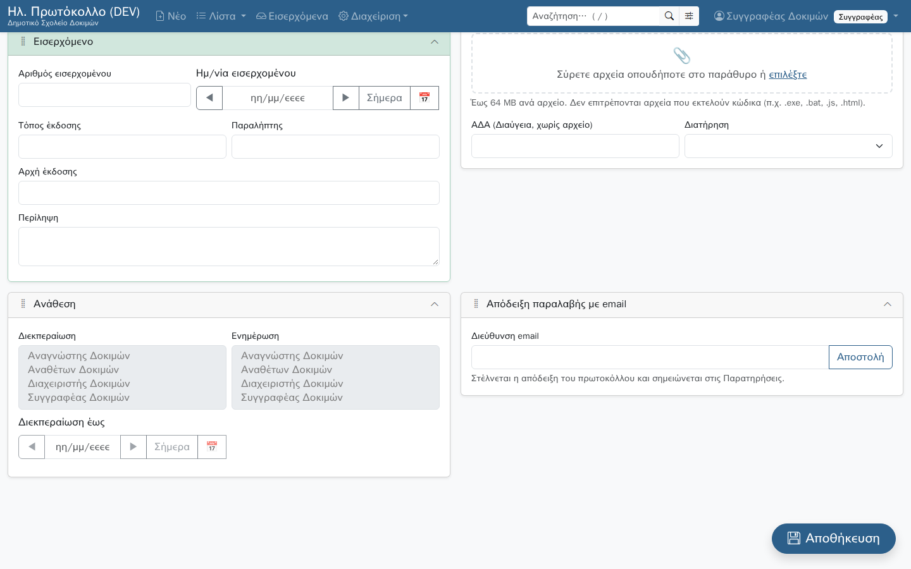
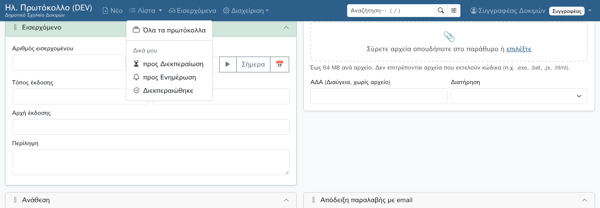

# R1j: the protocol form's buttons: one floating Αποθήκευση, copy and receipt at the far right

| | |
|---|---|
| Status | ✅ Done |
| Branch | `task/R1j-form-actions` |

## What was asked (owner, 2026-11-20)
On the protocol page:
- remove both *Αποθήκευση* buttons, at the top and at the bottom; one *Αποθήκευση* always visible at the bottom right
  of the screen instead;
- *Νέο* and *Λίστα* under the protocol number are not needed: the top bar has them;
- *Λίστα* in the top bar only opened a menu: clicking it should go back to the list;
- *Αντιγραφή ως νέο* and *Απόδειξη* are not used often: put them at the far right, with icons.

## What changed
- **Αποθήκευση**: one button, fixed at the bottom right of the screen, whatever the scroll. It has a 💾 icon, and a
  spinner while saving. As before, it waits for uploads to finish. The page ends with some empty space, so the last
  fields never stay under it. Who may not save (e.g. a reader) does not get it, as before.
- **The row under the number**: *Νέο* and *Λίστα* are gone. *Ανάθεση*, *Διεκπεραιώθηκε*, *◀ Προηγούμενο*, *Επόμενο ▶*
  and *Διαγραφή* stay where they were. *Αντιγραφή ως νέο* (icon ⧉) and *Απόδειξη* (icon 🧾) are at the right end of
  the row. A new protocol has none of these buttons, so the row is not shown.
- **Λίστα in the top bar**: the word is a link to the list. A small **▾** next to it opens the other lists as before
  (*Όλα τα πρωτόκολλα*, *προς Διεκπεραίωση* …).
  - It leads to each role's start page, the same as *Όλα τα πρωτόκολλα* and the application's name.
  - In this set-up, that is *προς Διεκπεραίωση* for writers.
  - It goes to the list on the page, now that *Λίστα* is not under the number. It is on every page, not only the form.

## How verified
- PHPUnit:
  - `ProtocolFormTest::test_the_actions_one_floating_save_and_copy_receipt_at_the_end` checks:
    - one submit button, the floating one;
    - no *Νέο* / *Λίστα* links in the form;
    - copy and receipt after *Προηγούμενο* / *Επόμενο*, with their icons;
    - a new protocol has the same button and no copy.
  - `ModernLayoutTest::test_the_list_item_is_a_link_and_its_arrow_opens_the_menu` checks:
    - *Λίστα* leads to the role's list;
    - its ▾ opens the menu;
    - only *Λίστα* is split.
- Browser (`protocol-form.spec.js`, R1j) checks:
  - one save button, at the bottom right, at the top of the page and at its end;
  - copy and receipt at the far right of the row, apart from the others;
  - saving with the floating button;
  - the ▾ opens the lists, and clicking *Λίστα* goes to the list.
- The form, top bar, receipt and components browser tests pass: 28 of 28.
- Full PHPUnit: 537 tests pass.

## Owner actions
None. To try it: step 38 in [OWNER-TODO.md](../../OWNER-TODO.md).
