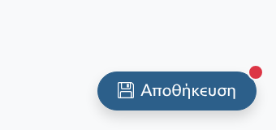
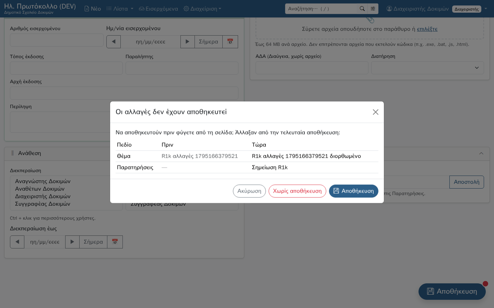

# R1k: unsaved changes on the protocol page: a red dot, and a question before leaving

| | |
|---|---|
| Status | ✅ Done |
| Branch | `task/R1k-unsaved-changes` (on top of R3f) |

## What was asked (owner, 2026-11-20)
- On the protocol page, as soon as the user changes anything, a small red dot on *Αποθήκευση*: the protocol has
  changes that need to be saved.
- If the user changed the page and goes away, ask whether to save the changes, and show what changed since the
  last save.

## What changed
- **Red dot** on the floating *Αποθήκευση* (R1j) while the page differs from the last save. Its tooltip says
  *«Υπάρχουν αλλαγές που δεν έχουν αποθηκευτεί»*. Undoing a change removes the dot.
  - It counts every field, the assignments (*Διεκπεραίωση*, *Ενημέρωση*), new attachments and their ΑΔΑ, and
    *Χωρίς σφραγίδα*.
  - It works on a new protocol too, measured from when the page opened.
- **Leaving with changes**: a click on a link that leaves the page shows a window first. Such links are the top bar,
  *◀ Προηγούμενο* / *Επόμενο ▶*, *Αντιγραφή ως νέο*, and the like. The window:
  - is titled *Οι αλλαγές δεν έχουν αποθηκευτεί*;
  - lists each changed field with its value **before** (at the last save) and **now**;
  - asks what to do:
    - *Ακύρωση*: stay on the page;
    - *Χωρίς αποθήκευση*: go, and drop the changes;
    - *Αποθήκευση*: save, then go where the user was going, with the usual message there. If something is missing,
      the page stays with the messages at the fields, as with the button.
- Links that open a new tab (*Απόδειξη*, files) never ask: the page stays open.
- **Closing or reloading the tab** with changes: the browser's own question. Browsers allow only their standard text
  there, so it cannot list the changes.
- After a save the page reloads, so there is no dot and no question until the next change.

## Safety
After *Αποθήκευση* in the window, the server goes on only to a page of the application. It accepts a path such as
`/home/list`, never a whole address or `//…`, so a crafted request cannot send the user to another site.

## How verified
- PHPUnit `ProtocolFormTest::test_save_then_go_on_only_within_the_application` checks:
  - the save, then the page asked for;
  - for an outside address, `//…`, `/\…`, `javascript:` or an empty value: saved, then back on the protocol;
  - the page carries the labels, the dialog and the dot.
- Browser (`protocol-form.spec.js`, R1k):
  - without changes, links leave at once;
  - a change shows the dot, and undoing it hides the dot;
  - the dialog lists the two changes with before / now;
  - *Ακύρωση* stays; *Χωρίς αποθήκευση* goes and nothing is saved;
  - *Αποθήκευση* saves, then opens *Λίστα* with the message;
  - after a save with the button: no dot and no question;
  - reloading with a change: the browser's question.

  All 14 form browser tests pass.
- Full PHPUnit: 551 tests pass.

## Review
- Codex (P2): an assigner who may assign but not edit the protocol has no *Αποθήκευση*, so the page had no dialog.
  After changing an assignment, any link was blocked and nothing opened. The same happened to a reader setting the
  completion date.
  - Fixed: the question applies only where the page saves. Assigning keeps its own button (*Ανάθεση*), as before.
  - Browser test: such an assigner changes the assignment and leaves with *Νέο*. It failed before: stuck on the
    page.
- Codex (P2): a keyword or related number typed but not yet a tag did not count, so the user could leave without a
  question. The same held for a tag still on its way to the server.
  - Fixed: both count as changes. They are listed as *«… (νέο)»*, and the dot follows typing.
  - Browser test: typing a keyword shows the dot and lists it in the dialog. It failed before.
- Codex (P2), third round: a tag changed in place, with its editor still open, did not count.
  - Fixed: an open editor whose text differs from its tag counts as a change.
  - Browser test: edit a saved keyword in place; the dot shows and the dialog lists the new text. It failed before.

## Owner actions
None. To try it: step 43 in [OWNER-TODO.md](../../OWNER-TODO.md).
