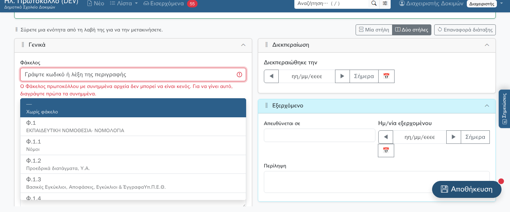

# R1l: the protocol form shows a refused «Αποθήκευση»

| | |
|---|---|
| Status | ✅ Done |
| Branch | `task/R1l-form-error-into-view` |

## What was asked (owner, 2026-11-25)
Editing a protocol, *Αποθήκευση* refused with an error such as «no folder set» should scroll to that error. If the
user has scrolled past the field, nothing shows what happened.

## What changed
- When *Αποθήκευση* is refused, the page **scrolls to the first field marked wrong** and puts the cursor in it. The
  field is red with the reason under it, as before. The floating button is at the bottom, and the field (e.g.
  *Φάκελος*) may be far above it.
- A collapsed section with an error already opened (R1i); now it is also brought into view. For *Φάκελος*, the
  cursor in it opens the folder list, so a folder can be chosen at once.
- If no field is marked (an error that belongs to no field), the page goes to the first error message instead.
- The same as the inbox's *Καταχώριση* (R5r).

## How verified
- PHPUnit `ProtocolFormTest::test_a_refused_save_tells_the_page_to_show_the_error`:
  - a protocol with a file whose folder is emptied: refused, the error at *Φάκελος* (red), the browser told, the
    folder unchanged;
  - with a folder: saved, nothing told.

  The check that the browser is told failed before. Full suite: 688 tests, green.
- Browser (`protocol-form.spec.js`, R1l), in a 600 px high window:
  - a protocol with a file; *— Χωρίς φάκελο*;
  - scrolled to the bottom: *Φάκελος* out of view;
  - *Αποθήκευση* → *Φάκελος* red, in view and focused, with its message.

## Owner actions
None. To try it: step 88 in [OWNER-TODO.md](../../OWNER-TODO.md).
