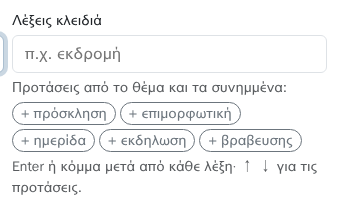

# R1p: keywords offered in the protocol form, from the subject and the files

| | |
|---|---|
| Status | ✅ Done |
| Branch | `task/R1p-form-keyword-suggestions` |

## What was asked (owner, 2026-11-26)
«The same logic behind the mechanism which produces keyword suggestions based on attachment filenames can be also
used when manually creating a new protocol: the user adds an attachment, then the app suggests keywords. Likewise just
after entering text and leaving the Θέμα field.»

## What changed
- **Under *Λέξεις κλειδιά*** in the protocol form: *Προτάσεις από το θέμα και τα συνημμένα:*, with **+ word**
  buttons, as in the inbox (R5d/R5e) and worked out the same way:
  - **first**, keywords already used in protocols (blue) whose words appear in the subject or a file's name, most
    used first;
  - **then**, other significant words (grey): long enough, not a common word or a number. A word in capitals takes
    the spelling it has in earlier subjects, when there is one.
- **When they appear or change:**
  - when you **leave Θέμα** (Tab or click elsewhere: the subject is sent then);
  - as soon as a **file is added** (its name counts);
  - for a saved protocol, the names of its files count too.
- **A click** puts the word in the field, and it is no longer offered. Words already in the field are never offered.
- **Only while *Λέξεις κλειδιά* can be changed:** never for readers or a protocol locked for the user.
- The data behind them is cached for a minute or ten, as in the inbox, so the form is not slowed down.

## How verified
- PHPUnit `ProtocolFormTest::test_keywords_are_offered_from_the_subject_and_the_files`:
  - nothing offered with nothing typed;
  - after Θέμα: a keyword in use and a new word;
  - a file «ΙΑΤΡΙΚΗ ΓΝΩΜΑΤΕΥΣΗ.pdf» offers «γνωμάτευση» (spelling from an earlier subject);
  - a chosen one disappears from the offer;
  - a saved protocol: offered to an administrator, not to a reader.

  Full suite green.
- Browser (`protocol-form.spec.js`, R1p): none at first; after Θέμα and Tab the words of the subject; a file added
  adds its words; a click makes it a keyword pill and removes it from the offer.

## Owner actions
None. To try it: step 108 in [OWNER-TODO.md](../../OWNER-TODO.md).
