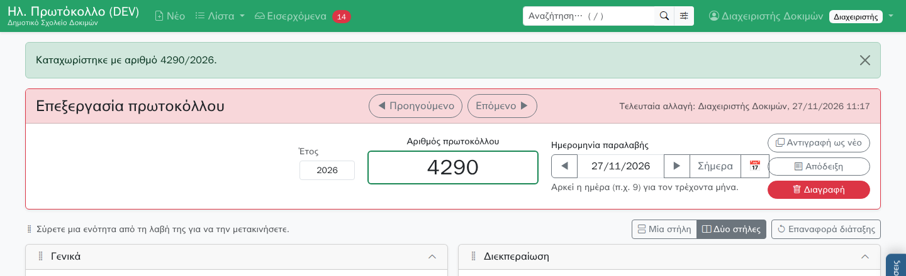
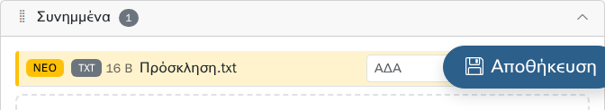

# R1q: protocol form: buttons rearranged, TAB from field to field, new files marked «ΝΕΟ»

| | |
|---|---|
| Status | ✅ Done |
| Branch | `task/R1q-form-buttons-tab-order` |

## What was asked (owner, 2026-11-27)
1. Remove *Σύνδεσμος*.
2. *Αντιγραφή ως νέο* and *Απόδειξη* at the right, stacked: *Αντιγραφή ως νέο*, under it *Απόδειξη*, under that
   *Διαγραφή*.
3. *Προηγούμενο* / *Επόμενο* up, inside the coloured border, next to *Επεξεργασία πρωτοκόλλου* but centred, to save
   vertical space.
4. Keyboard: TAB should go Έτος, number, *Ημερομηνία παραλαβής*, *Φάκελος* (when that section is first) and so on.

Also: a new attachment should say **ΝΕΟ**, coloured, with its whole line in another colour, instead of «(θα αποθηκευτεί
με το πρωτόκολλο)».

## What changed
- **Title line:** title at the left, ◀ Προηγούμενο / Επόμενο ▶ in its middle, *Τελευταία αλλαγή* at the right.
- **At the right of the date**, one under the other:
  - *Αντιγραφή ως νέο* (not for readers);
  - *Απόδειξη*;
  - *Διαγραφή* (red, for those who may delete).

  The row of buttons under the number is gone: only *Ανάθεση* / *Διεκπεραιώθηκε* remain there, for the users who have
  them. The card is a line shorter.
- **Σύνδεσμος removed**, with its script. The direct links `/protocol/N/YYYY` still open a protocol.
- **TAB:** Έτος → number → date → the first section's fields (*Φάκελος*, *Θέμα*, …) and on.
  - Nothing in between: the layout buttons (*Μία στήλη* / *Δύο στήλες* / *Επαναφορά*) and the sections' ▴ are left to
    the mouse.
  - The buttons at the right come before the year in the page's order, so TAB from the date never visits them.
  - The year was skipped before; it is in the order now.
- **A bug found on the way:** TAB from *Φάκελος* lost the cursor (it went to the page itself). The folder list scrolls,
  and browsers put such lists in the TAB order, so TAB went into the list and it then closed. The list is now out of the
  TAB order. The same fix is in the inbox's and the search page's folder and keyword lists.
- **Where the cursor starts:** at the number, or, for users who may not choose the number, at the date when they may
  change it. It never starts in *Φάκελος*: that list opens on focus and would cover the fields below.
- **New files:** a yellow **ΝΕΟ** before the name, and the whole line tinted yellow with a yellow edge (theme colours).
  The hover title, and a hidden text for screen readers, still say it is saved with the protocol.

## How verified
- PHPUnit:
  - `ProtocolFormTest::test_the_actions_one_floating_save_and_copy_receipt_at_the_end`:
    - ◀ ▶ in the title line;
    - copy, receipt, delete in this order, before the year in the page;
    - no *Σύνδεσμος*; the year has no `tabindex=-1`; every section ▴ has;
    - none of it on a new protocol;
    - readers: receipt only.
  - `DirectLinkTest::test_the_form_has_no_link_to_copy`: no pill, and the link still opens the protocol.

  Full suite green.
- Browser (`protocol-form.spec.js`, R1q):
  - new protocol: the cursor in the number; Shift+TAB is Έτος; TAB gives number, date, Φάκελος, Θέμα, Σχετικοί;
  - with the folder list open, TAB goes to Θέμα;
  - a new file shows ΝΕΟ and the tint;
  - saved protocol:
    - ◀ ▶ centred in the title line;
    - the three buttons in one column, top to bottom, at the right of the date;
    - the date still on the number's line;
    - TAB from the date goes to Φάκελος;
    - ◀ works.
  - R1j adjusted to the stack.
  - The form, trash, direct links, inbox, search, preview and stamp specs are green.

## Owner actions
None. To try it: step 114 in [OWNER-TODO.md](../../OWNER-TODO.md).
