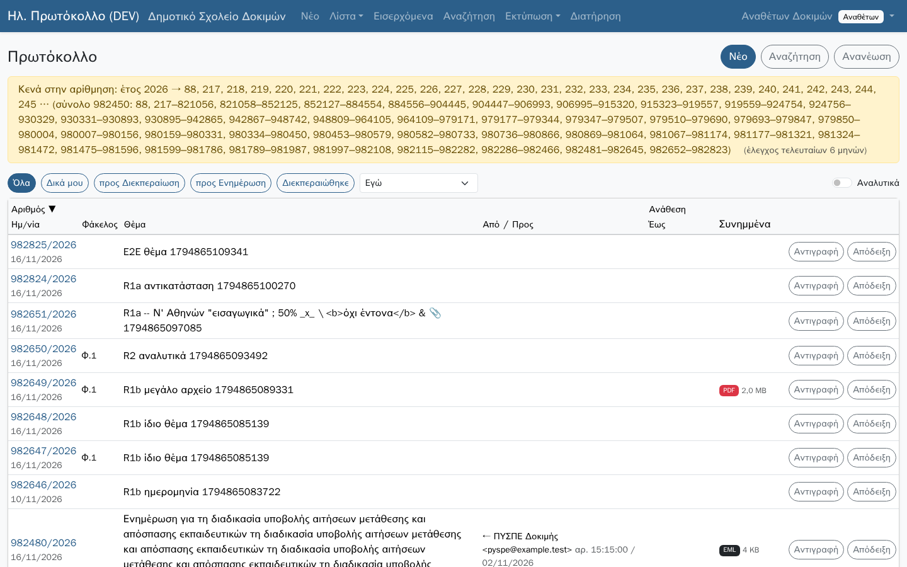
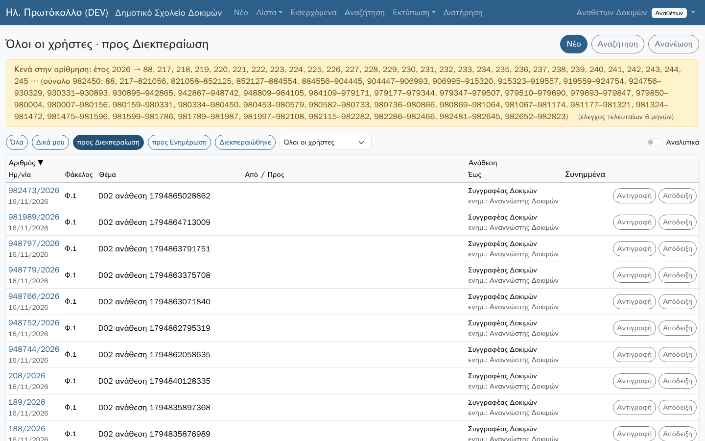
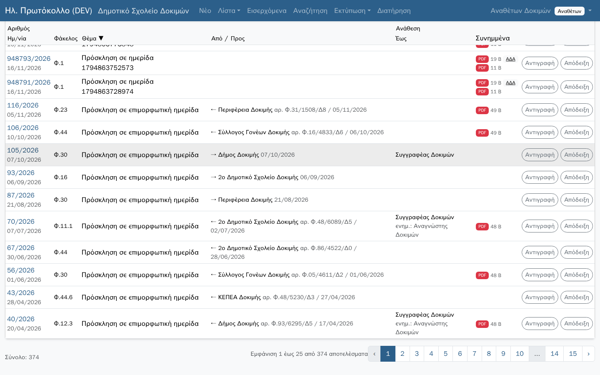
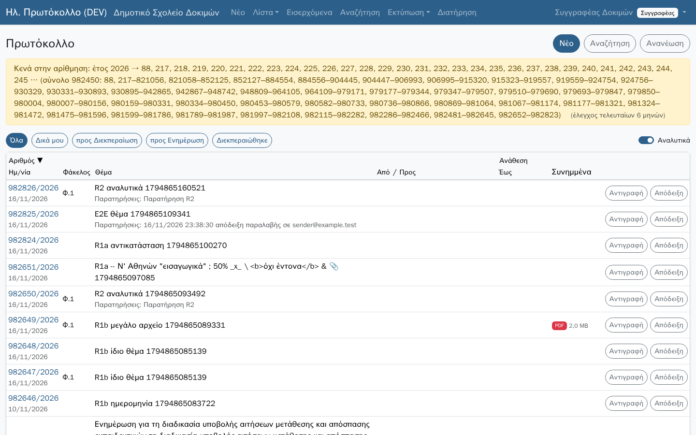

# R2: the protocol list, rebuilt

| | |
|---|---|
| Status | ✅ Done (reaches the production server with the final deployment) |
| Branch | `task/R2-protocol-list` |

## What was wrong
The main list (*Λίστα*) was an 829-line page on the old layout:
- sorting by reloading the page with `?field=…`;
- a "detailed / compact" switch that was forgotten on the next visit;
- the filters only in the menu.

The owner asked for:
- filters on the page (mine / assigned / pending / done);
- sorting;
- a header that stays visible;
- actions as pills;
- the missing-numbers banner (A02) as part of the list.

## What changed
- New list at the same addresses (`/home/list`, and `/home/list/d`, `/e`, `/f` with `/a` or a user id from the menu),
  on the new layout. Livewire component `App\Livewire\ProtocolList`.
- **Filters as pills:**
  - *Όλα*;
  - *Δικά μου* (new: registered by me or assigned to me);
  - *προς Διεκπεραίωση*, *προς Ενημέρωση*, *Διεκπεραιώθηκε*.

  Administrators and assigners also choose whose list: *Εγώ*, *Όλοι οι χρήστες* or a user. Others always see their
  own (also when they type another address). The setting *limitProtocolAccessList* still applies to every filter.
  The filter and the sorting are in the address, so a list can be bookmarked or sent.
- **Sorting:** click a column title (▲ / ▼). Number, date, folder, subject, sender/addressee, assignee and deadline.
  Old `?field=…&sort=…` addresses still work. An unknown column falls back to the number.
- **Header stays visible** under the top bar while scrolling.
- **Each row:**
  - number/year and date;
  - folder (description on hover);
  - subject;
  - ← sender, number, date and → addressee, date;
  - who handles it, who is informed, the deadline in colour (red < 1 day, orange < 3, blue < 6) or ✔ with the done
    date;
  - attachments with type and size (download) and ΑΔΑ;
  - pills *Αντιγραφή* and *Απόδειξη*.

  A click anywhere on the row opens the protocol.
- **Αναλυτικά** (switch): summaries, keywords, related numbers (links) and notes under the subject. The browser
  remembers the choice (owner's decision: collapsed sections remembered per browser).
- The missing-numbers banner (A02) is at the top, with its links to fill a gap. The list refreshes itself every
  *minutesRefreshInterval* minutes, as before, without reloading the page. Page numbers come from *showRowsInPage*;
  the page counter is in Greek.
- Removed: the old list view and its controller method.

## How verified
- `ProtocolListTest` (6 tests):
  - filters for oneself at the old addresses (to handle / to inform / handled / mine / all);
  - assigners see another user's or everybody's list; writers never, not even by address or by changing the
    component;
  - the limit setting on every filter;
  - sorting by column, toggling, by assignee (no text column since R1a); bad values fall back;
  - a row shows assignees, the coloured deadline, attachments and related links;
  - rows per page follow the setting, Greek page counter.
- Existing list tests (A02 banner, D04 dates, access, escaping) pass unchanged against the new list.
- Browser (`e2e/tests/protocol-list.spec.js`):
  - the assigner switches to *προς Διεκπεραίωση · Όλοι οι χρήστες* (title and address follow);
  - sorts by subject both ways;
  - after scrolling 2,500 px the header is still at the top;
  - a writer switches on *Αναλυτικά*: the notes appear, and they are still shown after reloading the page;
  - a click on the row opens the protocol.

  The smoke tests (every role) use the new list.

  

  

  

  
- Full suites: PHPUnit 313, browser 37/37.

## Owner actions
1. Optional, after `git pull` and *Demo: start*: open *Λίστα*, try the filter pills, click a column title, switch on
   *Αναλυτικά* and reload the page.
2. Final deployment: nothing extra.
