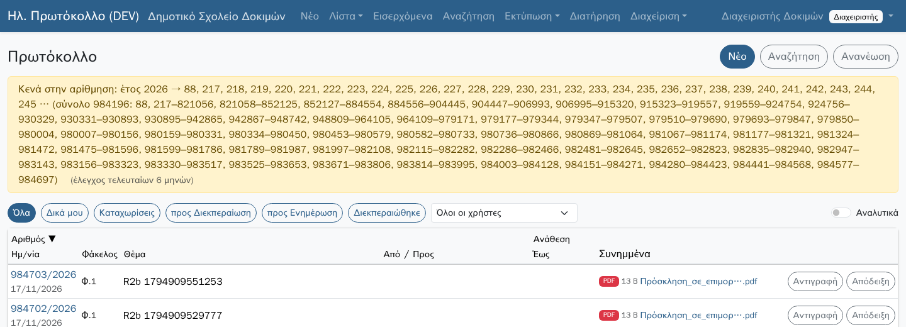
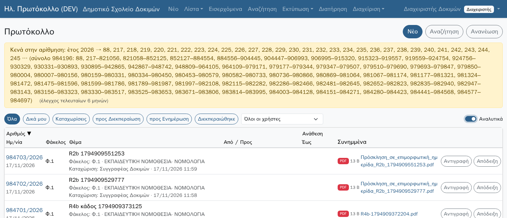

# R2b: list feedback after Batch 6 (user filter, detailed view, file names)

| | |
|---|---|
| Status | ✅ Done |
| Branch | `task/R2b-list-feedback` |

The owner tried the new list (R2) and reported (2026-11-17):

## What was wrong
1. **Choosing a user did not filter the list.** Under the *Όλα* pill the user menu only changed the title. This was
   the old list's rule: with *Όλα* the user was ignored.
2. **The user menu treated every user the same**, although most users have nothing assigned.
3. **Αναλυτικά added little:** only the summaries, keywords, related numbers and remarks, which are usually empty.
4. **The Συνημμένα column showed only a PDF/DOC badge**, not which file it is.

## What changed
- **User menu:**
  - Under *Όλα* the first choice is *Όλοι οι χρήστες* (everything, as before). Choosing a person shows what they
    registered or are assigned to, and the title says so ("Μαρία Κ. · Πρωτόκολλο").
  - Under the other pills it works as before: *Εγώ*, *Όλοι οι χρήστες*, or a person.
  - Two groups: **Με εκκρεμείς αναθέσεις**, with the number of protocols each user still has to handle (marked
    *Διεκπεραιώθηκε* = no longer counted; informing is not counted), then **Χωρίς εκκρεμείς αναθέσεις**.
- **Αναλυτικά** now also shows, under the subject:
  - the folder's description;
  - the incoming document (number, date, issuing authority, place, recipient) and the outgoing one (to, date);
  - who registered the protocol and when;
  - the summaries, keywords, related numbers and remarks, as before;
  - in the attachments column, the whole file names and the ΑΔΑ numbers.
- **Συνημμένα column:** each file shows the start of its name and the extension (`Πρόσκληση_σε_επιμορ….pdf`) on one
  line, the whole name on hover; the link opens the file as before.

## How verified
- PHPUnit (`ProtocolListTest`, 3 new):
  - `test_choosing_a_user_under_all_shows_that_users_protocols`;
  - `test_user_menu_groups_users_by_open_assignments` (a done assignment and an "inform" one do not count);
  - `test_detailed_view_and_attachment_names` (incoming/outgoing details, who registered, short name + whole name on
    hover, ΑΔΑ; `FileBadge::shortName`).
- Browser (`protocol-list.spec.js`): an administrator sees *Όλοι οι χρήστες* first and the two groups; the file's short
  name with the whole name on hover; choosing the writer shows only the writer's protocols and back to everybody shows
  more; *Αναλυτικά* shows the whole file name and who registered the protocol.
- Full suites: PHPUnit 343, browser 47/47.

  
  

  (The long yellow box of missing numbers comes from test numbers in the demo database; R2c replaces it.)

## Owner actions
None.
