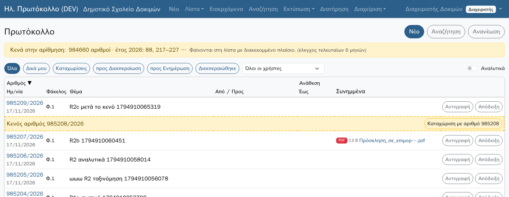

# R2c: missing numbers as rows in the list

| | |
|---|---|
| Status | ✅ Done (the setting merge runs at the final deployment, with `migrate`) |
| Branch | `task/R2c-gap-rows` |

## What was asked (owner, 2026-11-17)
- Check for missing protocol numbers from the number in *Ρυθμίσεις → Αρ.Πρωτοκόλλου για ξεκίνημα*.
- Show each missing number in the list as an entry of its own (other background, dashed border), from which a protocol
  can be registered with that number.

Agreed suggestion: one row per run of consecutive missing numbers, the yellow box above the list shortened to one line,
one setting instead of two.

## What was there
- A yellow box above the list with up to 30 missing numbers as links, then the whole set in ranges. In a book with many
  missing numbers it filled the screen.
- Two settings that both looked like "the start": *Αρ.Πρωτοκόλλου για ξεκίνημα* (the first number of an empty book)
  and *Έλεγχος κενών αριθμών: από Αρ.Πρωτοκόλλου* (A02).

## What changed
- **Rows in the list:**
  - Each run of missing numbers is a row in its place: amber background, dashed border, "Κενός αριθμός 1234/2026", or
    "Κενοί αριθμοί 1234–1240/2026 · 7 αριθμοί".
  - Administrators who may choose the number (*Έλεγχοι καταχώρισης* off) get **Καταχώριση με αριθμό …**. It opens the
    new-protocol form with that number filled in: the highest of the run when the list is newest first, the lowest when
    it is sorted upwards.
  - The rows appear in the whole list (*Όλα*, *Όλοι οι χρήστες*) sorted by number, where they have a place. They are
    shown to administrators, assigners and writers, as the box was.
- **The yellow box** is one line: how many numbers, the first ones in ranges, and where to see them ("Φαίνονται στη
  λίστα με διακεκομμένο πλαίσιο", or "Επιλέξτε «Όλα», ταξινόμηση κατά αριθμό" on other views).
- **One setting:**
  - The check starts at *Αρ.Πρωτοκόλλου για ξεκίνημα*, for the current year, still within the last N months (*Έλεγχος
    κενών αριθμών: τελευταίοι μήνες*, default 6).
  - The separate "from number" setting is gone. A value set there moves to *Αρ.Πρωτοκόλλου για ξεκίνημα* (migration,
    safe to run twice). That setting otherwise only matters for an empty book.
  - 0, the installer's value, still means 1.

## How verified
- PHPUnit (`NumberGapsTest`, 2 new; existing ones moved to the start number):
  - rows for 3 and 5–7 in number order, the button numbers (7 newest first, 5 upwards);
  - no rows under another filter, where the box says where to find them;
  - a writer sees the rows without the button;
  - the old setting moves and is no longer stored;
  - the settings page still saves with 0.
- Browser (`protocol-list.spec.js`): an administrator leaves one number out. The dashed row appears right under the new
  protocol, and its button opens the form with that number. After saving, the row is gone. The smoke test of the box
  still passes.
- Full suites: PHPUnit 345, browser 48/48.

  

## Owner actions
1. At the final deployment: check *Ρυθμίσεις → Αρ.Πρωτοκόλλου για ξεκίνημα*. Set it to the first number of the year
   you want checked (e.g. the first number used after the move), so older missing numbers are not listed.
