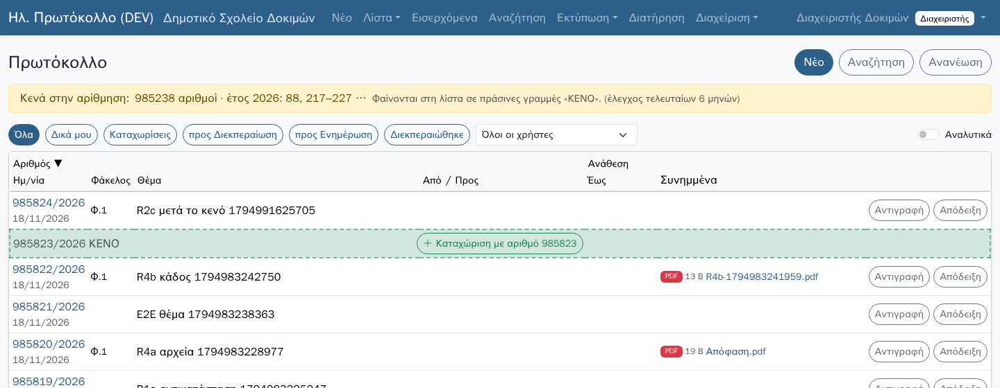

# R2d: missing-number rows, new look

| | |
|---|---|
| Status | ✅ Done |
| Branch | `task/R2d-gap-row-look` |

## What was asked (owner, 2026-11-18)
- Background green, all the text dimmed (grey).
- Instead of "Κενός αριθμός 10939/2026": the number first, followed by ΚΕΝΟ.
- The button *Καταχώριση με αριθμό …* in the middle of the row, with a small + in front.

## What changed
- The row (R2c) is light green with a green dashed border. Its text is grey:
  - one number: **10939/2026** ΚΕΝΟ;
  - several: **10935–10939/2026** ΚΕΝΑ · 5 αριθμοί.
- The button is green, has a + icon and sits in the middle of the row. On a phone it goes under the number.
- The yellow line above the list now says "Φαίνονται στη λίστα σε πράσινες γραμμές «ΚΕΝΟ»".
- New `<x-icon name="plus|check|warning">` for small icons drawn inside the page (no icon font to download), also used
  by R1f.

## How verified
- PHPUnit `NumberGapsTest`: "5–7/YYYY ΚΕΝΑ · 3 αριθμοί" and "3/YYYY ΚΕΝΟ" in number order, the + icon, the
  ascending row.
- Browser (`protocol-list.spec.js`):
  - the row is green;
  - the button has the + icon and is centred in the row (within 20 px);
  - clicking it opens the form with that number, and after saving the row is gone.

  

## Owner actions
None.
