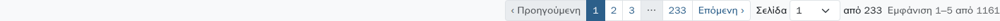
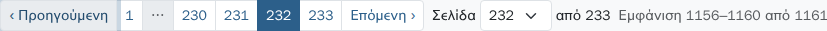

# R2e: the list's pager above the list too, with any page from a list

| | |
|---|---|
| Status | ✅ Done |
| Branch | `task/R2e-list-pager` |

## What was asked (owner, 2026-11-19)
- The pager at the bottom of the protocol list (*Λίστα*) should be at the top of the page too.
- A way to choose a specific page from a list of the pages.
- Moving to the next or the previous page.

## What was there
At the bottom only, the standard pager:
- ‹ and › arrows;
- a run of page numbers, which skipped most of them (e.g. 1 2 3 … 233);
- an "Εμφάνιση … από …" line.

A page far from the start took many clicks, and in a long list the pager was a long scroll away.

## What changed
A pager (`x-list-pager`, [resources/views/components/list-pager.blade.php](../../resources/views/components/list-pager.blade.php))
**above and below** the list, the same in both places:

- **‹ Προηγούμενη** and **Επόμενη ›**. They are greyed out on the first and the last page.
- **Page numbers**: the first, the last, and two on either side of the current page, with … between.
- **Σελίδα [ ▾ ] από N**: a list of **every** page. Choosing one goes there at once.
- **Εμφάνιση 26–50 από 1161**: the rows shown.
- *Σύνολο: N* stays at the bottom left.
- Both pagers on the **right**, ending where the list ends (owner, after seeing the first version, 2026-11-19).

Behaviour:
- The lower pager brings the top of the list into view after a change; the upper one is already there.
- Both pagers always show the same page.
- The page is in the address (`?page=…`), so a reload or a bookmark keeps it.
- On a phone only the buttons (‹ ›) and the page list are shown; the numbers would not fit.
- With one page there is no pager: only *Σύνολο*.

## How verified
- PHPUnit (`ProtocolListTest`):
  - `test_pager_above_and_below_with_previous_next_and_any_page`:
    - a pager on top and at the bottom, each with every page in its list;
    - *Εμφάνιση 1–2 από 9*;
    - going to a page, previous, next, with the rows of that page;
    - previous disabled on the first page and next on the last;
    - both lists showing the current page.
    - It failed before the change.
  - `test_no_pager_for_a_single_page`.
  - The earlier pagination test (rows per page, Greek text) still passes.
- Browser (`protocol-list.spec.js`, 5 rows per page so the demo has many pages):
  - previous disabled on page 1;
  - *Επόμενη* on top → page 2, in the address and in both lists;
  - the last page chosen in the **lower** list → the list goes there, *Επόμενη* is disabled, and the top of the list is
    in view;
  - *Προηγούμενη* below → the page before;
  - a reload keeps the page.
  - both pagers end at the list's right edge.
- Full suites: PHPUnit 510, browser list tests 5/5.

## Owner actions
None. To try it: step 31 in [OWNER-TODO.md](../../OWNER-TODO.md).
