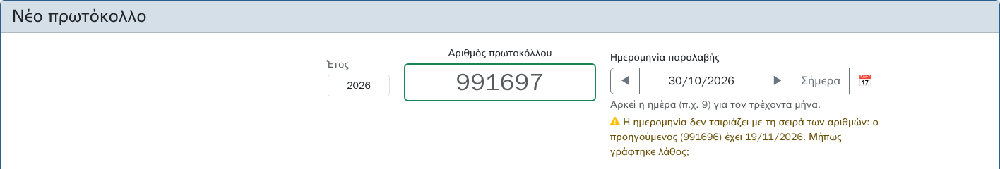
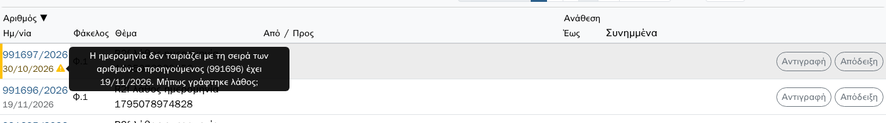

# R2f: dates out of order with the numbers, or in the future, are flagged

| | |
|---|---|
| Status | ✅ Done |
| Branch | `task/R2f-date-order` (on top of R6d) |

## What was asked (owner, 2026-11-19)
- A check in the protocol list for typing mistakes in the date. Among protocols of 10/11/2026, one of 20/11/2026 was
  probably given a wrong date.
- Show it differently, with a ⚠ whose tooltip explains what is wrong.
- A date in the future is suspect too.
- Take the first and last protocol of each day into account: as the day changes, they normally have different dates.
- Users may still set the date they want.
- The same check in the form, when creating or editing, as for a number that already exists.

Owner's choices:
- **a future date only warns**: it can be saved;
- **the odd protocol is flagged**, not the ones around it.

## How it decides
Numbers go up in sequence, so dates never go back. A protocol is flagged when:
- **its date breaks that order.** The flagged protocols are the fewest whose removal leaves the dates in order.
  - A single odd protocol is the one out of step with both neighbours: in 10/11, 10/11, **20/11**, 10/11 only the
    20/11 one is flagged.
  - A new day starting between two numbers is normal.
  - The first and last protocol of a year are judged too.
  - Two or more wrong ones in a row are all flagged.
- **its date is after today.**

Each year is checked on its own, since numbering restarts every year.

In the form, a date is compared with the nearest protocols before and after its number whose dates are in order. A
new protocol, numbered on save, is compared with the last one of the year. So a wrongly dated neighbour neither hides
the mistake nor makes a right date look wrong.

## What changed
- **`App\Services\DateOrder`** (the rule above): `flags()` for the list, `check()` for the form, `message()` for the
  text. Batch 10's integrity check "dates going backwards" (A03) can reuse it.
- **List:**
  - a flagged row has a light orange background and an orange bar on its left;
  - its date is in orange, with a **⚠**. The mouse over the ⚠ (or the keyboard) explains it, without opening the
    protocol. For example: *«Η ημερομηνία δεν ταιριάζει με τη σειρά των αριθμών: ο προηγούμενος (1233) έχει
    10/11/2026 και ο επόμενος (1235) 10/11/2026. Μήπως γράφτηκε λάθος;»*, or *«Η ημερομηνία είναι μετά τη
    σημερινή.»*
- **Form** (new and existing protocols):
  - under the date, the same explanation with ⚠ as soon as the date changes;
  - it does not stop the save;
  - it is shown only to whoever may set the date: an administrator with *Έλεγχοι καταχώρισης* off, or anyone with
    *Ο Συγγραφέας αλλάζει την ημερομηνία πρωτοκόλλου*.
- The date field now sends its value when it changes (it used to wait for the next action), so the warning appears
  at once.

## How verified
- PHPUnit `DateOrderTest`:
  - the odd date (later or earlier) flagged, not its neighbours;
  - a new day not flagged;
  - the first and the last protocol of a year;
  - two wrong ones in a row;
  - each year on its own;
  - a future date;
  - the explanation's text;
  - the form's check: new and edited protocols, a future date, and a wrongly dated last protocol.
- `ProtocolListTest::test_dates_out_of_order_or_in_the_future_are_flagged`: the rows, the explanation, the neighbours
  not flagged.
- `ProtocolFormTest::test_a_date_out_of_order_or_in_the_future_is_a_warning_that_does_not_block`:
  - the warning when creating and editing, and none for a right date;
  - a future date saved anyway;
  - not shown to a writer who cannot set the date.
- Browser (`protocol-list.spec.js`): a date 20 days back gives the warning in the form; the protocol is saved; its
  row is flagged; hovering the ⚠ shows the explanation and stays on the list; correcting the date removes both.
- Full suites: PHPUnit 524; browser list tests 6/6.

## Owner actions
None. To try it: step 34 in [OWNER-TODO.md](../../OWNER-TODO.md).
