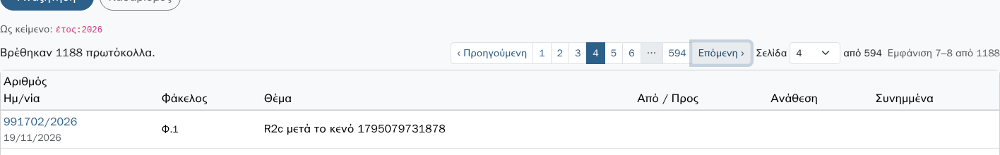

# R2g: the list pager on every paged screen

| | |
|---|---|
| Status | ✅ Done |
| Branch | `task/R2g-pager-everywhere` (on top of R2f) |

## What was asked (owner, 2026-11-19)
"Apply the new pager to the other paged screens too." The pager is the one of R2e:
- above and below the list;
- ‹ Προηγούμενη / Επόμενη ›;
- page numbers;
- *Σελίδα [ ▾ ] από N*;
- the rows shown.

## What changed
- **The same pager** (`x-list-pager`) on every screen that has pages:

  | Screen | Before | Now |
  |---|---|---|
  | Search results of the box (`/search`) | Livewire's pager above and below | the list pager above and below |
  | *Σύνθετη αναζήτηση* (`/find`) | the same | the same |
  | *Κάδος* (`/trash`) | Livewire's pager below | the list pager above and below |
  | *Χρήστες* (`/users`) | below | above and below |
  | *Εκκαθάριση* (`/arxeio`) | below | above and below |

  All on the right, as on *Λίστα*.
- **Choosing a page from the lower pager** brings the upper one into view, so the start of the new page is visible.
  It used to scroll to the top of the protocol list only. The pager stops below the sticky top bar, not under it.
- **A page past the last one** (an old bookmark, rows removed since, or typed in the address) shows the last page
  on every screen, as on *Λίστα* since the review of R2e. One rule for all: `PagesWithinRange::pageOf`.

## How verified
- PHPUnit `PagersTest`, one test per screen (search box, advanced search, trash, users, clean-up). Each has three or
  more pages and asks for page 999, then checks:
  - both pagers are there;
  - the last page is chosen in both;
  - the last page's rows are shown.

  All five failed before the change. The protocol list's tests still pass, now through the shared rule.
- Browser (`search.spec.js`):
  - *Σύνθετη αναζήτηση* with 2 results per page: page 3 chosen from the lower pager, so the upper one shows 3 and is
    in view;
  - *Επόμενη* above → page 4 in both.

  The list, settings and search browser tests pass (13/13).
- Full suites: PHPUnit 529.

## Owner actions
None. To try it: step 35 in [OWNER-TODO.md](../../OWNER-TODO.md).
