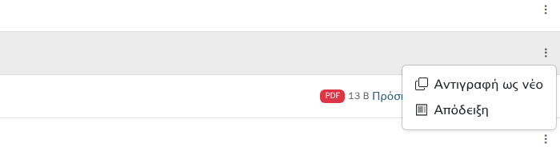

# R2h: the list row's actions under ⋮

| | |
|---|---|
| Status | ✅ Done |
| Branch | `task/R2h-row-actions-menu` |

## What was asked (owner, 2026-11-19)
In the protocol list, each row ended with two buttons, *Αντιγραφή* and *Απόδειξη*. They do not need to be visible at
all times: put them under a three-dot button, to save space.

## What changed
- Each row ends with **⋮** (`bi-three-dots-vertical`). A click opens a small menu:
  - *Αντιγραφή ως νέο*: the new-protocol form with this one's content, as before;
  - *Απόδειξη*: the receipt, in a new tab, as before.
- The last column is now narrow (2.5rem instead of the width of two buttons), so the other columns get the room.
- *Απόδειξη* used to be hidden on screens narrower than 1200px. It is now in the menu on every screen.
- The ⋮ sits above the row's link: pressing it does not open the protocol. The menu is placed on the page itself, so
  the list's frame does not cut it off. Its label for screen readers names the protocol, e.g. *«Ενέργειες για το
  12/2026»*.

## How verified
- PHPUnit `ProtocolListTest::test_row_actions_are_under_a_menu`: the ⋮ with its label, both menu items with their
  addresses (the receipt in a new tab), and no buttons left in the row.
- Browser (`protocol-list.spec.js`):
  - the items are hidden until ⋮ is pressed;
  - the menu shows both;
  - pressing ⋮ stays on the list;
  - *Απόδειξη* opens the receipt in a new tab;
  - *Αντιγραφή ως νέο* opens the copy form.

  All 7 list browser tests pass.
- Full suite: PHPUnit 531.

## Owner actions
None. To try it: step 36 in [OWNER-TODO.md](../../OWNER-TODO.md).

## Review
- Codex (P2): an open menu over the next rows was drawn under their attachment links, which could take the click
  meant for the menu. The menu's wrapper and those links are on the same layer, and later rows win.
  - Fixed: while open, the menu's wrapper is raised above the rows. Bootstrap's `z-2` helper is `!important`, so the
    rule is too.
  - Browser test: wherever the open menu overlaps a later row's link, the menu is on top. It failed before the fix,
    with an attachment link on top.
