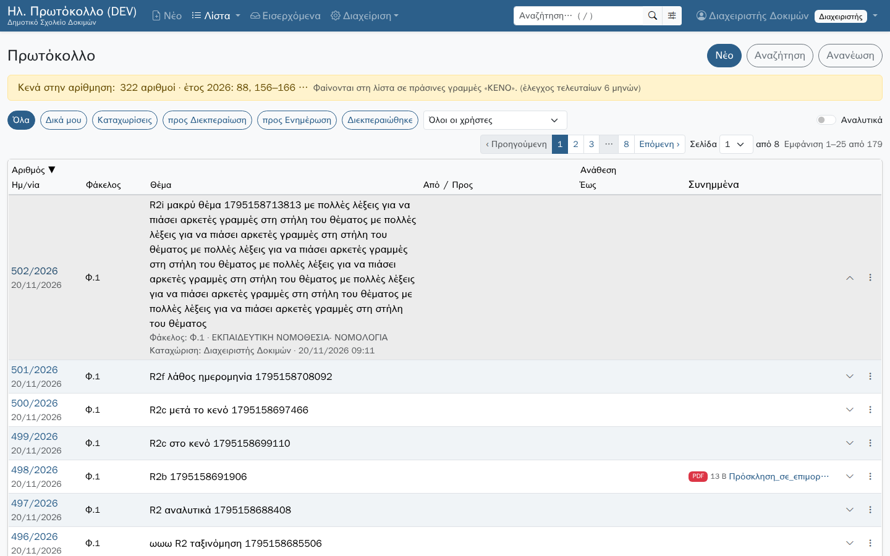

# R2i: the list's rows: alternating colours, fixed columns, short rows that open

| | |
|---|---|
| Status | ✅ Done |
| Branch | `task/R2i-list-rows` (on top of R3e) |

## What was asked (owner, 2026-11-20)
- In the protocol list, rows in alternating colours, so each row is easier to tell from the next.
- A fixed size for the rows, for readability.
- A way to expand and collapse the full contents of a row.

## What changed
- **Alternating colours:** every second protocol row is light blue. The green *ΚΕΝΟ* rows do not count, so the
  alternation never breaks around them. A row with a date warning (R2f) keeps its orange.
- **Fixed columns:** the columns have set widths, the same on every page, whatever the contents:
  - *Αριθμός*, *Φάκελος*, *Ανάθεση*, *Συνημμένα* and the actions are fixed;
  - *Από / Προς* is a fixed share;
  - *Θέμα* takes the rest.

  Long words wrap inside their column instead of widening it.
- **Short rows:** each row shows at most:
  - two lines of the subject, and two of *Από / Προς*, ending in …;
  - two attachments, then *+N ακόμη*.
- **▾ at the end of each row** (next to ⋮) opens that row in full:
  - the whole subject;
  - every file with its full name;
  - the extra details of *Αναλυτικά* (folder's description, incoming, outgoing, keywords, notes …).

  The ▾ turns to ▴; pressing it again shortens the row. *+N ακόμη* opens the row too. Neither opens the protocol.
- **Αναλυτικά** opens every row, as before; the ▾ buttons are then hidden.

## How verified
- PHPUnit `ProtocolListTest::test_rows_are_short_with_a_toggle_to_show_all` checks:
  - the fixed columns;
  - each row's toggle and its label, and the subject that shortens;
  - the details shown when the row is open;
  - *+1 ακόμη* for three files, and nothing for a protocol without files.
- Browser (`protocol-list.spec.js`, R2i), on a protocol with a long subject:
  - neighbouring rows have different colours, and every second row the same;
  - the table's layout is fixed;
  - the subject takes two lines at most;
  - ▾ opens only that row, stays on the list and shows the details; pressing again closes it;
  - *Αναλυτικά* opens every row and hides ▾.

  All 8 list browser tests pass.
- Full PHPUnit: 549 tests pass.

## Owner actions
None. To try it: step 41 in [OWNER-TODO.md](../../OWNER-TODO.md).
