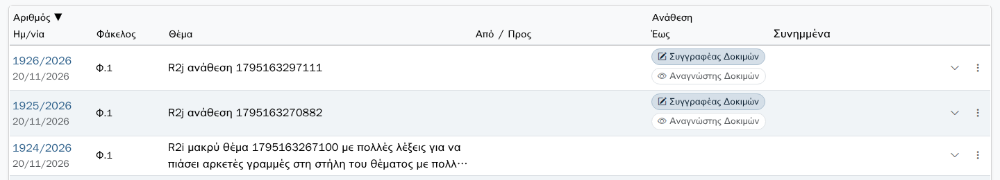
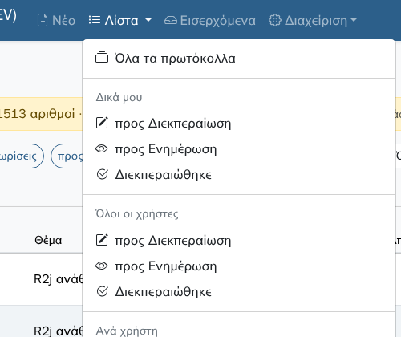

# R2j: assignments as pills with icons

| | |
|---|---|
| Status | ✅ Done |
| Branch | `task/R2j-assignment-pills` (on top of R1k) |

## What was asked (owner, 2026-11-20)
In the protocol list, instead of the names as text (*«ενημ.: Όνομα»*), a pill per user with an icon before the
name: eyes for *Ενημέρωση*, something meaning «work to do» for *Διεκπεραίωση*. Suggestions first.

The owner chose, from the suggestions:
- one pill per user;
- ✎ (pencil on paper) for *Διεκπεραίωση*, 👁 for *Ενημέρωση*;
- the same icons in the menu.

## What changed
- **Ανάθεση** column of the list: each user is a pill.
  - *Διεκπεραίωση*: light blue, with **✎**;
  - *Ενημέρωση*: white with a grey outline, with **👁**.

  The mouse over a pill says *«Διεκπεραίωση: Μαρία …»*; screen readers read the same. The deadline (*έως …*) or the
  ✔ of a completed protocol stays below the pills.
- **Search results** show the *Διεκπεραίωση* pills the same way.
- **Λίστα menu**: *προς Διεκπεραίωση* has ✎ (was ⌛) and *προς Ενημέρωση* has 👁 (was 🔔), so an icon means the same
  everywhere. The same goes for *Αρχική σελίδα* in the user menu.
- One component draws the pills: `<x-assignee-pills>`.

## How verified
- PHPUnit:
  - `ProtocolListTest::test_assignments_are_pills_with_icons`: each pill with its class, icon, tooltip and hidden
    label; no «ενημ.:» left; the menu's icons.
  - `test_row_shows_assignees_deadline_attachments_and_related_links`: now checks the pills instead of the old text.
- Browser (`protocol-list.spec.js`, R2j): a protocol assigned in the form shows both pills with their icons in the
  list, and the menu has the same icons. All 9 list browser tests pass.
- Full PHPUnit: 552 tests pass.

## Owner actions
None. To try it: step 44 in [OWNER-TODO.md](../../OWNER-TODO.md).
